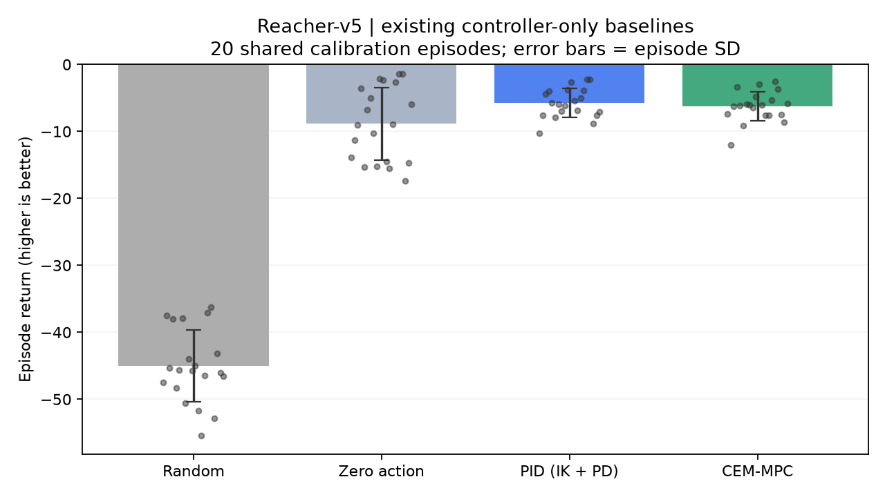

# Reacher-v5：PID/MPC 先验候选任务评估

2026-11-11。目的：寻找控制器单独执行时未出现“存活到时间上限即满分”的任务，作为下一轮先验＋Flow 的候选；本次没有训练 RL，也没有搜索控制器参数。

## 任务与协议

Reacher-v5 控制平面两关节机械臂，使末端靠近随机目标。每回合50步。当前安装环境实际默认奖励为 r=−末端到目标的距离−两维动作平方和（距离权重1、控制权重1，依据实际实现而非文档中部分旧描述）。更接近0更好；0是非正奖励的理论上界，不是保证能达到的固定“满分”。提前接近目标也不会把所有后续策略压成同一个回报。

固定现有PID（实际为固定肘支逆运动学＋PD，kp=[2,2]、kd=[0.3,0.3]、ki=[0,0]）和现有CEM-MPC（H=10、population=64、iterations=4、elite_fraction=0.125，timeout=0.5秒）。均直接执行当前控制器确定性动作，不经Flow、不混合基础高斯、不加源扰动；饱和动作按框架 pre-tanh 变换限制到约±0.999。

四种策略使用相同的20个环境校准seed：50000–50019；MPC控制器seed=0。20回合不是20个独立训练seed。后续正式实验应使用独立评估seed。

## 实测结果

| 策略 | 平均return ± 回合间标准差 | 平均最终末端距离 | 控制器无效/超时回退率 |
|---|---:|---:|---:|
| Random | -45.04 ± 5.34 | 20.7377 cm | 0.0% |
| Zero action | -8.88 ± 5.44 | 17.7537 cm | 0.0% |
| PID (IK + PD) | -5.73 ± 2.15 | 0.0157 cm | 0.0% |
| CEM-MPC | -6.26 ± 2.20 | 4.5418 cm | 0.0% |

标准差为回合间总体标准差（ddof=0）；散点为单回合结果，所有策略使用配对环境seed。Reacher默认没有任务失败提前终止条件，所以本次环境“failure_rate=0”不等于成功到达目标，不作为控制质量结论。

## 判断

- 推荐下一轮选Reacher-v5。现有PID/MPC都优于随机和零动作，提供有用但未饱和的先验；MPC最终平均距离约4.54cm，仍有明显的跟踪改进空间。
- PID最终平均距离仅约0.016cm，已经很接近目标。它的回报损失更多可能来自到达过程和控制开销，不能仅凭负回报断言PID定位不准。Flow若要改进，需要优化整条到达轨迹和动作成本，而不只是最终距离。
- 不能将负回报本身当作“已证明次优”的证据，也不能保证Flow一定超越控制器。本次未测最优策略，仅确认任务没有倒立摆那种存活奖励饱和，并量化现有先验。
- 当前MPC规划目标含distance+5·distance²+0.01·速度²+0.1·动作²，与环境奖励的动作权重1不同。短视规划和目标差异都可能限制回报；正式比较需要保留此事实，或另设与环境目标一致的MPC版本，避免把规划目标不一致误当成Flow本身的优势。
- 下一轮训练前应保留这两个controller-only基线，再加入β=1的加噪源但无Flow，以及Gaussian＋Flow与混合先验＋Flow。PID/MPC预算和计算成本分别记录。

原始逐回合数据与参数快照：[results.json](outputs/controller_screening/reacher_20261111/results.json)。可复现入口：scripts/screen_reacher_controllers.py；该脚本拒绝覆盖本次已存在的结果。
