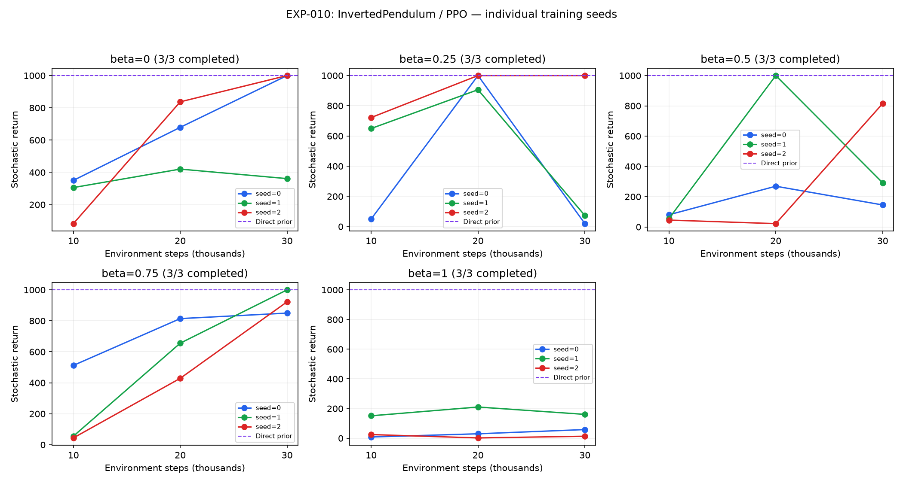
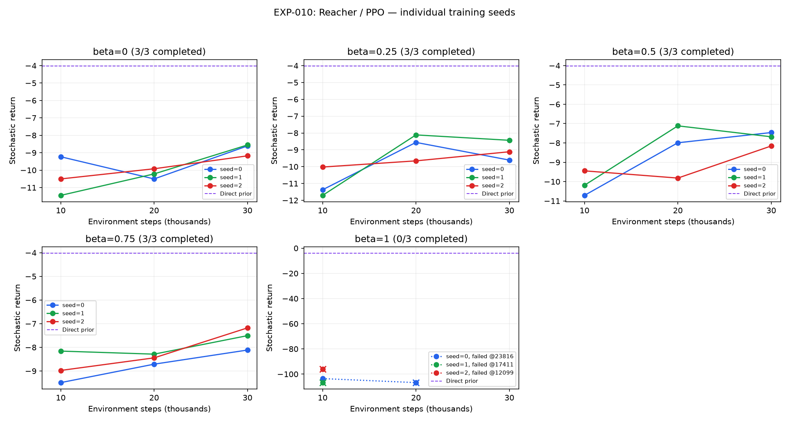
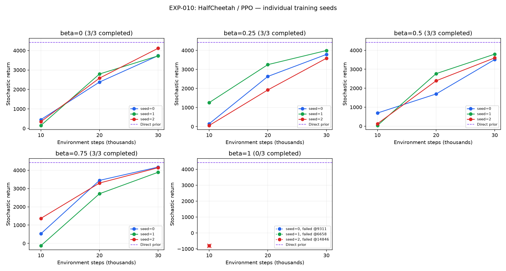
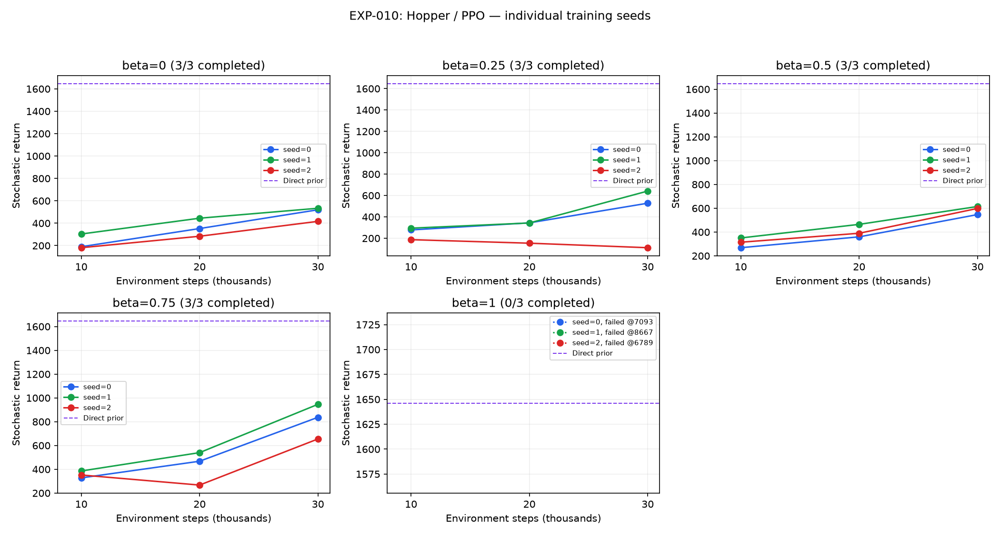
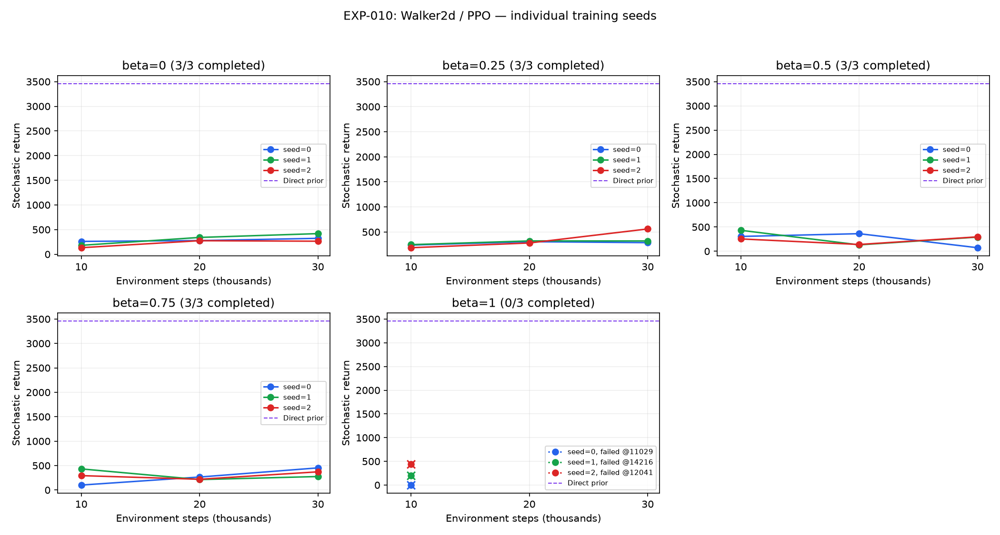
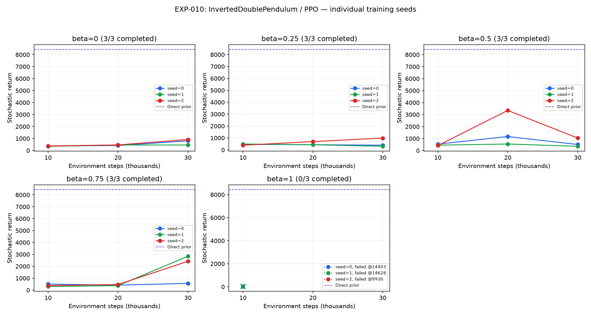
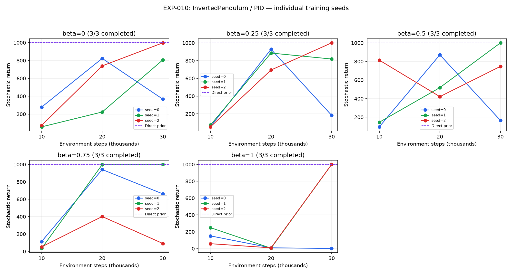
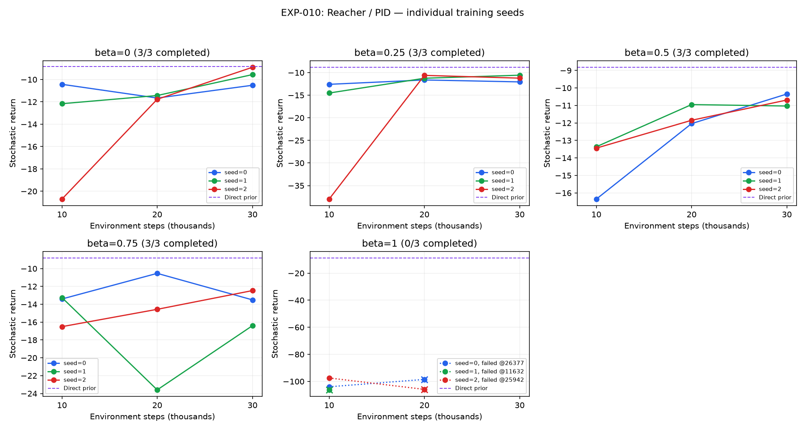
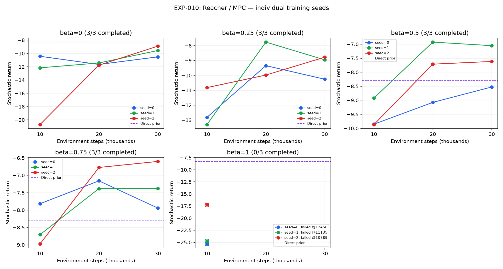
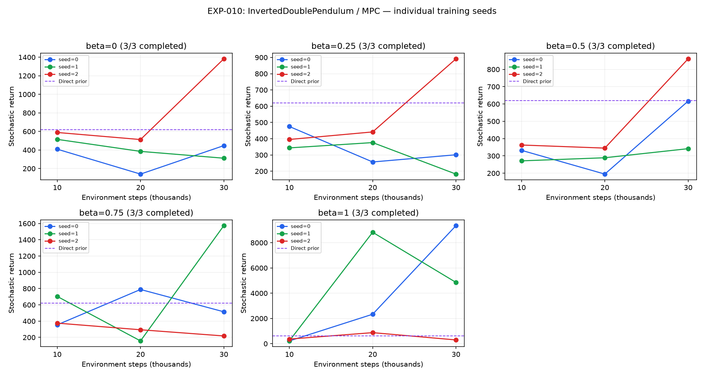

# EXP-010 · mujoco_30k_a100_v1（Agent 接续记录）

实验日期以原始日志为准；本记录于 2026-11-18 补齐。自动生成统计与证据索引，研究解释保留在 ../notes.md。

## 状态与入口

- 批次已结束：150 个 run，129 completed，21 failed_numerical；没有运行中或待启动项。运行编号 `mujoco_prior_beta_30k_v1`。
- Flow 矩阵：2026-11-13T12:14:13+08:00 → 2026-11-17T11:00:55+08:00，均为北京时间。先验制备在矩阵之前。
- 入口配置：[mujoco_prior_beta_30k.yaml](../../../configs/experiment/mujoco_prior_beta_30k.yaml)；启动器：[run_mujoco_suite.py](../../../scripts/run_mujoco_suite.py)。本记录不启动训练。
- 运行清单：[manifest.json](../../../outputs/experiments/mujoco_30k_a100_v1/manifest.json)；服务器验收：[verification.json](../../../outputs/experiments/mujoco_30k_a100_v1/verification.json)；先验 registry：[prior_registry.json](../../../outputs/experiments/mujoco_30k_a100_v1/prior_registry.json)。
- 人读报告与 5 张综合图：[实验总结](../../experiment_reports/mujoco_30k_a100_v1/实验总结.md)；机器可读统计：[analysis.json](../../../outputs/analysis/mujoco_30k_a100_v1/analysis.json)。
- 本记录附带 150 份完整解析配置、[run_index.json](run_index.json) 和 10 张逐 seed 图。编号只表示本地索引，不是新增实验。

## 配置、预算与统计口径

PPO 六任务；PID 为 InvertedPendulum/Reacher；MPC 为 Reacher/InvertedDoublePendulum（cem_mpc）。每组合 β=0/0.25/0.5/0.75/1，训练 seed=0/1/2。
单环境、Flow 预算 30k、前 5k uniform_action 热身、UTD=1、batch=256；Actor/双 Critic [256,256,256]；K_train/local/exec/eval=32/16/1/1；α=0.1，Critic 熵项开启，Heun 密度估计 5 步。
`prior_flame_m`，public_state，不加 controller features；源为概率混合而非动作插值。β=0 是本实现高斯源对照，不是已完成官方 FLAME 复现。奖励未改写。
PPO 使用 native pre-tanh 分布，PID/MPC latent σ=0.3，base σ=1。每个 run 第 0 步前评估直接先验 10 回合；PPO 另评估均值动作。所有 run 均有本地 JSONL/TensorBoard，WandB disabled。
主指标为完整 30k run 的最后一次随机策略评估（10 回合，环境 seeds=10000–10009），不是 best_eval_return。10k/20k/30k 加一次最终 30k 评估；同一步取最后一条。
组统计为 3 个训练 seed 的均值±样本 SD（ddof=1）；先验 SD 为回合总体 SD。AUC 仅覆盖已测 10k–30k。失败样本终点为空、不补零，最后有效评估单列。
实际 Flow 交互 4,151,270/4,500,000 步，梯度更新 3,401,399 次。六个 PPO 先验各 1,001,472 步（seed100，共享冻结）；本轮新训五个，共 5,007,360 步，HalfCheetah 复用历史先验。

## 已核对结果（50 组）

每行 n=3 计划 run；失败组没有 30k 终点均值。详细差值与配对改善数见人读报告及审计 CSV。

| 环境 / 先验 | β | 完成/计划 | 30k return ± seed SD | 直接先验均值 | 10k–30k AUC |
|---|---|---|---|---|---|
| InvertedPendulum / ppo | 0 | 3/3 | 787.10 ± 368.75 | 1,000.00 | 581.06 |
| InvertedPendulum / ppo | 0.25 | 3/3 | 364.20 ± 551.28 | 1,000.00 | 693.88 |
| InvertedPendulum / ppo | 0.5 | 3/3 | 417.37 ± 352.04 | 1,000.00 | 334.62 |
| InvertedPendulum / ppo | 0.75 | 3/3 | 924.23 ± 75.06 | 1,000.00 | 598.52 |
| InvertedPendulum / ppo | 1 | 3/3 | 77.50 ± 75.58 | 1,000.00 | 75.13 |
| Reacher / ppo | 0 | 3/3 | -8.78 ± 0.35 | -4.02 | -9.90 |
| Reacher / ppo | 0.25 | 3/3 | -9.05 ± 0.59 | -4.02 | -9.41 |
| Reacher / ppo | 0.5 | 3/3 | -7.77 ± 0.36 | -4.02 | -8.62 |
| Reacher / ppo | 0.75 | 3/3 | -7.60 ± 0.48 | -4.02 | -8.36 |
| Reacher / ppo | 1 | 0/3 | 数值失败 | -4.02 | — |
| HalfCheetah / ppo | 0 | 3/3 | 3,857.43 ± 223.20 | 4,416.72 | 2,335.48 |
| HalfCheetah / ppo | 0.25 | 3/3 | 3,786.46 ± 202.90 | 4,416.72 | 2,368.41 |
| HalfCheetah / ppo | 0.5 | 3/3 | 3,636.66 ± 145.38 | 4,416.72 | 2,122.97 |
| HalfCheetah / ppo | 0.75 | 3/3 | 4,067.14 ± 155.17 | 4,416.72 | 2,740.68 |
| HalfCheetah / ppo | 1 | 0/3 | 数值失败 | 4,416.72 | — |
| Hopper / ppo | 0 | 3/3 | 490.08 ± 63.96 | 1,646.24 | 358.88 |
| Hopper / ppo | 0.25 | 3/3 | 426.82 ± 279.05 | 1,646.24 | 309.98 |
| Hopper / ppo | 0.5 | 3/3 | 586.52 ± 35.44 | 1,646.24 | 426.73 |
| Hopper / ppo | 0.75 | 3/3 | 812.58 ± 147.12 | 1,646.24 | 504.39 |
| Hopper / ppo | 1 | 0/3 | 数值失败 | 1,646.24 | — |
| Walker2d / ppo | 0 | 3/3 | 334.97 ± 77.62 | 3,458.18 | 280.27 |
| Walker2d / ppo | 0.25 | 3/3 | 389.85 ± 149.06 | 3,458.18 | 305.07 |
| Walker2d / ppo | 0.5 | 3/3 | 220.24 ± 127.88 | 3,458.18 | 243.14 |
| Walker2d / ppo | 0.75 | 3/3 | 367.28 ± 88.65 | 3,458.18 | 277.50 |
| Walker2d / ppo | 1 | 0/3 | 数值失败 | 3,458.18 | — |
| InvertedDoublePendulum / ppo | 0 | 3/3 | 725.04 ± 240.49 | 8,433.07 | 495.09 |
| InvertedDoublePendulum / ppo | 0.25 | 3/3 | 561.66 ± 375.05 | 8,433.07 | 513.22 |
| InvertedDoublePendulum / ppo | 0.5 | 3/3 | 634.11 ± 361.86 | 8,433.07 | 1,118.68 |
| InvertedDoublePendulum / ppo | 0.75 | 3/3 | 1,943.10 ± 1,210.04 | 8,433.07 | 796.94 |
| InvertedDoublePendulum / ppo | 1 | 0/3 | 数值失败 | 8,433.07 | — |
| InvertedPendulum / pid | 0 | 3/3 | 723.70 ± 322.85 | 1,000.00 | 512.75 |
| InvertedPendulum / pid | 0.25 | 3/3 | 667.13 ± 428.70 | 1,000.00 | 599.73 |
| InvertedPendulum / pid | 0.5 | 3/3 | 637.30 ± 428.09 | 1,000.00 | 549.12 |
| InvertedPendulum / pid | 0.75 | 3/3 | 584.43 ± 459.04 | 1,000.00 | 552.73 |
| InvertedPendulum / pid | 1 | 3/3 | 667.33 ± 576.20 | 1,000.00 | 208.80 |
| Reacher / pid | 0 | 3/3 | -9.66 ± 0.81 | -8.82 | -11.83 |
| Reacher / pid | 0.25 | 3/3 | -11.28 ± 0.74 | -8.82 | -13.83 |
| Reacher / pid | 0.5 | 3/3 | -10.69 ± 0.34 | -8.82 | -12.07 |
| Reacher / pid | 0.75 | 3/3 | -14.12 ± 2.04 | -8.82 | -15.24 |
| Reacher / pid | 1 | 0/3 | 数值失败 | -8.82 | — |
| Reacher / mpc | 0 | 3/3 | -9.66 ± 0.81 | -8.29 | -11.83 |
| Reacher / mpc | 0.25 | 3/3 | -9.33 ± 0.81 | -8.29 | -9.92 |
| Reacher / mpc | 0.5 | 3/3 | -7.73 ± 0.74 | -8.29 | -8.27 |
| Reacher / mpc | 0.75 | 3/3 | -7.31 ± 0.67 | -8.29 | -7.50 |
| Reacher / mpc | 1 | 0/3 | 数值失败 | -8.29 | — |
| InvertedDoublePendulum / mpc | 0 | 3/3 | 713.79 ± 583.11 | 619.24 | 477.53 |
| InvertedDoublePendulum / mpc | 0.25 | 3/3 | 458.37 ± 379.80 | 619.24 | 394.93 |
| InvertedDoublePendulum / mpc | 0.5 | 3/3 | 606.42 ± 259.75 | 619.24 | 370.35 |
| InvertedDoublePendulum / mpc | 0.75 | 3/3 | 768.61 ± 712.61 | 619.24 | 518.16 |
| InvertedDoublePendulum / mpc | 1 | 3/3 | 4,835.05 ± 4,527.85 | 619.24 | 3,281.78 |

## 先验身份与本地路径

服务器绝对路径保存在原始配置中，不改写；在本地读取时将 `/inspire/hdd/project/fdu-weilong/public/PGOFP/` 前缀替换为当前 checkout 根目录。

PPO content hash 按现有 artifact 协议对五个内容文件复算，与 artifact manifest 和 registry 三方一致；只读文件，不加载策略权重执行。

| PPO 环境 | 本地 artifact | seed | 实际制备步数 | 完整 content hash |
|---|---|---|---|---|
| InvertedPendulum | [artifacts/priors/mujoco_prior_beta_30k_v1/attempts/inverted_pendulum_e7c44a41/inverted_pendulum_ppo_seed100/stage_1000000](../../../artifacts/priors/mujoco_prior_beta_30k_v1/attempts/inverted_pendulum_e7c44a41/inverted_pendulum_ppo_seed100/stage_1000000) | 100 | 1,001,472 | `e583a5a7d2bccc4ef7f31af00484a0244c9dca387c2211bae0f528bf7ba2e0d4` |
| Reacher | [artifacts/priors/mujoco_prior_beta_30k_v1/reacher_ppo_seed100/stage_1000000](../../../artifacts/priors/mujoco_prior_beta_30k_v1/reacher_ppo_seed100/stage_1000000) | 100 | 1,001,472 | `6d7f305a5e4fde88cec6fd1060e5bc1762019b8c799748bc70161936867377a8` |
| HalfCheetah | [artifacts/priors/half_cheetah_ppo_seed100/stage_1000000](../../../artifacts/priors/half_cheetah_ppo_seed100/stage_1000000) | 100 | 1,001,472 | `a27496680c583ad0a4be1ec77e40eaf358944b63351b54defbe5dec6498c7e38` |
| Hopper | [artifacts/priors/mujoco_prior_beta_30k_v1/hopper_ppo_seed100/stage_1000000](../../../artifacts/priors/mujoco_prior_beta_30k_v1/hopper_ppo_seed100/stage_1000000) | 100 | 1,001,472 | `b029416d931b9a00861afbadd21d5fa552d7b5b1f4885fcf72601b5fdc0fe1ad` |
| Walker2d | [artifacts/priors/mujoco_prior_beta_30k_v1/walker2d_ppo_seed100/stage_1000000](../../../artifacts/priors/mujoco_prior_beta_30k_v1/walker2d_ppo_seed100/stage_1000000) | 100 | 1,001,472 | `187f6087195c4e6daf3ac39cd933654be5077c70175b2176fe3f12348093423a` |
| InvertedDoublePendulum | [artifacts/priors/mujoco_prior_beta_30k_v1/inverted_double_pendulum_ppo_seed100/stage_1000000](../../../artifacts/priors/mujoco_prior_beta_30k_v1/inverted_double_pendulum_ppo_seed100/stage_1000000) | 100 | 1,001,472 | `5e9e89068316fda9691be6aecb056bc006055d01dfba76af5c184016b227014b` |

PID 与 CEM-MPC 的参数完整保存在每份解析 YAML 的 `prior.controller` 中，版本见下述 run_index 的 controller_versions；不是 PPO 权重 artifact。

## 全部 150 个 run 的接续索引

编号对应 configs/runNNN.yaml。每行链接原始 run 目录，JSON 索引另列原始配置、日志、事件、逐回合评估、先验基线、数值失败文件和配置 SHA-256。

| 配置编号 | 原始 run（环境/先验） | β | seed | 状态 | 实际步数 | 30k 最终回报 | 最后已测步数:回报 |
|---|---|---|---|---|---|---|---|
| [001](configs/run001.yaml) | [inverted_pendulum / ppo](../../../outputs/experiments/mujoco_30k_a100_v1/runs/mujoco_prior_beta_30k_v1__inverted_pendulum__ppo__beta0__s0__38ff25) | 0 | 0 | completed | 30,000 | 1,000.00 | 30000:1,000.00 |
| [002](configs/run002.yaml) | [inverted_pendulum / ppo](../../../outputs/experiments/mujoco_30k_a100_v1/runs/mujoco_prior_beta_30k_v1__inverted_pendulum__ppo__beta0__s1__44a7c3) | 0 | 1 | completed | 30,000 | 361.30 | 30000:361.30 |
| [003](configs/run003.yaml) | [inverted_pendulum / ppo](../../../outputs/experiments/mujoco_30k_a100_v1/runs/mujoco_prior_beta_30k_v1__inverted_pendulum__ppo__beta0__s2__859fca) | 0 | 2 | completed | 30,000 | 1,000.00 | 30000:1,000.00 |
| [004](configs/run004.yaml) | [inverted_pendulum / ppo](../../../outputs/experiments/mujoco_30k_a100_v1/runs/mujoco_prior_beta_30k_v1__inverted_pendulum__ppo__beta0.25__s0__334a56) | 0.25 | 0 | completed | 30,000 | 19.40 | 30000:19.40 |
| [005](configs/run005.yaml) | [inverted_pendulum / ppo](../../../outputs/experiments/mujoco_30k_a100_v1/runs/mujoco_prior_beta_30k_v1__inverted_pendulum__ppo__beta0.25__s1__d67550) | 0.25 | 1 | completed | 30,000 | 73.20 | 30000:73.20 |
| [006](configs/run006.yaml) | [inverted_pendulum / ppo](../../../outputs/experiments/mujoco_30k_a100_v1/runs/mujoco_prior_beta_30k_v1__inverted_pendulum__ppo__beta0.25__s2__22c31c) | 0.25 | 2 | completed | 30,000 | 1,000.00 | 30000:1,000.00 |
| [007](configs/run007.yaml) | [inverted_pendulum / ppo](../../../outputs/experiments/mujoco_30k_a100_v1/runs/mujoco_prior_beta_30k_v1__inverted_pendulum__ppo__beta0.5__s0__2c2d4f) | 0.5 | 0 | completed | 30,000 | 145.40 | 30000:145.40 |
| [008](configs/run008.yaml) | [inverted_pendulum / ppo](../../../outputs/experiments/mujoco_30k_a100_v1/runs/mujoco_prior_beta_30k_v1__inverted_pendulum__ppo__beta0.5__s1__aeb436) | 0.5 | 1 | completed | 30,000 | 291.70 | 30000:291.70 |
| [009](configs/run009.yaml) | [inverted_pendulum / ppo](../../../outputs/experiments/mujoco_30k_a100_v1/runs/mujoco_prior_beta_30k_v1__inverted_pendulum__ppo__beta0.5__s2__6199eb) | 0.5 | 2 | completed | 30,000 | 815.00 | 30000:815.00 |
| [010](configs/run010.yaml) | [inverted_pendulum / ppo](../../../outputs/experiments/mujoco_30k_a100_v1/runs/mujoco_prior_beta_30k_v1__inverted_pendulum__ppo__beta0.75__s0__6b8476) | 0.75 | 0 | completed | 30,000 | 849.90 | 30000:849.90 |
| [011](configs/run011.yaml) | [inverted_pendulum / ppo](../../../outputs/experiments/mujoco_30k_a100_v1/runs/mujoco_prior_beta_30k_v1__inverted_pendulum__ppo__beta0.75__s1__c70e98) | 0.75 | 1 | completed | 30,000 | 1,000.00 | 30000:1,000.00 |
| [012](configs/run012.yaml) | [inverted_pendulum / ppo](../../../outputs/experiments/mujoco_30k_a100_v1/runs/mujoco_prior_beta_30k_v1__inverted_pendulum__ppo__beta0.75__s2__d1516c) | 0.75 | 2 | completed | 30,000 | 922.80 | 30000:922.80 |
| [013](configs/run013.yaml) | [inverted_pendulum / ppo](../../../outputs/experiments/mujoco_30k_a100_v1/runs/mujoco_prior_beta_30k_v1__inverted_pendulum__ppo__beta1__s0__ad0db2) | 1 | 0 | completed | 30,000 | 58.40 | 30000:58.40 |
| [014](configs/run014.yaml) | [inverted_pendulum / ppo](../../../outputs/experiments/mujoco_30k_a100_v1/runs/mujoco_prior_beta_30k_v1__inverted_pendulum__ppo__beta1__s1__456701) | 1 | 1 | completed | 30,000 | 160.80 | 30000:160.80 |
| [015](configs/run015.yaml) | [inverted_pendulum / ppo](../../../outputs/experiments/mujoco_30k_a100_v1/runs/mujoco_prior_beta_30k_v1__inverted_pendulum__ppo__beta1__s2__21ccfc) | 1 | 2 | completed | 30,000 | 13.30 | 30000:13.30 |
| [016](configs/run016.yaml) | [reacher / ppo](../../../outputs/experiments/mujoco_30k_a100_v1/runs/mujoco_prior_beta_30k_v1__reacher__ppo__beta0__s0__50a656) | 0 | 0 | completed | 30,000 | -8.61 | 30000:-8.61 |
| [017](configs/run017.yaml) | [reacher / ppo](../../../outputs/experiments/mujoco_30k_a100_v1/runs/mujoco_prior_beta_30k_v1__reacher__ppo__beta0__s1__c06cc6) | 0 | 1 | completed | 30,000 | -8.55 | 30000:-8.55 |
| [018](configs/run018.yaml) | [reacher / ppo](../../../outputs/experiments/mujoco_30k_a100_v1/runs/mujoco_prior_beta_30k_v1__reacher__ppo__beta0__s2__44f979) | 0 | 2 | completed | 30,000 | -9.18 | 30000:-9.18 |
| [019](configs/run019.yaml) | [reacher / ppo](../../../outputs/experiments/mujoco_30k_a100_v1/runs/mujoco_prior_beta_30k_v1__reacher__ppo__beta0.25__s0__043289) | 0.25 | 0 | completed | 30,000 | -9.61 | 30000:-9.61 |
| [020](configs/run020.yaml) | [reacher / ppo](../../../outputs/experiments/mujoco_30k_a100_v1/runs/mujoco_prior_beta_30k_v1__reacher__ppo__beta0.25__s1__40b13d) | 0.25 | 1 | completed | 30,000 | -8.43 | 30000:-8.43 |
| [021](configs/run021.yaml) | [reacher / ppo](../../../outputs/experiments/mujoco_30k_a100_v1/runs/mujoco_prior_beta_30k_v1__reacher__ppo__beta0.25__s2__cf231b) | 0.25 | 2 | completed | 30,000 | -9.11 | 30000:-9.11 |
| [022](configs/run022.yaml) | [reacher / ppo](../../../outputs/experiments/mujoco_30k_a100_v1/runs/mujoco_prior_beta_30k_v1__reacher__ppo__beta0.5__s0__3f608a) | 0.5 | 0 | completed | 30,000 | -7.46 | 30000:-7.46 |
| [023](configs/run023.yaml) | [reacher / ppo](../../../outputs/experiments/mujoco_30k_a100_v1/runs/mujoco_prior_beta_30k_v1__reacher__ppo__beta0.5__s1__bca5c4) | 0.5 | 1 | completed | 30,000 | -7.68 | 30000:-7.68 |
| [024](configs/run024.yaml) | [reacher / ppo](../../../outputs/experiments/mujoco_30k_a100_v1/runs/mujoco_prior_beta_30k_v1__reacher__ppo__beta0.5__s2__1bcf1c) | 0.5 | 2 | completed | 30,000 | -8.16 | 30000:-8.16 |
| [025](configs/run025.yaml) | [reacher / ppo](../../../outputs/experiments/mujoco_30k_a100_v1/runs/mujoco_prior_beta_30k_v1__reacher__ppo__beta0.75__s0__a1d01b) | 0.75 | 0 | completed | 30,000 | -8.11 | 30000:-8.11 |
| [026](configs/run026.yaml) | [reacher / ppo](../../../outputs/experiments/mujoco_30k_a100_v1/runs/mujoco_prior_beta_30k_v1__reacher__ppo__beta0.75__s1__062bf9) | 0.75 | 1 | completed | 30,000 | -7.51 | 30000:-7.51 |
| [027](configs/run027.yaml) | [reacher / ppo](../../../outputs/experiments/mujoco_30k_a100_v1/runs/mujoco_prior_beta_30k_v1__reacher__ppo__beta0.75__s2__071e6b) | 0.75 | 2 | completed | 30,000 | -7.18 | 30000:-7.18 |
| [028](configs/run028.yaml) | [reacher / ppo](../../../outputs/experiments/mujoco_30k_a100_v1/runs/mujoco_prior_beta_30k_v1__reacher__ppo__beta1__s0__36c220) | 1 | 0 | failed_numerical | 23,816 | — | 20000:-106.76 |
| [029](configs/run029.yaml) | [reacher / ppo](../../../outputs/experiments/mujoco_30k_a100_v1/runs/mujoco_prior_beta_30k_v1__reacher__ppo__beta1__s1__590db7) | 1 | 1 | failed_numerical | 17,411 | — | 10000:-106.70 |
| [030](configs/run030.yaml) | [reacher / ppo](../../../outputs/experiments/mujoco_30k_a100_v1/runs/mujoco_prior_beta_30k_v1__reacher__ppo__beta1__s2__464d79) | 1 | 2 | failed_numerical | 12,099 | — | 10000:-95.93 |
| [031](configs/run031.yaml) | [half_cheetah / ppo](../../../outputs/experiments/mujoco_30k_a100_v1/runs/mujoco_prior_beta_30k_v1__half_cheetah__ppo__beta0__s0__bb814c) | 0 | 0 | completed | 30,000 | 3,732.09 | 30000:3,732.09 |
| [032](configs/run032.yaml) | [half_cheetah / ppo](../../../outputs/experiments/mujoco_30k_a100_v1/runs/mujoco_prior_beta_30k_v1__half_cheetah__ppo__beta0__s1__da2ea1) | 0 | 1 | completed | 30,000 | 3,725.08 | 30000:3,725.08 |
| [033](configs/run033.yaml) | [half_cheetah / ppo](../../../outputs/experiments/mujoco_30k_a100_v1/runs/mujoco_prior_beta_30k_v1__half_cheetah__ppo__beta0__s2__ef3382) | 0 | 2 | completed | 30,000 | 4,115.13 | 30000:4,115.13 |
| [034](configs/run034.yaml) | [half_cheetah / ppo](../../../outputs/experiments/mujoco_30k_a100_v1/runs/mujoco_prior_beta_30k_v1__half_cheetah__ppo__beta0.25__s0__b9e811) | 0.25 | 0 | completed | 30,000 | 3,785.36 | 30000:3,785.36 |
| [035](configs/run035.yaml) | [half_cheetah / ppo](../../../outputs/experiments/mujoco_30k_a100_v1/runs/mujoco_prior_beta_30k_v1__half_cheetah__ppo__beta0.25__s1__d4623d) | 0.25 | 1 | completed | 30,000 | 3,989.91 | 30000:3,989.91 |
| [036](configs/run036.yaml) | [half_cheetah / ppo](../../../outputs/experiments/mujoco_30k_a100_v1/runs/mujoco_prior_beta_30k_v1__half_cheetah__ppo__beta0.25__s2__fe48c5) | 0.25 | 2 | completed | 30,000 | 3,584.12 | 30000:3,584.12 |
| [037](configs/run037.yaml) | [half_cheetah / ppo](../../../outputs/experiments/mujoco_30k_a100_v1/runs/mujoco_prior_beta_30k_v1__half_cheetah__ppo__beta0.5__s0__14e6f1) | 0.5 | 0 | completed | 30,000 | 3,512.75 | 30000:3,512.75 |
| [038](configs/run038.yaml) | [half_cheetah / ppo](../../../outputs/experiments/mujoco_30k_a100_v1/runs/mujoco_prior_beta_30k_v1__half_cheetah__ppo__beta0.5__s1__0702cb) | 0.5 | 1 | completed | 30,000 | 3,796.69 | 30000:3,796.69 |
| [039](configs/run039.yaml) | [half_cheetah / ppo](../../../outputs/experiments/mujoco_30k_a100_v1/runs/mujoco_prior_beta_30k_v1__half_cheetah__ppo__beta0.5__s2__47639a) | 0.5 | 2 | completed | 30,000 | 3,600.52 | 30000:3,600.52 |
| [040](configs/run040.yaml) | [half_cheetah / ppo](../../../outputs/experiments/mujoco_30k_a100_v1/runs/mujoco_prior_beta_30k_v1__half_cheetah__ppo__beta0.75__s0__50a482) | 0.75 | 0 | completed | 30,000 | 4,173.42 | 30000:4,173.42 |
| [041](configs/run041.yaml) | [half_cheetah / ppo](../../../outputs/experiments/mujoco_30k_a100_v1/runs/mujoco_prior_beta_30k_v1__half_cheetah__ppo__beta0.75__s1__656f26) | 0.75 | 1 | completed | 30,000 | 3,889.08 | 30000:3,889.08 |
| [042](configs/run042.yaml) | [half_cheetah / ppo](../../../outputs/experiments/mujoco_30k_a100_v1/runs/mujoco_prior_beta_30k_v1__half_cheetah__ppo__beta0.75__s2__6711fd) | 0.75 | 2 | completed | 30,000 | 4,138.91 | 30000:4,138.91 |
| [043](configs/run043.yaml) | [half_cheetah / ppo](../../../outputs/experiments/mujoco_30k_a100_v1/runs/mujoco_prior_beta_30k_v1__half_cheetah__ppo__beta1__s0__249f5d) | 1 | 0 | failed_numerical | 9,311 | — | 未到首次评估 |
| [044](configs/run044.yaml) | [half_cheetah / ppo](../../../outputs/experiments/mujoco_30k_a100_v1/runs/mujoco_prior_beta_30k_v1__half_cheetah__ppo__beta1__s1__6549c0) | 1 | 1 | failed_numerical | 6,658 | — | 未到首次评估 |
| [045](configs/run045.yaml) | [half_cheetah / ppo](../../../outputs/experiments/mujoco_30k_a100_v1/runs/mujoco_prior_beta_30k_v1__half_cheetah__ppo__beta1__s2__9138b6) | 1 | 2 | failed_numerical | 14,846 | — | 10000:-802.14 |
| [046](configs/run046.yaml) | [hopper / ppo](../../../outputs/experiments/mujoco_30k_a100_v1/runs/mujoco_prior_beta_30k_v1__hopper__ppo__beta0__s0__9eecdf) | 0 | 0 | completed | 30,000 | 519.99 | 30000:519.99 |
| [047](configs/run047.yaml) | [hopper / ppo](../../../outputs/experiments/mujoco_30k_a100_v1/runs/mujoco_prior_beta_30k_v1__hopper__ppo__beta0__s1__ec1309) | 0 | 1 | completed | 30,000 | 533.61 | 30000:533.61 |
| [048](configs/run048.yaml) | [hopper / ppo](../../../outputs/experiments/mujoco_30k_a100_v1/runs/mujoco_prior_beta_30k_v1__hopper__ppo__beta0__s2__4f5073) | 0 | 2 | completed | 30,000 | 416.65 | 30000:416.65 |
| [049](configs/run049.yaml) | [hopper / ppo](../../../outputs/experiments/mujoco_30k_a100_v1/runs/mujoco_prior_beta_30k_v1__hopper__ppo__beta0.25__s0__d01c16) | 0.25 | 0 | completed | 30,000 | 527.75 | 30000:527.75 |
| [050](configs/run050.yaml) | [hopper / ppo](../../../outputs/experiments/mujoco_30k_a100_v1/runs/mujoco_prior_beta_30k_v1__hopper__ppo__beta0.25__s1__8a19b2) | 0.25 | 1 | completed | 30,000 | 641.36 | 30000:641.36 |
| [051](configs/run051.yaml) | [hopper / ppo](../../../outputs/experiments/mujoco_30k_a100_v1/runs/mujoco_prior_beta_30k_v1__hopper__ppo__beta0.25__s2__600011) | 0.25 | 2 | completed | 30,000 | 111.34 | 30000:111.34 |
| [052](configs/run052.yaml) | [hopper / ppo](../../../outputs/experiments/mujoco_30k_a100_v1/runs/mujoco_prior_beta_30k_v1__hopper__ppo__beta0.5__s0__319575) | 0.5 | 0 | completed | 30,000 | 546.68 | 30000:546.68 |
| [053](configs/run053.yaml) | [hopper / ppo](../../../outputs/experiments/mujoco_30k_a100_v1/runs/mujoco_prior_beta_30k_v1__hopper__ppo__beta0.5__s1__a1e436) | 0.5 | 1 | completed | 30,000 | 614.54 | 30000:614.54 |
| [054](configs/run054.yaml) | [hopper / ppo](../../../outputs/experiments/mujoco_30k_a100_v1/runs/mujoco_prior_beta_30k_v1__hopper__ppo__beta0.5__s2__b68108) | 0.5 | 2 | completed | 30,000 | 598.35 | 30000:598.35 |
| [055](configs/run055.yaml) | [hopper / ppo](../../../outputs/experiments/mujoco_30k_a100_v1/runs/mujoco_prior_beta_30k_v1__hopper__ppo__beta0.75__s0__329788) | 0.75 | 0 | completed | 30,000 | 836.90 | 30000:836.90 |
| [056](configs/run056.yaml) | [hopper / ppo](../../../outputs/experiments/mujoco_30k_a100_v1/runs/mujoco_prior_beta_30k_v1__hopper__ppo__beta0.75__s1__2b832d) | 0.75 | 1 | completed | 30,000 | 946.04 | 30000:946.04 |
| [057](configs/run057.yaml) | [hopper / ppo](../../../outputs/experiments/mujoco_30k_a100_v1/runs/mujoco_prior_beta_30k_v1__hopper__ppo__beta0.75__s2__eed7f3) | 0.75 | 2 | completed | 30,000 | 654.82 | 30000:654.82 |
| [058](configs/run058.yaml) | [hopper / ppo](../../../outputs/experiments/mujoco_30k_a100_v1/runs/mujoco_prior_beta_30k_v1__hopper__ppo__beta1__s0__5633f0) | 1 | 0 | failed_numerical | 7,093 | — | 未到首次评估 |
| [059](configs/run059.yaml) | [hopper / ppo](../../../outputs/experiments/mujoco_30k_a100_v1/runs/mujoco_prior_beta_30k_v1__hopper__ppo__beta1__s1__486640) | 1 | 1 | failed_numerical | 8,667 | — | 未到首次评估 |
| [060](configs/run060.yaml) | [hopper / ppo](../../../outputs/experiments/mujoco_30k_a100_v1/runs/mujoco_prior_beta_30k_v1__hopper__ppo__beta1__s2__111bae) | 1 | 2 | failed_numerical | 6,789 | — | 未到首次评估 |
| [061](configs/run061.yaml) | [walker2d / ppo](../../../outputs/experiments/mujoco_30k_a100_v1/runs/mujoco_prior_beta_30k_v1__walker2d__ppo__beta0__s0__dde475) | 0 | 0 | completed | 30,000 | 322.66 | 30000:322.66 |
| [062](configs/run062.yaml) | [walker2d / ppo](../../../outputs/experiments/mujoco_30k_a100_v1/runs/mujoco_prior_beta_30k_v1__walker2d__ppo__beta0__s1__43882a) | 0 | 1 | completed | 30,000 | 418.00 | 30000:418.00 |
| [063](configs/run063.yaml) | [walker2d / ppo](../../../outputs/experiments/mujoco_30k_a100_v1/runs/mujoco_prior_beta_30k_v1__walker2d__ppo__beta0__s2__4357b8) | 0 | 2 | completed | 30,000 | 264.23 | 30000:264.23 |
| [064](configs/run064.yaml) | [walker2d / ppo](../../../outputs/experiments/mujoco_30k_a100_v1/runs/mujoco_prior_beta_30k_v1__walker2d__ppo__beta0.25__s0__5b0811) | 0.25 | 0 | completed | 30,000 | 287.51 | 30000:287.51 |
| [065](configs/run065.yaml) | [walker2d / ppo](../../../outputs/experiments/mujoco_30k_a100_v1/runs/mujoco_prior_beta_30k_v1__walker2d__ppo__beta0.25__s1__3b6574) | 0.25 | 1 | completed | 30,000 | 321.18 | 30000:321.18 |
| [066](configs/run066.yaml) | [walker2d / ppo](../../../outputs/experiments/mujoco_30k_a100_v1/runs/mujoco_prior_beta_30k_v1__walker2d__ppo__beta0.25__s2__bbc6ab) | 0.25 | 2 | completed | 30,000 | 560.87 | 30000:560.87 |
| [067](configs/run067.yaml) | [walker2d / ppo](../../../outputs/experiments/mujoco_30k_a100_v1/runs/mujoco_prior_beta_30k_v1__walker2d__ppo__beta0.5__s0__d215ac) | 0.5 | 0 | completed | 30,000 | 72.60 | 30000:72.60 |
| [068](configs/run068.yaml) | [walker2d / ppo](../../../outputs/experiments/mujoco_30k_a100_v1/runs/mujoco_prior_beta_30k_v1__walker2d__ppo__beta0.5__s1__d50d61) | 0.5 | 1 | completed | 30,000 | 291.55 | 30000:291.55 |
| [069](configs/run069.yaml) | [walker2d / ppo](../../../outputs/experiments/mujoco_30k_a100_v1/runs/mujoco_prior_beta_30k_v1__walker2d__ppo__beta0.5__s2__4b19e3) | 0.5 | 2 | completed | 30,000 | 296.56 | 30000:296.56 |
| [070](configs/run070.yaml) | [walker2d / ppo](../../../outputs/experiments/mujoco_30k_a100_v1/runs/mujoco_prior_beta_30k_v1__walker2d__ppo__beta0.75__s0__531adc) | 0.75 | 0 | completed | 30,000 | 453.25 | 30000:453.25 |
| [071](configs/run071.yaml) | [walker2d / ppo](../../../outputs/experiments/mujoco_30k_a100_v1/runs/mujoco_prior_beta_30k_v1__walker2d__ppo__beta0.75__s1__5dfa11) | 0.75 | 1 | completed | 30,000 | 276.18 | 30000:276.18 |
| [072](configs/run072.yaml) | [walker2d / ppo](../../../outputs/experiments/mujoco_30k_a100_v1/runs/mujoco_prior_beta_30k_v1__walker2d__ppo__beta0.75__s2__6ac8b1) | 0.75 | 2 | completed | 30,000 | 372.42 | 30000:372.42 |
| [073](configs/run073.yaml) | [walker2d / ppo](../../../outputs/experiments/mujoco_30k_a100_v1/runs/mujoco_prior_beta_30k_v1__walker2d__ppo__beta1__s0__bd9d25) | 1 | 0 | failed_numerical | 11,029 | — | 10000:-0.75 |
| [074](configs/run074.yaml) | [walker2d / ppo](../../../outputs/experiments/mujoco_30k_a100_v1/runs/mujoco_prior_beta_30k_v1__walker2d__ppo__beta1__s1__18e3ec) | 1 | 1 | failed_numerical | 14,216 | — | 10000:196.46 |
| [075](configs/run075.yaml) | [walker2d / ppo](../../../outputs/experiments/mujoco_30k_a100_v1/runs/mujoco_prior_beta_30k_v1__walker2d__ppo__beta1__s2__10cfa0) | 1 | 2 | failed_numerical | 12,041 | — | 10000:439.34 |
| [076](configs/run076.yaml) | [inverted_double_pendulum / ppo](../../../outputs/experiments/mujoco_30k_a100_v1/runs/mujoco_prior_beta_30k_v1__inverted_double_pendulum__ppo__beta0__s0__a8f3c3) | 0 | 0 | completed | 30,000 | 803.98 | 30000:803.98 |
| [077](configs/run077.yaml) | [inverted_double_pendulum / ppo](../../../outputs/experiments/mujoco_30k_a100_v1/runs/mujoco_prior_beta_30k_v1__inverted_double_pendulum__ppo__beta0__s1__d2b56f) | 0 | 1 | completed | 30,000 | 455.01 | 30000:455.01 |
| [078](configs/run078.yaml) | [inverted_double_pendulum / ppo](../../../outputs/experiments/mujoco_30k_a100_v1/runs/mujoco_prior_beta_30k_v1__inverted_double_pendulum__ppo__beta0__s2__683327) | 0 | 2 | completed | 30,000 | 916.14 | 30000:916.14 |
| [079](configs/run079.yaml) | [inverted_double_pendulum / ppo](../../../outputs/experiments/mujoco_30k_a100_v1/runs/mujoco_prior_beta_30k_v1__inverted_double_pendulum__ppo__beta0.25__s0__6a7d71) | 0.25 | 0 | completed | 30,000 | 392.97 | 30000:392.97 |
| [080](configs/run080.yaml) | [inverted_double_pendulum / ppo](../../../outputs/experiments/mujoco_30k_a100_v1/runs/mujoco_prior_beta_30k_v1__inverted_double_pendulum__ppo__beta0.25__s1__6f73ab) | 0.25 | 1 | completed | 30,000 | 300.57 | 30000:300.57 |
| [081](configs/run081.yaml) | [inverted_double_pendulum / ppo](../../../outputs/experiments/mujoco_30k_a100_v1/runs/mujoco_prior_beta_30k_v1__inverted_double_pendulum__ppo__beta0.25__s2__0302c1) | 0.25 | 2 | completed | 30,000 | 991.43 | 30000:991.43 |
| [082](configs/run082.yaml) | [inverted_double_pendulum / ppo](../../../outputs/experiments/mujoco_30k_a100_v1/runs/mujoco_prior_beta_30k_v1__inverted_double_pendulum__ppo__beta0.5__s0__c64c0c) | 0.5 | 0 | completed | 30,000 | 505.91 | 30000:505.91 |
| [083](configs/run083.yaml) | [inverted_double_pendulum / ppo](../../../outputs/experiments/mujoco_30k_a100_v1/runs/mujoco_prior_beta_30k_v1__inverted_double_pendulum__ppo__beta0.5__s1__6251a7) | 0.5 | 1 | completed | 30,000 | 353.80 | 30000:353.80 |
| [084](configs/run084.yaml) | [inverted_double_pendulum / ppo](../../../outputs/experiments/mujoco_30k_a100_v1/runs/mujoco_prior_beta_30k_v1__inverted_double_pendulum__ppo__beta0.5__s2__3c7e6d) | 0.5 | 2 | completed | 30,000 | 1,042.62 | 30000:1,042.62 |
| [085](configs/run085.yaml) | [inverted_double_pendulum / ppo](../../../outputs/experiments/mujoco_30k_a100_v1/runs/mujoco_prior_beta_30k_v1__inverted_double_pendulum__ppo__beta0.75__s0__76028e) | 0.75 | 0 | completed | 30,000 | 567.14 | 30000:567.14 |
| [086](configs/run086.yaml) | [inverted_double_pendulum / ppo](../../../outputs/experiments/mujoco_30k_a100_v1/runs/mujoco_prior_beta_30k_v1__inverted_double_pendulum__ppo__beta0.75__s1__ff5d7e) | 0.75 | 1 | completed | 30,000 | 2,841.37 | 30000:2,841.37 |
| [087](configs/run087.yaml) | [inverted_double_pendulum / ppo](../../../outputs/experiments/mujoco_30k_a100_v1/runs/mujoco_prior_beta_30k_v1__inverted_double_pendulum__ppo__beta0.75__s2__2291d5) | 0.75 | 2 | completed | 30,000 | 2,420.80 | 30000:2,420.80 |
| [088](configs/run088.yaml) | [inverted_double_pendulum / ppo](../../../outputs/experiments/mujoco_30k_a100_v1/runs/mujoco_prior_beta_30k_v1__inverted_double_pendulum__ppo__beta1__s0__d5c060) | 1 | 0 | failed_numerical | 14,403 | — | 10000:21.89 |
| [089](configs/run089.yaml) | [inverted_double_pendulum / ppo](../../../outputs/experiments/mujoco_30k_a100_v1/runs/mujoco_prior_beta_30k_v1__inverted_double_pendulum__ppo__beta1__s1__d3748e) | 1 | 1 | failed_numerical | 14,628 | — | 10000:56.50 |
| [090](configs/run090.yaml) | [inverted_double_pendulum / ppo](../../../outputs/experiments/mujoco_30k_a100_v1/runs/mujoco_prior_beta_30k_v1__inverted_double_pendulum__ppo__beta1__s2__66cb70) | 1 | 2 | failed_numerical | 9,930 | — | 未到首次评估 |
| [091](configs/run091.yaml) | [inverted_pendulum / pid](../../../outputs/experiments/mujoco_30k_a100_v1/runs/mujoco_prior_beta_30k_v1__inverted_pendulum__pid__beta0__s0__92828f) | 0 | 0 | completed | 30,000 | 367.60 | 30000:367.60 |
| [092](configs/run092.yaml) | [inverted_pendulum / pid](../../../outputs/experiments/mujoco_30k_a100_v1/runs/mujoco_prior_beta_30k_v1__inverted_pendulum__pid__beta0__s1__238349) | 0 | 1 | completed | 30,000 | 806.20 | 30000:806.20 |
| [093](configs/run093.yaml) | [inverted_pendulum / pid](../../../outputs/experiments/mujoco_30k_a100_v1/runs/mujoco_prior_beta_30k_v1__inverted_pendulum__pid__beta0__s2__71cc5f) | 0 | 2 | completed | 30,000 | 997.30 | 30000:997.30 |
| [094](configs/run094.yaml) | [inverted_pendulum / pid](../../../outputs/experiments/mujoco_30k_a100_v1/runs/mujoco_prior_beta_30k_v1__inverted_pendulum__pid__beta0.25__s0__51c415) | 0.25 | 0 | completed | 30,000 | 183.40 | 30000:183.40 |
| [095](configs/run095.yaml) | [inverted_pendulum / pid](../../../outputs/experiments/mujoco_30k_a100_v1/runs/mujoco_prior_beta_30k_v1__inverted_pendulum__pid__beta0.25__s1__787686) | 0.25 | 1 | completed | 30,000 | 818.00 | 30000:818.00 |
| [096](configs/run096.yaml) | [inverted_pendulum / pid](../../../outputs/experiments/mujoco_30k_a100_v1/runs/mujoco_prior_beta_30k_v1__inverted_pendulum__pid__beta0.25__s2__0e84c2) | 0.25 | 2 | completed | 30,000 | 1,000.00 | 30000:1,000.00 |
| [097](configs/run097.yaml) | [inverted_pendulum / pid](../../../outputs/experiments/mujoco_30k_a100_v1/runs/mujoco_prior_beta_30k_v1__inverted_pendulum__pid__beta0.5__s0__a2fce6) | 0.5 | 0 | completed | 30,000 | 165.10 | 30000:165.10 |
| [098](configs/run098.yaml) | [inverted_pendulum / pid](../../../outputs/experiments/mujoco_30k_a100_v1/runs/mujoco_prior_beta_30k_v1__inverted_pendulum__pid__beta0.5__s1__5daab1) | 0.5 | 1 | completed | 30,000 | 1,000.00 | 30000:1,000.00 |
| [099](configs/run099.yaml) | [inverted_pendulum / pid](../../../outputs/experiments/mujoco_30k_a100_v1/runs/mujoco_prior_beta_30k_v1__inverted_pendulum__pid__beta0.5__s2__709719) | 0.5 | 2 | completed | 30,000 | 746.80 | 30000:746.80 |
| [100](configs/run100.yaml) | [inverted_pendulum / pid](../../../outputs/experiments/mujoco_30k_a100_v1/runs/mujoco_prior_beta_30k_v1__inverted_pendulum__pid__beta0.75__s0__d6def9) | 0.75 | 0 | completed | 30,000 | 661.60 | 30000:661.60 |
| [101](configs/run101.yaml) | [inverted_pendulum / pid](../../../outputs/experiments/mujoco_30k_a100_v1/runs/mujoco_prior_beta_30k_v1__inverted_pendulum__pid__beta0.75__s1__0d26b8) | 0.75 | 1 | completed | 30,000 | 1,000.00 | 30000:1,000.00 |
| [102](configs/run102.yaml) | [inverted_pendulum / pid](../../../outputs/experiments/mujoco_30k_a100_v1/runs/mujoco_prior_beta_30k_v1__inverted_pendulum__pid__beta0.75__s2__12fd2a) | 0.75 | 2 | completed | 30,000 | 91.70 | 30000:91.70 |
| [103](configs/run103.yaml) | [inverted_pendulum / pid](../../../outputs/experiments/mujoco_30k_a100_v1/runs/mujoco_prior_beta_30k_v1__inverted_pendulum__pid__beta1__s0__2ea955) | 1 | 0 | completed | 30,000 | 2.00 | 30000:2.00 |
| [104](configs/run104.yaml) | [inverted_pendulum / pid](../../../outputs/experiments/mujoco_30k_a100_v1/runs/mujoco_prior_beta_30k_v1__inverted_pendulum__pid__beta1__s1__86f9c2) | 1 | 1 | completed | 30,000 | 1,000.00 | 30000:1,000.00 |
| [105](configs/run105.yaml) | [inverted_pendulum / pid](../../../outputs/experiments/mujoco_30k_a100_v1/runs/mujoco_prior_beta_30k_v1__inverted_pendulum__pid__beta1__s2__1a3f89) | 1 | 2 | completed | 30,000 | 1,000.00 | 30000:1,000.00 |
| [106](configs/run106.yaml) | [reacher / pid](../../../outputs/experiments/mujoco_30k_a100_v1/runs/mujoco_prior_beta_30k_v1__reacher__pid__beta0__s0__483dee) | 0 | 0 | completed | 30,000 | -10.51 | 30000:-10.51 |
| [107](configs/run107.yaml) | [reacher / pid](../../../outputs/experiments/mujoco_30k_a100_v1/runs/mujoco_prior_beta_30k_v1__reacher__pid__beta0__s1__0dbe00) | 0 | 1 | completed | 30,000 | -9.56 | 30000:-9.56 |
| [108](configs/run108.yaml) | [reacher / pid](../../../outputs/experiments/mujoco_30k_a100_v1/runs/mujoco_prior_beta_30k_v1__reacher__pid__beta0__s2__cca630) | 0 | 2 | completed | 30,000 | -8.90 | 30000:-8.90 |
| [109](configs/run109.yaml) | [reacher / pid](../../../outputs/experiments/mujoco_30k_a100_v1/runs/mujoco_prior_beta_30k_v1__reacher__pid__beta0.25__s0__751e63) | 0.25 | 0 | completed | 30,000 | -12.05 | 30000:-12.05 |
| [110](configs/run110.yaml) | [reacher / pid](../../../outputs/experiments/mujoco_30k_a100_v1/runs/mujoco_prior_beta_30k_v1__reacher__pid__beta0.25__s1__d55515) | 0.25 | 1 | completed | 30,000 | -10.57 | 30000:-10.57 |
| [111](configs/run111.yaml) | [reacher / pid](../../../outputs/experiments/mujoco_30k_a100_v1/runs/mujoco_prior_beta_30k_v1__reacher__pid__beta0.25__s2__b5ad14) | 0.25 | 2 | completed | 30,000 | -11.23 | 30000:-11.23 |
| [112](configs/run112.yaml) | [reacher / pid](../../../outputs/experiments/mujoco_30k_a100_v1/runs/mujoco_prior_beta_30k_v1__reacher__pid__beta0.5__s0__64f6f9) | 0.5 | 0 | completed | 30,000 | -10.35 | 30000:-10.35 |
| [113](configs/run113.yaml) | [reacher / pid](../../../outputs/experiments/mujoco_30k_a100_v1/runs/mujoco_prior_beta_30k_v1__reacher__pid__beta0.5__s1__456491) | 0.5 | 1 | completed | 30,000 | -11.03 | 30000:-11.03 |
| [114](configs/run114.yaml) | [reacher / pid](../../../outputs/experiments/mujoco_30k_a100_v1/runs/mujoco_prior_beta_30k_v1__reacher__pid__beta0.5__s2__b5d722) | 0.5 | 2 | completed | 30,000 | -10.69 | 30000:-10.69 |
| [115](configs/run115.yaml) | [reacher / pid](../../../outputs/experiments/mujoco_30k_a100_v1/runs/mujoco_prior_beta_30k_v1__reacher__pid__beta0.75__s0__fc2f0f) | 0.75 | 0 | completed | 30,000 | -13.51 | 30000:-13.51 |
| [116](configs/run116.yaml) | [reacher / pid](../../../outputs/experiments/mujoco_30k_a100_v1/runs/mujoco_prior_beta_30k_v1__reacher__pid__beta0.75__s1__9bb139) | 0.75 | 1 | completed | 30,000 | -16.39 | 30000:-16.39 |
| [117](configs/run117.yaml) | [reacher / pid](../../../outputs/experiments/mujoco_30k_a100_v1/runs/mujoco_prior_beta_30k_v1__reacher__pid__beta0.75__s2__f2339b) | 0.75 | 2 | completed | 30,000 | -12.47 | 30000:-12.47 |
| [118](configs/run118.yaml) | [reacher / pid](../../../outputs/experiments/mujoco_30k_a100_v1/runs/mujoco_prior_beta_30k_v1__reacher__pid__beta1__s0__c7f1a4) | 1 | 0 | failed_numerical | 26,377 | — | 20000:-98.51 |
| [119](configs/run119.yaml) | [reacher / pid](../../../outputs/experiments/mujoco_30k_a100_v1/runs/mujoco_prior_beta_30k_v1__reacher__pid__beta1__s1__2665c2) | 1 | 1 | failed_numerical | 11,632 | — | 10000:-106.25 |
| [120](configs/run120.yaml) | [reacher / pid](../../../outputs/experiments/mujoco_30k_a100_v1/runs/mujoco_prior_beta_30k_v1__reacher__pid__beta1__s2__8039db) | 1 | 2 | failed_numerical | 25,942 | — | 20000:-105.88 |
| [121](configs/run121.yaml) | [reacher / mpc](../../../outputs/experiments/mujoco_30k_a100_v1/runs/mujoco_prior_beta_30k_v1__reacher__mpc__beta0__s0__996eb5) | 0 | 0 | completed | 30,000 | -10.51 | 30000:-10.51 |
| [122](configs/run122.yaml) | [reacher / mpc](../../../outputs/experiments/mujoco_30k_a100_v1/runs/mujoco_prior_beta_30k_v1__reacher__mpc__beta0__s1__34de53) | 0 | 1 | completed | 30,000 | -9.56 | 30000:-9.56 |
| [123](configs/run123.yaml) | [reacher / mpc](../../../outputs/experiments/mujoco_30k_a100_v1/runs/mujoco_prior_beta_30k_v1__reacher__mpc__beta0__s2__9576c0) | 0 | 2 | completed | 30,000 | -8.90 | 30000:-8.90 |
| [124](configs/run124.yaml) | [reacher / mpc](../../../outputs/experiments/mujoco_30k_a100_v1/runs/mujoco_prior_beta_30k_v1__reacher__mpc__beta0.25__s0__90a713) | 0.25 | 0 | completed | 30,000 | -10.26 | 30000:-10.26 |
| [125](configs/run125.yaml) | [reacher / mpc](../../../outputs/experiments/mujoco_30k_a100_v1/runs/mujoco_prior_beta_30k_v1__reacher__mpc__beta0.25__s1__8de5eb) | 0.25 | 1 | completed | 30,000 | -8.96 | 30000:-8.96 |
| [126](configs/run126.yaml) | [reacher / mpc](../../../outputs/experiments/mujoco_30k_a100_v1/runs/mujoco_prior_beta_30k_v1__reacher__mpc__beta0.25__s2__cebc07) | 0.25 | 2 | completed | 30,000 | -8.78 | 30000:-8.78 |
| [127](configs/run127.yaml) | [reacher / mpc](../../../outputs/experiments/mujoco_30k_a100_v1/runs/mujoco_prior_beta_30k_v1__reacher__mpc__beta0.5__s0__d35d14) | 0.5 | 0 | completed | 30,000 | -8.53 | 30000:-8.53 |
| [128](configs/run128.yaml) | [reacher / mpc](../../../outputs/experiments/mujoco_30k_a100_v1/runs/mujoco_prior_beta_30k_v1__reacher__mpc__beta0.5__s1__0f04f9) | 0.5 | 1 | completed | 30,000 | -7.05 | 30000:-7.05 |
| [129](configs/run129.yaml) | [reacher / mpc](../../../outputs/experiments/mujoco_30k_a100_v1/runs/mujoco_prior_beta_30k_v1__reacher__mpc__beta0.5__s2__309a28) | 0.5 | 2 | completed | 30,000 | -7.61 | 30000:-7.61 |
| [130](configs/run130.yaml) | [reacher / mpc](../../../outputs/experiments/mujoco_30k_a100_v1/runs/mujoco_prior_beta_30k_v1__reacher__mpc__beta0.75__s0__ae148b) | 0.75 | 0 | completed | 30,000 | -7.94 | 30000:-7.94 |
| [131](configs/run131.yaml) | [reacher / mpc](../../../outputs/experiments/mujoco_30k_a100_v1/runs/mujoco_prior_beta_30k_v1__reacher__mpc__beta0.75__s1__5d8248) | 0.75 | 1 | completed | 30,000 | -7.38 | 30000:-7.38 |
| [132](configs/run132.yaml) | [reacher / mpc](../../../outputs/experiments/mujoco_30k_a100_v1/runs/mujoco_prior_beta_30k_v1__reacher__mpc__beta0.75__s2__317109) | 0.75 | 2 | completed | 30,000 | -6.60 | 30000:-6.60 |
| [133](configs/run133.yaml) | [reacher / mpc](../../../outputs/experiments/mujoco_30k_a100_v1/runs/mujoco_prior_beta_30k_v1__reacher__mpc__beta1__s0__c2bee1) | 1 | 0 | failed_numerical | 12,458 | — | 10000:-25.31 |
| [134](configs/run134.yaml) | [reacher / mpc](../../../outputs/experiments/mujoco_30k_a100_v1/runs/mujoco_prior_beta_30k_v1__reacher__mpc__beta1__s1__63ea08) | 1 | 1 | failed_numerical | 11,135 | — | 10000:-24.71 |
| [135](configs/run135.yaml) | [reacher / mpc](../../../outputs/experiments/mujoco_30k_a100_v1/runs/mujoco_prior_beta_30k_v1__reacher__mpc__beta1__s2__0022a8) | 1 | 2 | failed_numerical | 10,789 | — | 10000:-17.22 |
| [136](configs/run136.yaml) | [inverted_double_pendulum / mpc](../../../outputs/experiments/mujoco_30k_a100_v1/runs/mujoco_prior_beta_30k_v1__inverted_double_pendulum__mpc__beta0__s0__0fb294) | 0 | 0 | completed | 30,000 | 447.17 | 30000:447.17 |
| [137](configs/run137.yaml) | [inverted_double_pendulum / mpc](../../../outputs/experiments/mujoco_30k_a100_v1/runs/mujoco_prior_beta_30k_v1__inverted_double_pendulum__mpc__beta0__s1__b1d0d9) | 0 | 1 | completed | 30,000 | 311.65 | 30000:311.65 |
| [138](configs/run138.yaml) | [inverted_double_pendulum / mpc](../../../outputs/experiments/mujoco_30k_a100_v1/runs/mujoco_prior_beta_30k_v1__inverted_double_pendulum__mpc__beta0__s2__1b7da2) | 0 | 2 | completed | 30,000 | 1,382.55 | 30000:1,382.55 |
| [139](configs/run139.yaml) | [inverted_double_pendulum / mpc](../../../outputs/experiments/mujoco_30k_a100_v1/runs/mujoco_prior_beta_30k_v1__inverted_double_pendulum__mpc__beta0.25__s0__36e1eb) | 0.25 | 0 | completed | 30,000 | 301.20 | 30000:301.20 |
| [140](configs/run140.yaml) | [inverted_double_pendulum / mpc](../../../outputs/experiments/mujoco_30k_a100_v1/runs/mujoco_prior_beta_30k_v1__inverted_double_pendulum__mpc__beta0.25__s1__a5c6e7) | 0.25 | 1 | completed | 30,000 | 182.38 | 30000:182.38 |
| [141](configs/run141.yaml) | [inverted_double_pendulum / mpc](../../../outputs/experiments/mujoco_30k_a100_v1/runs/mujoco_prior_beta_30k_v1__inverted_double_pendulum__mpc__beta0.25__s2__a1a26b) | 0.25 | 2 | completed | 30,000 | 891.53 | 30000:891.53 |
| [142](configs/run142.yaml) | [inverted_double_pendulum / mpc](../../../outputs/experiments/mujoco_30k_a100_v1/runs/mujoco_prior_beta_30k_v1__inverted_double_pendulum__mpc__beta0.5__s0__0bc81a) | 0.5 | 0 | completed | 30,000 | 616.46 | 30000:616.46 |
| [143](configs/run143.yaml) | [inverted_double_pendulum / mpc](../../../outputs/experiments/mujoco_30k_a100_v1/runs/mujoco_prior_beta_30k_v1__inverted_double_pendulum__mpc__beta0.5__s1__c8e0ef) | 0.5 | 1 | completed | 30,000 | 341.80 | 30000:341.80 |
| [144](configs/run144.yaml) | [inverted_double_pendulum / mpc](../../../outputs/experiments/mujoco_30k_a100_v1/runs/mujoco_prior_beta_30k_v1__inverted_double_pendulum__mpc__beta0.5__s2__e26d79) | 0.5 | 2 | completed | 30,000 | 861.01 | 30000:861.01 |
| [145](configs/run145.yaml) | [inverted_double_pendulum / mpc](../../../outputs/experiments/mujoco_30k_a100_v1/runs/mujoco_prior_beta_30k_v1__inverted_double_pendulum__mpc__beta0.75__s0__c49404) | 0.75 | 0 | completed | 30,000 | 514.61 | 30000:514.61 |
| [146](configs/run146.yaml) | [inverted_double_pendulum / mpc](../../../outputs/experiments/mujoco_30k_a100_v1/runs/mujoco_prior_beta_30k_v1__inverted_double_pendulum__mpc__beta0.75__s1__68df9d) | 0.75 | 1 | completed | 30,000 | 1,573.42 | 30000:1,573.42 |
| [147](configs/run147.yaml) | [inverted_double_pendulum / mpc](../../../outputs/experiments/mujoco_30k_a100_v1/runs/mujoco_prior_beta_30k_v1__inverted_double_pendulum__mpc__beta0.75__s2__f255a7) | 0.75 | 2 | completed | 30,000 | 217.79 | 30000:217.79 |
| [148](configs/run148.yaml) | [inverted_double_pendulum / mpc](../../../outputs/experiments/mujoco_30k_a100_v1/runs/mujoco_prior_beta_30k_v1__inverted_double_pendulum__mpc__beta1__s0__035577) | 1 | 0 | completed | 30,000 | 9,352.69 | 30000:9,352.69 |
| [149](configs/run149.yaml) | [inverted_double_pendulum / mpc](../../../outputs/experiments/mujoco_30k_a100_v1/runs/mujoco_prior_beta_30k_v1__inverted_double_pendulum__mpc__beta1__s1__f9a7d0) | 1 | 1 | completed | 30,000 | 4,855.40 | 30000:4,855.40 |
| [150](configs/run150.yaml) | [inverted_double_pendulum / mpc](../../../outputs/experiments/mujoco_30k_a100_v1/runs/mujoco_prior_beta_30k_v1__inverted_double_pendulum__mpc__beta1__s2__80491b) | 1 | 2 | completed | 30,000 | 297.06 | 30000:297.06 |

## 逐 seed 原始曲线

每个任务/先验独立绘图，每个 β 一个子图，每条线为一个训练 seed；不平滑、无均值阴影、不补点、不外推。× 为数值失败 run 的最后已测点，失败停止步数写在图例中，未到首次评估的 run 只有图例。

### InvertedPendulum / PPO



### Reacher / PPO



### HalfCheetah / PPO



### Hopper / PPO



### Walker2d / PPO



### InvertedDoublePendulum / PPO



### InvertedPendulum / PID



### Reacher / PID



### Reacher / MPC



### InvertedDoublePendulum / MPC



## 数值失败与不可误读项

21 个失败均 β=1、flow_training 阶段、`non-finite values in critic loss`；这只是直接退出检查，未定位首个异常根因。失败时间/实际步数不能替代完成预算；原服务器汇总失败行的 final_tail_return 可能只是中途评估。

| 环境 / 先验 | seed | 停止步数 | 证据 |
|---|---|---|---|
| reacher / ppo | 0 | 23,816 | [numerical_failure.json](../../../outputs/experiments/mujoco_30k_a100_v1/runs/mujoco_prior_beta_30k_v1__reacher__ppo__beta1__s0__36c220/numerical_failure.json) |
| reacher / ppo | 1 | 17,411 | [numerical_failure.json](../../../outputs/experiments/mujoco_30k_a100_v1/runs/mujoco_prior_beta_30k_v1__reacher__ppo__beta1__s1__590db7/numerical_failure.json) |
| reacher / ppo | 2 | 12,099 | [numerical_failure.json](../../../outputs/experiments/mujoco_30k_a100_v1/runs/mujoco_prior_beta_30k_v1__reacher__ppo__beta1__s2__464d79/numerical_failure.json) |
| half_cheetah / ppo | 0 | 9,311 | [numerical_failure.json](../../../outputs/experiments/mujoco_30k_a100_v1/runs/mujoco_prior_beta_30k_v1__half_cheetah__ppo__beta1__s0__249f5d/numerical_failure.json) |
| half_cheetah / ppo | 1 | 6,658 | [numerical_failure.json](../../../outputs/experiments/mujoco_30k_a100_v1/runs/mujoco_prior_beta_30k_v1__half_cheetah__ppo__beta1__s1__6549c0/numerical_failure.json) |
| half_cheetah / ppo | 2 | 14,846 | [numerical_failure.json](../../../outputs/experiments/mujoco_30k_a100_v1/runs/mujoco_prior_beta_30k_v1__half_cheetah__ppo__beta1__s2__9138b6/numerical_failure.json) |
| hopper / ppo | 0 | 7,093 | [numerical_failure.json](../../../outputs/experiments/mujoco_30k_a100_v1/runs/mujoco_prior_beta_30k_v1__hopper__ppo__beta1__s0__5633f0/numerical_failure.json) |
| hopper / ppo | 1 | 8,667 | [numerical_failure.json](../../../outputs/experiments/mujoco_30k_a100_v1/runs/mujoco_prior_beta_30k_v1__hopper__ppo__beta1__s1__486640/numerical_failure.json) |
| hopper / ppo | 2 | 6,789 | [numerical_failure.json](../../../outputs/experiments/mujoco_30k_a100_v1/runs/mujoco_prior_beta_30k_v1__hopper__ppo__beta1__s2__111bae/numerical_failure.json) |
| walker2d / ppo | 0 | 11,029 | [numerical_failure.json](../../../outputs/experiments/mujoco_30k_a100_v1/runs/mujoco_prior_beta_30k_v1__walker2d__ppo__beta1__s0__bd9d25/numerical_failure.json) |
| walker2d / ppo | 1 | 14,216 | [numerical_failure.json](../../../outputs/experiments/mujoco_30k_a100_v1/runs/mujoco_prior_beta_30k_v1__walker2d__ppo__beta1__s1__18e3ec/numerical_failure.json) |
| walker2d / ppo | 2 | 12,041 | [numerical_failure.json](../../../outputs/experiments/mujoco_30k_a100_v1/runs/mujoco_prior_beta_30k_v1__walker2d__ppo__beta1__s2__10cfa0/numerical_failure.json) |
| inverted_double_pendulum / ppo | 0 | 14,403 | [numerical_failure.json](../../../outputs/experiments/mujoco_30k_a100_v1/runs/mujoco_prior_beta_30k_v1__inverted_double_pendulum__ppo__beta1__s0__d5c060/numerical_failure.json) |
| inverted_double_pendulum / ppo | 1 | 14,628 | [numerical_failure.json](../../../outputs/experiments/mujoco_30k_a100_v1/runs/mujoco_prior_beta_30k_v1__inverted_double_pendulum__ppo__beta1__s1__d3748e/numerical_failure.json) |
| inverted_double_pendulum / ppo | 2 | 9,930 | [numerical_failure.json](../../../outputs/experiments/mujoco_30k_a100_v1/runs/mujoco_prior_beta_30k_v1__inverted_double_pendulum__ppo__beta1__s2__66cb70/numerical_failure.json) |
| reacher / pid | 0 | 26,377 | [numerical_failure.json](../../../outputs/experiments/mujoco_30k_a100_v1/runs/mujoco_prior_beta_30k_v1__reacher__pid__beta1__s0__c7f1a4/numerical_failure.json) |
| reacher / pid | 1 | 11,632 | [numerical_failure.json](../../../outputs/experiments/mujoco_30k_a100_v1/runs/mujoco_prior_beta_30k_v1__reacher__pid__beta1__s1__2665c2/numerical_failure.json) |
| reacher / pid | 2 | 25,942 | [numerical_failure.json](../../../outputs/experiments/mujoco_30k_a100_v1/runs/mujoco_prior_beta_30k_v1__reacher__pid__beta1__s2__8039db/numerical_failure.json) |
| reacher / mpc | 0 | 12,458 | [numerical_failure.json](../../../outputs/experiments/mujoco_30k_a100_v1/runs/mujoco_prior_beta_30k_v1__reacher__mpc__beta1__s0__c2bee1/numerical_failure.json) |
| reacher / mpc | 1 | 11,135 | [numerical_failure.json](../../../outputs/experiments/mujoco_30k_a100_v1/runs/mujoco_prior_beta_30k_v1__reacher__mpc__beta1__s1__63ea08/numerical_failure.json) |
| reacher / mpc | 2 | 10,789 | [numerical_failure.json](../../../outputs/experiments/mujoco_30k_a100_v1/runs/mujoco_prior_beta_30k_v1__reacher__mpc__beta1__s2__0022a8/numerical_failure.json) |

## 下一位 Agent 必读

1. 本批结果已结束，不要为补记录重新启动、重试或续训。数值失败保留；以后新实验另建编号和目录。旧 EXP-001–009 不覆盖。
2. 同一先验的 15 次直接评估复用相同种子，不能当作 15 个独立先验样本。Reacher/PID 与 MPC 的 β0 曲线相同，不能合并成 6 个独立高斯 seed。
3. PPO 包装器构造先于 Agent，会消耗全局 Torch RNG；本轮只按任务/先验组内 β 配对，不宣称跨先验初始权重相同。
4. 147 个 run 源码 commit=4e154ad 且 dirty=true，3 个未记录 Git；结果数据同步 commit=e8f7036。dirty 可能包含被跟踪的 outputs，缺少源码 diff，不能断言是干净的算法快照。具体 provenance 见 run_index。
5. 已核对每个成功 run 的 30k 随机回报与 JSONL、最终十回合 CSV、服务器汇总一致；server verification 整体 false 来自 21 个失败，129 个成功 run 的记录验收均 true。
6. 最优 β 为本轮事后选择；仅三训练 seed、固定十个评估环境 seed，不做显著性或通用优越性结论。全部 PPO 任务最佳组均值低于直接先验；Reacher/MPC β=.75 为较一致正例，双摆 MPC β=1 高方差。
7. eval/failure_rate 是环境 terminated，不是训练数值失败率，也不通用于安全性/任务成功率。β1 仍有先验随机性，不能写成无噪声。
8. vGPU 额度与物理设备名称不同；日志显示 A100-SXM4-80GB，不能据此写成独占 80GB。未采集 GPU 利用率时间序列，不能推导 GPU 加速倍数。
9. Flow checkpoint/replay 按 Git 规则未同步。本地可统计日志、核对冻结先验，不能据此宣称已重评训练策略。原始 YAML 保留服务器路径，恢复前要另取 checkpoint 并处理路径。
10. 优先诊断 β1 首个异常、隔离初始化 RNG，再在固定 β 的独立 seeds/评估种子上确认正例；不要把先验制备或 MPC 模型访问成本漏出样本效率核算。

## 离线更新

在项目根目录运行；只读原始结果并重建派生文档，不训练、无网络：

```bash
PYTHONPATH=src .venv/bin/python scripts/summarize_mujoco_30k.py
.venv/bin/python scripts/update_experiment_records.py
```

本批次专项生成器为 scripts/experiment_record_mujoco_30k.py，由总记录生成器调用。run_index 中 SHA-256 为完整配置文件字节哈希，recorded_config_hash 为训练系统记录的配置身份，两者不可混为同一个算法。
