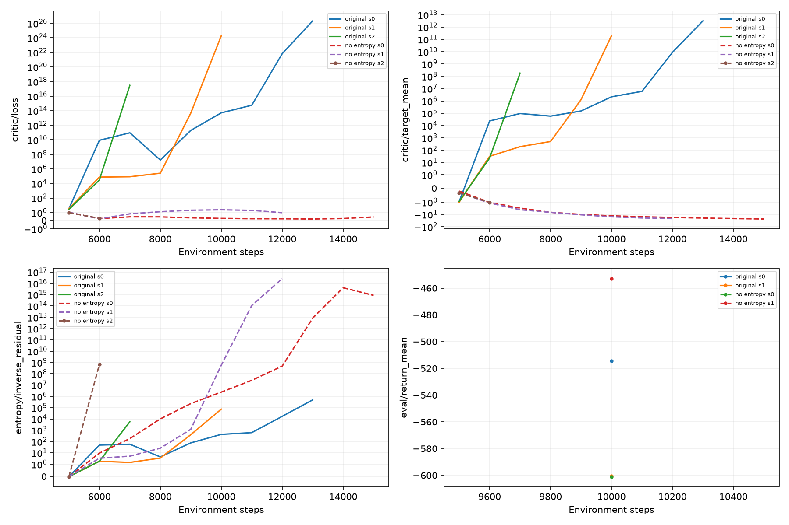

# β=1 PPO 先验：Critic 熵项短程消融报告

更新时间：2026-11-04T00:00:23+08:00（北京时间）

**状态：实验已结束，包含失败**。

## 问题与预先设定的判据

验证移除 Critic 目标中的 −α logπ_proxy 后，β=1 是否能越过原配置三个 seed 的数值失败点。每个 seed 预算 20,000 环境步；通过判据为三个 seed 均完成预算且无 numerical_error。该判据只检验短程稳定性，不检验 300k 最终性能。

## 配置与方法

- seed=0/1/2，从头训练；HalfCheetah-v5；冻结 PPO stage_1000000，native pre-tanh 分布，β=1。
- algorithm.use_entropy=false：Critic 目标改为 y=r+γ·mask·Q_target；Actor 的 Q 重加权温度 α=0.1 保持不变。并非关闭所有与熵相关的计算，Actor 日志点仍运行密度代理诊断。
- 网络、优化器、候选数、warmup 与原实验一致；预算由 300k 改为 20k，评估间隔仍为 10k，每次 10 回合。日志改为 local、flush_every=1，完全不连接 WandB。
- 诊断入口 scripts/train_entropy_diagnostic.py 只读取密度结果，增加 logπ 的 batch 最小/最大值、绝对值最大值、非有限值数量与反向误差最大值，不增加随机采样或修改损失。原实验没有这些极值记录。
- 移除 Critic 熵估计会改变共享 trace 随机流的消耗；因此同 seed 不等于逐步配对的轨迹，结果是机制证据而非完全隔离的因果证明。
- 本轮配置：[配置](../../../configs/experiment/halfcheetah_ppo_beta1_noentropy_20k.yaml)；全部原始配置与日志在 outputs/experiments/halfcheetah_ppo_beta1_noentropy_20k。

## 结果

| 实验 | seed | 状态 | 实际步数 | 最后评估步数 | 最后评估回报 |
|---|---:|---|---:|---:|---:|
| halfcheetah_ppo_beta1_300k | 0 | failed_numerical | 13632 | 10000 | -514.36 |
| halfcheetah_ppo_beta1_300k | 1 | failed_numerical | 10490 | 10000 | -600.38 |
| halfcheetah_ppo_beta1_300k | 2 | failed_numerical | 7345 | — | — |
| halfcheetah_ppo_beta1_300k_retry1 | 0 | failed_numerical | 13632 | 10000 | -514.36 |
| halfcheetah_ppo_beta1_300k_retry1 | 1 | failed_numerical | 10490 | 10000 | -600.38 |
| halfcheetah_ppo_beta1_300k_retry1 | 2 | failed_numerical | 7345 | — | — |
| halfcheetah_ppo_beta1_noentropy_20k | 0 | failed_numerical | 16000 | 10000 | -601.03 |
| halfcheetah_ppo_beta1_noentropy_20k | 1 | failed_numerical | 13000 | 10000 | -452.86 |
| halfcheetah_ppo_beta1_noentropy_20k | 2 | failed_numerical | 7000 | — | — |

原始实验与 retry 使用相同 seed，不能当作六个独立样本。表中最后评估可能是中途评估，只有 completed 的预算终点才是该预算的最终结果。

## 诊断图

曲线使用日志记录值；训练指标为日志窗口聚合值，不能当作单步异常值。entropy/inverse_residual 是实现已有的平均重建误差，原有同名指标可能被 Actor 诊断覆盖；不应一概理解为 target 专用。非有限值不绘制，但失败状态保留。

## 密度极值记录

| seed | 最大记录 logπ 绝对值 | 最大记录反向误差 |
|---:|---:|---:|
| 0 | 4.31915e+33 | 1.05858e+16 |
| 1 | 8.442e+36 | 5.94789e+17 |
| 2 | 3.79384e+20 | 3.75829e+09 |

极值指标每次密度调用先取 batch 极值，再经现有日志窗口聚合；上表是这些记录的最大值，不是所有训练样本的全局极值。

## 解释与局限

三个 seed 均未完成 20k。停止原因均变成 alpha entropy 密度诊断检查失败（而非 critic loss 非有限值），分别为 seed0:16000、seed1:13000、seed2:7000 步；非有限样本分别为 253/256、17/256、13/256。温度固定为 0.1，alpha entropy 是代码检查位置名称，不表示自动温度优化失败。关闭熵项没有关闭日志点的密度诊断，因此停止步数不能视为 Actor 或 Critic 必然在该步发生参数 NaN。

最后有效训练日志中 Critic loss 分别约为 0.460、0.990、0.290，Q 目标约为 −23.51、−21.74、−1.05；原配置的 Critic loss 则曾达到 10^17–10^26 量级。这支持熵代理污染 Critic 目标的解释，但未证明其为唯一或最早根因。

同时 Actor 仍严重失稳：seed0 在 15k 的目标速度范数约 2.79×10^6、预测速度范数约 1333、裁剪前梯度范数约 6.26×10^7；seed1 在 12k 的对应量约为 2.43×10^5、598、1.12×10^7。密度重建误差随之巨大，说明单独移除 Critic 熵项不足以恢复整体数值稳定。日志窗口聚合不提供单步先后顺序，不能断言 Actor 失稳必然先于反向积分失稳。

结论：目前更符合 Actor/MeanFlow 目标与密度反演存在另一条失稳链路，而熵项把问题传播并放大到 Critic 的机制；仍不能把根因确定为旧 PPO 价值网络冲突。PPO 控制器只加载策略和其归一化器，未导入 PPO 价值网络。

建议下一步做短程定位而非直接跑 300k：先在不改变优化目标的前提下记录 Actor 目标、JVP、候选潜变量、先验尺度和密度积分轨迹的单步极值，定位首个异常；再比较 β=1 与高斯混合源。关闭纯日志密度检查的对照可以判断诊断是否提前终止训练，但不等同于修复，必须继续监测 Actor 和部署动作质量。两项 10k 回报仅为中途结果（约 −601、−453），不用于最终性能比较。
