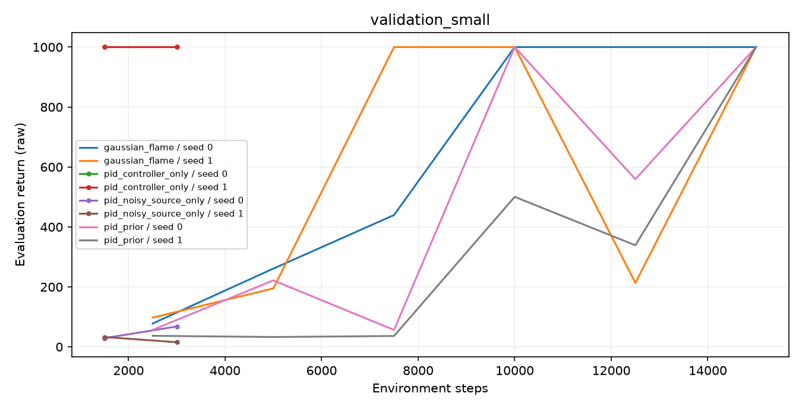
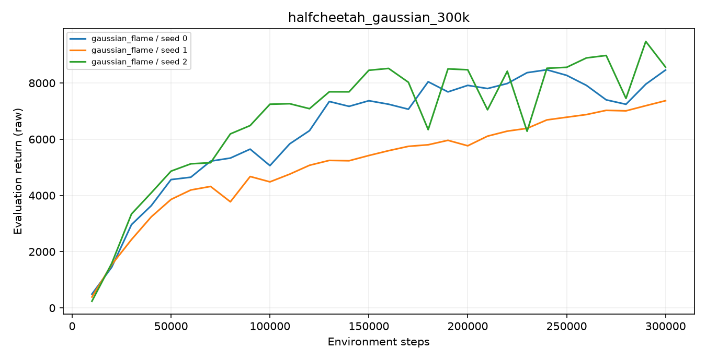
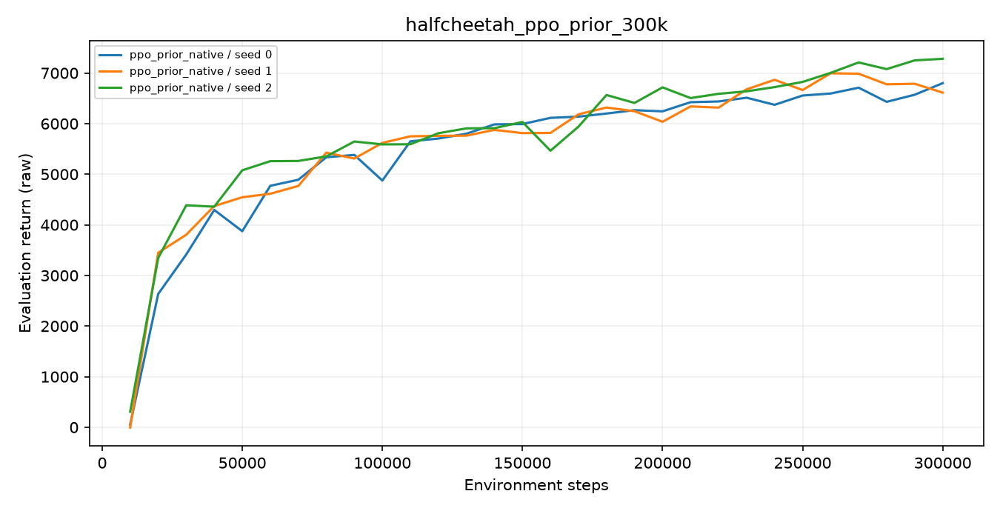
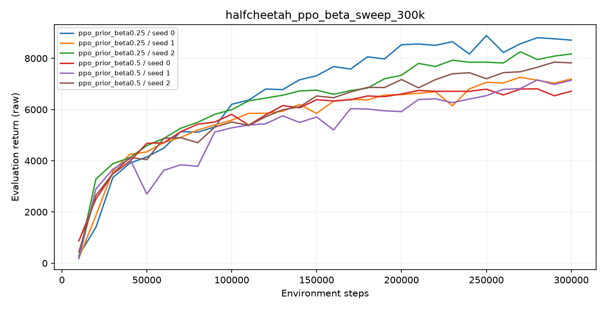
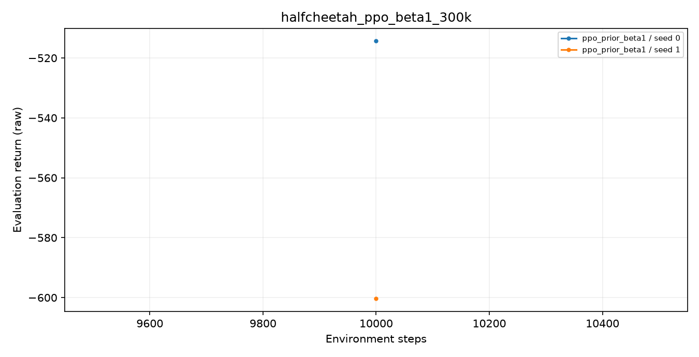
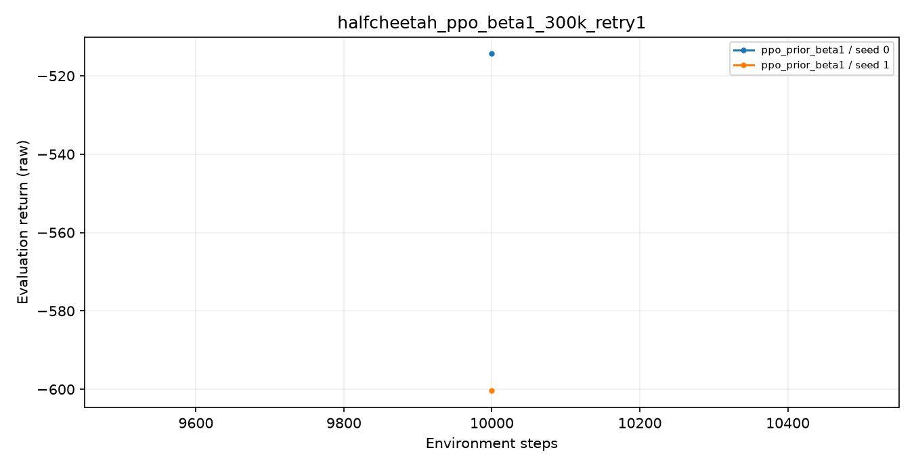
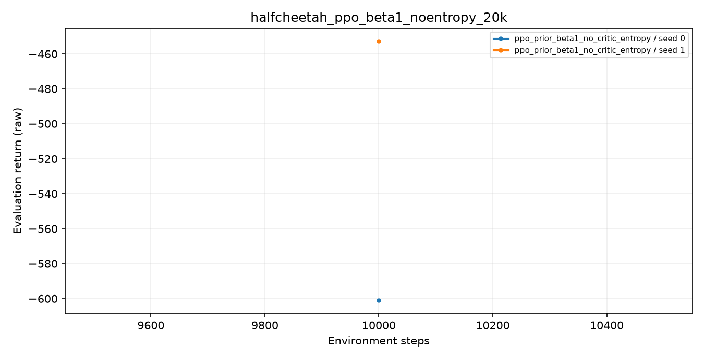
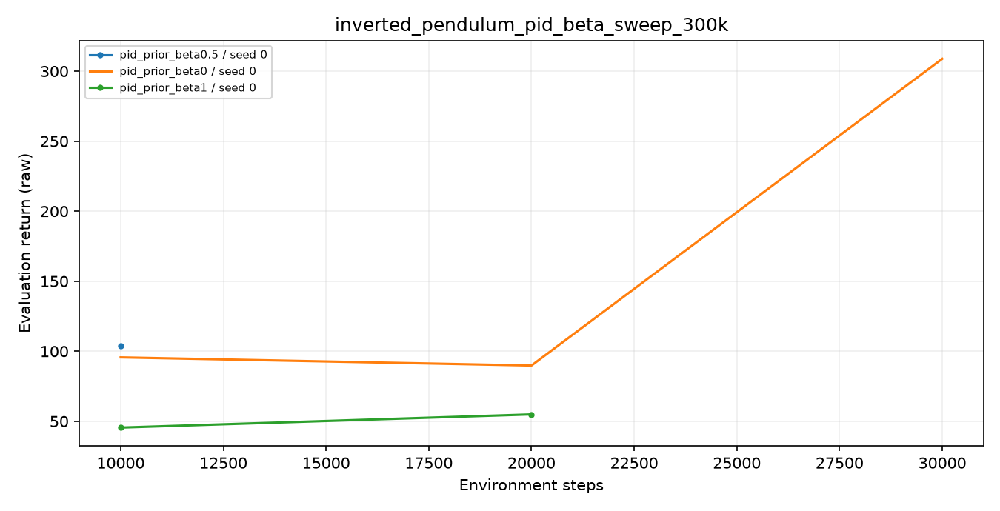
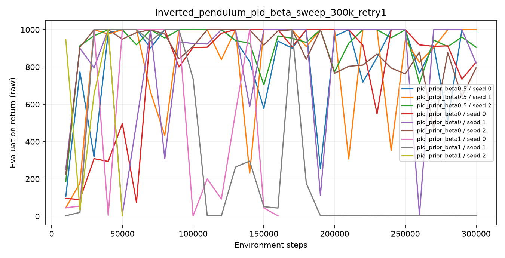

# PGOFP 本地实验记录

## Agent 记录写入规范

1. 本文件是实验索引；原始证据为各 run 的 config_resolved.yaml、manifest.json、metrics.jsonl、events.jsonl 和检查点。不得依赖 WandB 作为唯一记录。
2. 每次新实验或重跑分配独立序号、目录和 run；保留失败、恢复及历史记录，禁止用新结果覆盖旧实验。相同 seed 重跑属于复现，不得计作新增独立 seed。
3. 日期统一北京时间（UTC+8），优先采用日志中的 UTC 时间换算；缺失时间写“未知”，不得把文件修改时间当作实验开始时间。恢复后的 manifest 可能覆盖首次启动时间，须结合事件和矩阵记录判断。
4. 启动前记录目的、配置路径、全部解析配置、seed、预算、先验版本和实验差异；启动后记录状态；完成或失败后补上实际步数、评估、异常与图像。算法改动必须记录改动文件及版本/哈希。
5. 最终回报仅取 summary.final_eval；未完成实验不得把中途评估写作最终结果。均值和样本标准差以 seed 为单位；评估回合数与训练 seed 数分别注明。失败率须保留失败 seed，不得只报告成功样本。
6. Agent 记录中的曲线横轴为环境步数，使用本地原始评估，不平滑；同一步重复评估取最后一条。图像分别绘制每个 seed，不使用阴影。缺失评估不补造，不外推。人读报告另行注明聚合均值与 SD 图的口径。
7. 恢复必须记录恢复模式与检查点步数；本地 metrics_discarded.jsonl 保留回退数据，恢复曲线以当前 metrics.jsonl 为准。MuJoCo episode_restart 不保证逐步一致。
8. 每次更新运行 `.venv/bin/python scripts/update_experiment_records.py` 重建本报告与图片。自动生成区请勿手工维护；研究解释写入同目录 notes.md，避免刷新时丢失。不得在记录中写入账号密钥或 .env 内容。
9. 新配置后续默认启用 JSONL/TensorBoard 本地记录；WandB 账号已不可用，不应把在线连接作为实验启动前提。更改日志后端须显式记录，已有历史配置快照保持原样。

## 数据范围与统计口径

本报告扫描 outputs/experiments 下具有解析配置的所有 run；包括链路验证、正式预算的探索实验和失败重跑。先验训练 artifact 单列。日期为本地证据，状态来自每个 run，矩阵 launcher 状态可能滞后。

## 实验索引

| 序号 | 日期（北京时间，见时间说明） | 实验 | 完成/总 run |
|---|---|---|---|
| EXP-001 | 2026-10-20 17:06:56 | validation_small | 8/8 |
| EXP-002 | 2026-10-20 23:20:39 | halfcheetah_gaussian_300k | 3/3 |
| EXP-003 | 2026-10-21 19:03:47 | halfcheetah_ppo_prior_300k | 3/3 |
| EXP-004 | 2026-10-28 17:26:46 | halfcheetah_ppo_beta_sweep_300k | 6/6 |
| EXP-005 | 2026-10-31 00:52:33 | halfcheetah_ppo_beta1_300k | 0/3 |
| EXP-006 | 2026-10-31 20:41:30 | halfcheetah_ppo_beta1_300k_retry1 | 0/3 |
| EXP-007 | 2026-11-03 22:24:47 | halfcheetah_ppo_beta1_noentropy_20k | 0/3 |
| EXP-008 | 2026-11-04 15:42:34 | inverted_pendulum_pid_beta_sweep_300k | 0/3 |
| EXP-009 | 2026-11-04 23:39:12 | inverted_pendulum_pid_beta_sweep_300k_retry1 | 7/9 |
| EXP-010 | 2026-11-13 12:14:13 | mujoco_30k_a100_v1 | 129/150 |

## EXP-001 · validation_small

配置入口：[validation_small.yaml](../../configs/experiment/validation_small.yaml)；原始目录：[validation_small](../../outputs/experiments/validation_small)。

| run / seed | 状态 | 开始/最近清单时间（北京） | 实际步数 | 最终回报 | 最后中途评估（步数:回报） |
|---|---|---|---:|---:|---|
| [gaussian_flame](../../outputs/experiments/validation_small/runs/validation_small__gaussian_flame__s0__bf8df0) / 0 | completed | 2026-10-20 17:06:56 | 15000 | 1000.00 | 15000:1000.00 |
| [gaussian_flame](../../outputs/experiments/validation_small/runs/validation_small__gaussian_flame__s1__bbc45f) / 1 | completed | 2026-10-20 17:06:56 | 15000 | 1000.00 | 15000:1000.00 |
| [pid_controller_only](../../outputs/experiments/validation_small/runs/validation_small__pid_controller_only__s0__3ddb5e) / 0 | completed | 2026-10-20 17:06:56 | 3000 | 1000.00 | 3000:1000.00 |
| [pid_controller_only](../../outputs/experiments/validation_small/runs/validation_small__pid_controller_only__s1__044898) / 1 | completed | 2026-10-20 17:07:06 | 3000 | 1000.00 | 3000:1000.00 |
| [pid_noisy_source_only](../../outputs/experiments/validation_small/runs/validation_small__pid_noisy_source_only__s0__f231dd) / 0 | completed | 2026-10-20 17:07:18 | 3000 | 68.00 | 3000:68.00 |
| [pid_noisy_source_only](../../outputs/experiments/validation_small/runs/validation_small__pid_noisy_source_only__s1__f450d4) / 1 | completed | 2026-10-20 17:07:28 | 3000 | 15.40 | 3000:15.40 |
| [pid_prior](../../outputs/experiments/validation_small/runs/validation_small__pid_prior__s0__4e33f1) / 0 | completed | 2026-10-20 17:06:56 | 15000 | 1000.00 | 15000:1000.00 |
| [pid_prior](../../outputs/experiments/validation_small/runs/validation_small__pid_prior__s1__43111b) / 1 | completed | 2026-10-20 17:06:56 | 15000 | 1000.00 | 15000:1000.00 |



- gaussian_flame：完成最终评估 2/2；最终均值 1000.00，seed 间样本标准差 0.00。
- pid_controller_only：完成最终评估 2/2；最终均值 1000.00，seed 间样本标准差 0.00。
- pid_noisy_source_only：完成最终评估 2/2；最终均值 41.70，seed 间样本标准差 37.19。
- pid_prior：完成最终评估 2/2；最终均值 1000.00，seed 间样本标准差 0.00。

### validation_small__gaussian_flame__s0__bf8df0

完整配置快照：[run01_config.yaml](EXP-001/run01_config.yaml)；日志：[metrics.jsonl](../../outputs/experiments/validation_small/runs/validation_small__gaussian_flame__s0__bf8df0/metrics.jsonl)；事件：[events.jsonl](../../outputs/experiments/validation_small/runs/validation_small__gaussian_flame__s0__bf8df0/events.jsonl)。

配置哈希：`8a08a24a52066476`；来源版本：`[]`。

```yaml
seed: 0
env:
  name: inverted_pendulum
  id: InvertedPendulum-v5
  backend: mujoco
  kwargs: {}
  normalize_obs: true
  obs_clip: 10.0
  reward_scale: 1.0
  controllers:
  - pid
  - cem_mpc
  - ppo
  notes: Reward saturates at 1 per step; judge by episode length / failure, not return
    alone.
algorithm:
  name: gaussian_flame_m
  gamma: 0.99
  target_tau: 0.005
  K_train: 32
  K_local: 16
  sigma_local: 0.3
  K_exec: 1
  K_eval: 1
  actor_objective: reverse_qrmf
  use_entropy: true
  zt_proposal: standard_normal
  source_scope:
  - behavior
  - actor
  - target
  atanh_eps: 0.001
  flow:
    time_delta: 0.02
    flow_ratio: 0.5
    time_sampling: uniform
    logit_mean: -0.4
    logit_std: 1.0
  temperature:
    mode: fixed
    alpha: 0.1
    target_entropy: auto
    alpha_min: 0.001
    alpha_max: 10.0
  density:
    method: continuous_inverse_proxy
    steps: 5
    solver: heun
    trace: hutchinson
    n_trace_samples: 1
    chunk_size: 8192
    grid:
    - 0.0
    - 0.5
    - 1.0
    logdet: full
  params: {}
  forces:
    source.kind: gaussian
  inherits: null
source:
  kind: gaussian
  schedule: constant
  beta: 0.75
  sigma_prior: 0.3
  sigma_base: 1.0
  sigma_min: 0.05
  sigma_max: 2.0
  std_multiplier: 1.0
  total_steps: 1000000
  beta_start: 0.0
  beta_end: 0.75
  sigma_start: 1.0
  sigma_end: 0.3
  points: []
  max_delta: 0.0
prior:
  type: none
  controller_config: null
  controller: {}
  artifact_path: null
  distribution: native
  components: []
  fallback: gaussian
  model_access: observation_model
  cache_in_replay: true
network:
  actor_hidden:
  - 256
  - 256
  - 256
  critic_hidden:
  - 256
  - 256
  - 256
  time_embed_dim: 32
  time_max_freq: 4.0
  actor_activation: silu
  critic_activation: relu
  layer_norm: false
optimizer:
  actor_lr: 0.0003
  critic_lr: 0.0003
  alpha_lr: 0.0003
train:
  num_envs: 1
  total_env_steps: 15000
  learning_starts: 1000
  utd_ratio: 1.0
  batch_size: 256
  warmup_source: uniform_action
  max_grad_norm: 10.0
  actor_update_interval: 1
  log_interval: 1000
  sync_device_timing: false
eval:
  interval: 2500
  episodes: 5
  seed_base: 10000
  max_steps: null
  condition_bank_size: 0
  representative_action: true
checkpoint:
  interval: 5000
  save_replay: true
  best_metric: eval/return_mean
condition:
  mode: public_state
  use_reference: true
  use_phase: true
  use_controller_features: false
  source_features: auto
  reference_scale: 1.0
device: auto
```


### validation_small__gaussian_flame__s1__bbc45f

完整配置快照：[run02_config.yaml](EXP-001/run02_config.yaml)；日志：[metrics.jsonl](../../outputs/experiments/validation_small/runs/validation_small__gaussian_flame__s1__bbc45f/metrics.jsonl)；事件：[events.jsonl](../../outputs/experiments/validation_small/runs/validation_small__gaussian_flame__s1__bbc45f/events.jsonl)。

配置哈希：`6402814b5799604c`；来源版本：`[]`。

```yaml
seed: 1
env:
  name: inverted_pendulum
  id: InvertedPendulum-v5
  backend: mujoco
  kwargs: {}
  normalize_obs: true
  obs_clip: 10.0
  reward_scale: 1.0
  controllers:
  - pid
  - cem_mpc
  - ppo
  notes: Reward saturates at 1 per step; judge by episode length / failure, not return
    alone.
algorithm:
  name: gaussian_flame_m
  gamma: 0.99
  target_tau: 0.005
  K_train: 32
  K_local: 16
  sigma_local: 0.3
  K_exec: 1
  K_eval: 1
  actor_objective: reverse_qrmf
  use_entropy: true
  zt_proposal: standard_normal
  source_scope:
  - behavior
  - actor
  - target
  atanh_eps: 0.001
  flow:
    time_delta: 0.02
    flow_ratio: 0.5
    time_sampling: uniform
    logit_mean: -0.4
    logit_std: 1.0
  temperature:
    mode: fixed
    alpha: 0.1
    target_entropy: auto
    alpha_min: 0.001
    alpha_max: 10.0
  density:
    method: continuous_inverse_proxy
    steps: 5
    solver: heun
    trace: hutchinson
    n_trace_samples: 1
    chunk_size: 8192
    grid:
    - 0.0
    - 0.5
    - 1.0
    logdet: full
  params: {}
  forces:
    source.kind: gaussian
  inherits: null
source:
  kind: gaussian
  schedule: constant
  beta: 0.75
  sigma_prior: 0.3
  sigma_base: 1.0
  sigma_min: 0.05
  sigma_max: 2.0
  std_multiplier: 1.0
  total_steps: 1000000
  beta_start: 0.0
  beta_end: 0.75
  sigma_start: 1.0
  sigma_end: 0.3
  points: []
  max_delta: 0.0
prior:
  type: none
  controller_config: null
  controller: {}
  artifact_path: null
  distribution: native
  components: []
  fallback: gaussian
  model_access: observation_model
  cache_in_replay: true
network:
  actor_hidden:
  - 256
  - 256
  - 256
  critic_hidden:
  - 256
  - 256
  - 256
  time_embed_dim: 32
  time_max_freq: 4.0
  actor_activation: silu
  critic_activation: relu
  layer_norm: false
optimizer:
  actor_lr: 0.0003
  critic_lr: 0.0003
  alpha_lr: 0.0003
train:
  num_envs: 1
  total_env_steps: 15000
  learning_starts: 1000
  utd_ratio: 1.0
  batch_size: 256
  warmup_source: uniform_action
  max_grad_norm: 10.0
  actor_update_interval: 1
  log_interval: 1000
  sync_device_timing: false
eval:
  interval: 2500
  episodes: 5
  seed_base: 10000
  max_steps: null
  condition_bank_size: 0
  representative_action: true
checkpoint:
  interval: 5000
  save_replay: true
  best_metric: eval/return_mean
condition:
  mode: public_state
  use_reference: true
  use_phase: true
  use_controller_features: false
  source_features: auto
  reference_scale: 1.0
device: auto
```


### validation_small__pid_controller_only__s0__3ddb5e

完整配置快照：[run03_config.yaml](EXP-001/run03_config.yaml)；日志：[metrics.jsonl](../../outputs/experiments/validation_small/runs/validation_small__pid_controller_only__s0__3ddb5e/metrics.jsonl)；事件：[events.jsonl](../../outputs/experiments/validation_small/runs/validation_small__pid_controller_only__s0__3ddb5e/events.jsonl)。

配置哈希：`67113a4e838b43bd`；来源版本：`["ipend_pid_v1"]`。

```yaml
seed: 0
env:
  name: inverted_pendulum
  id: InvertedPendulum-v5
  backend: mujoco
  kwargs: {}
  normalize_obs: true
  obs_clip: 10.0
  reward_scale: 1.0
  controllers:
  - pid
  - cem_mpc
  - ppo
  notes: Reward saturates at 1 per step; judge by episode length / failure, not return
    alone.
algorithm:
  name: controller_only
  gamma: 0.99
  target_tau: 0.005
  K_train: 32
  K_local: 16
  sigma_local: 0.3
  K_exec: 1
  K_eval: 1
  actor_objective: reverse_qrmf
  use_entropy: true
  zt_proposal: standard_normal
  source_scope:
  - behavior
  - actor
  - target
  atanh_eps: 0.001
  flow:
    time_delta: 0.02
    flow_ratio: 0.5
    time_sampling: uniform
    logit_mean: -0.4
    logit_std: 1.0
  temperature:
    mode: fixed
    alpha: 0.1
    target_entropy: auto
    alpha_min: 0.001
    alpha_max: 10.0
  density:
    method: continuous_inverse_proxy
    steps: 5
    solver: heun
    trace: hutchinson
    n_trace_samples: 1
    chunk_size: 8192
    grid:
    - 0.0
    - 0.5
    - 1.0
    logdet: full
  params:
    mode: deterministic
  forces: {}
  inherits: null
source:
  kind: prior_mixture
  schedule: constant
  beta: 0.75
  sigma_prior: 0.3
  sigma_base: 1.0
  sigma_min: 0.05
  sigma_max: 2.0
  std_multiplier: 1.0
  total_steps: 1000000
  beta_start: 0.0
  beta_end: 0.75
  sigma_start: 1.0
  sigma_end: 0.3
  points: []
  max_delta: 0.0
prior:
  type: pid
  controller_config: inverted_pendulum_pid
  controller:
    name: inverted_pendulum_pid
    version: ipend_pid_v1
    quality: good
    dt: 0.04
    u_max_phys: 3.0
    integral_limit: 5.0
    gains:
      theta: 10.0
      theta_dot: 1.0
      x: 0.5
      x_dot: 0.5
      integral_x: 0.0
  artifact_path: null
  distribution: native
  components: []
  fallback: gaussian
  model_access: observation_model
  cache_in_replay: true
network:
  actor_hidden:
  - 256
  - 256
  - 256
  critic_hidden:
  - 256
  - 256
  - 256
  time_embed_dim: 32
  time_max_freq: 4.0
  actor_activation: silu
  critic_activation: relu
  layer_norm: false
optimizer:
  actor_lr: 0.0003
  critic_lr: 0.0003
  alpha_lr: 0.0003
train:
  num_envs: 1
  total_env_steps: 3000
  learning_starts: 1000
  utd_ratio: 1.0
  batch_size: 256
  warmup_source: uniform_action
  max_grad_norm: 10.0
  actor_update_interval: 1
  log_interval: 1000
  sync_device_timing: false
eval:
  interval: 1500
  episodes: 5
  seed_base: 10000
  max_steps: null
  condition_bank_size: 0
  representative_action: true
checkpoint:
  interval: 5000
  save_replay: true
  best_metric: eval/return_mean
condition:
  mode: public_state
  use_reference: true
  use_phase: true
  use_controller_features: false
  source_features: auto
  reference_scale: 1.0
device: auto
```


### validation_small__pid_controller_only__s1__044898

完整配置快照：[run04_config.yaml](EXP-001/run04_config.yaml)；日志：[metrics.jsonl](../../outputs/experiments/validation_small/runs/validation_small__pid_controller_only__s1__044898/metrics.jsonl)；事件：[events.jsonl](../../outputs/experiments/validation_small/runs/validation_small__pid_controller_only__s1__044898/events.jsonl)。

配置哈希：`331838cf23ddef94`；来源版本：`["ipend_pid_v1"]`。

```yaml
seed: 1
env:
  name: inverted_pendulum
  id: InvertedPendulum-v5
  backend: mujoco
  kwargs: {}
  normalize_obs: true
  obs_clip: 10.0
  reward_scale: 1.0
  controllers:
  - pid
  - cem_mpc
  - ppo
  notes: Reward saturates at 1 per step; judge by episode length / failure, not return
    alone.
algorithm:
  name: controller_only
  gamma: 0.99
  target_tau: 0.005
  K_train: 32
  K_local: 16
  sigma_local: 0.3
  K_exec: 1
  K_eval: 1
  actor_objective: reverse_qrmf
  use_entropy: true
  zt_proposal: standard_normal
  source_scope:
  - behavior
  - actor
  - target
  atanh_eps: 0.001
  flow:
    time_delta: 0.02
    flow_ratio: 0.5
    time_sampling: uniform
    logit_mean: -0.4
    logit_std: 1.0
  temperature:
    mode: fixed
    alpha: 0.1
    target_entropy: auto
    alpha_min: 0.001
    alpha_max: 10.0
  density:
    method: continuous_inverse_proxy
    steps: 5
    solver: heun
    trace: hutchinson
    n_trace_samples: 1
    chunk_size: 8192
    grid:
    - 0.0
    - 0.5
    - 1.0
    logdet: full
  params:
    mode: deterministic
  forces: {}
  inherits: null
source:
  kind: prior_mixture
  schedule: constant
  beta: 0.75
  sigma_prior: 0.3
  sigma_base: 1.0
  sigma_min: 0.05
  sigma_max: 2.0
  std_multiplier: 1.0
  total_steps: 1000000
  beta_start: 0.0
  beta_end: 0.75
  sigma_start: 1.0
  sigma_end: 0.3
  points: []
  max_delta: 0.0
prior:
  type: pid
  controller_config: inverted_pendulum_pid
  controller:
    name: inverted_pendulum_pid
    version: ipend_pid_v1
    quality: good
    dt: 0.04
    u_max_phys: 3.0
    integral_limit: 5.0
    gains:
      theta: 10.0
      theta_dot: 1.0
      x: 0.5
      x_dot: 0.5
      integral_x: 0.0
  artifact_path: null
  distribution: native
  components: []
  fallback: gaussian
  model_access: observation_model
  cache_in_replay: true
network:
  actor_hidden:
  - 256
  - 256
  - 256
  critic_hidden:
  - 256
  - 256
  - 256
  time_embed_dim: 32
  time_max_freq: 4.0
  actor_activation: silu
  critic_activation: relu
  layer_norm: false
optimizer:
  actor_lr: 0.0003
  critic_lr: 0.0003
  alpha_lr: 0.0003
train:
  num_envs: 1
  total_env_steps: 3000
  learning_starts: 1000
  utd_ratio: 1.0
  batch_size: 256
  warmup_source: uniform_action
  max_grad_norm: 10.0
  actor_update_interval: 1
  log_interval: 1000
  sync_device_timing: false
eval:
  interval: 1500
  episodes: 5
  seed_base: 10000
  max_steps: null
  condition_bank_size: 0
  representative_action: true
checkpoint:
  interval: 5000
  save_replay: true
  best_metric: eval/return_mean
condition:
  mode: public_state
  use_reference: true
  use_phase: true
  use_controller_features: false
  source_features: auto
  reference_scale: 1.0
device: auto
```


### validation_small__pid_noisy_source_only__s0__f231dd

完整配置快照：[run05_config.yaml](EXP-001/run05_config.yaml)；日志：[metrics.jsonl](../../outputs/experiments/validation_small/runs/validation_small__pid_noisy_source_only__s0__f231dd/metrics.jsonl)；事件：[events.jsonl](../../outputs/experiments/validation_small/runs/validation_small__pid_noisy_source_only__s0__f231dd/events.jsonl)。

配置哈希：`a52d0463afc63f89`；来源版本：`["ipend_pid_v1"]`。

```yaml
seed: 0
env:
  name: inverted_pendulum
  id: InvertedPendulum-v5
  backend: mujoco
  kwargs: {}
  normalize_obs: true
  obs_clip: 10.0
  reward_scale: 1.0
  controllers:
  - pid
  - cem_mpc
  - ppo
  notes: Reward saturates at 1 per step; judge by episode length / failure, not return
    alone.
algorithm:
  name: controller_only
  gamma: 0.99
  target_tau: 0.005
  K_train: 32
  K_local: 16
  sigma_local: 0.3
  K_exec: 1
  K_eval: 1
  actor_objective: reverse_qrmf
  use_entropy: true
  zt_proposal: standard_normal
  source_scope:
  - behavior
  - actor
  - target
  atanh_eps: 0.001
  flow:
    time_delta: 0.02
    flow_ratio: 0.5
    time_sampling: uniform
    logit_mean: -0.4
    logit_std: 1.0
  temperature:
    mode: fixed
    alpha: 0.1
    target_entropy: auto
    alpha_min: 0.001
    alpha_max: 10.0
  density:
    method: continuous_inverse_proxy
    steps: 5
    solver: heun
    trace: hutchinson
    n_trace_samples: 1
    chunk_size: 8192
    grid:
    - 0.0
    - 0.5
    - 1.0
    logdet: full
  params:
    mode: noisy_source
  forces: {}
  inherits: null
source:
  kind: prior_mixture
  schedule: constant
  beta: 0.75
  sigma_prior: 0.3
  sigma_base: 1.0
  sigma_min: 0.05
  sigma_max: 2.0
  std_multiplier: 1.0
  total_steps: 1000000
  beta_start: 0.0
  beta_end: 0.75
  sigma_start: 1.0
  sigma_end: 0.3
  points: []
  max_delta: 0.0
prior:
  type: pid
  controller_config: inverted_pendulum_pid
  controller:
    name: inverted_pendulum_pid
    version: ipend_pid_v1
    quality: good
    dt: 0.04
    u_max_phys: 3.0
    integral_limit: 5.0
    gains:
      theta: 10.0
      theta_dot: 1.0
      x: 0.5
      x_dot: 0.5
      integral_x: 0.0
  artifact_path: null
  distribution: native
  components: []
  fallback: gaussian
  model_access: observation_model
  cache_in_replay: true
network:
  actor_hidden:
  - 256
  - 256
  - 256
  critic_hidden:
  - 256
  - 256
  - 256
  time_embed_dim: 32
  time_max_freq: 4.0
  actor_activation: silu
  critic_activation: relu
  layer_norm: false
optimizer:
  actor_lr: 0.0003
  critic_lr: 0.0003
  alpha_lr: 0.0003
train:
  num_envs: 1
  total_env_steps: 3000
  learning_starts: 1000
  utd_ratio: 1.0
  batch_size: 256
  warmup_source: uniform_action
  max_grad_norm: 10.0
  actor_update_interval: 1
  log_interval: 1000
  sync_device_timing: false
eval:
  interval: 1500
  episodes: 5
  seed_base: 10000
  max_steps: null
  condition_bank_size: 0
  representative_action: true
checkpoint:
  interval: 5000
  save_replay: true
  best_metric: eval/return_mean
condition:
  mode: public_state
  use_reference: true
  use_phase: true
  use_controller_features: false
  source_features: auto
  reference_scale: 1.0
device: auto
```


### validation_small__pid_noisy_source_only__s1__f450d4

完整配置快照：[run06_config.yaml](EXP-001/run06_config.yaml)；日志：[metrics.jsonl](../../outputs/experiments/validation_small/runs/validation_small__pid_noisy_source_only__s1__f450d4/metrics.jsonl)；事件：[events.jsonl](../../outputs/experiments/validation_small/runs/validation_small__pid_noisy_source_only__s1__f450d4/events.jsonl)。

配置哈希：`7e3872631aa88839`；来源版本：`["ipend_pid_v1"]`。

```yaml
seed: 1
env:
  name: inverted_pendulum
  id: InvertedPendulum-v5
  backend: mujoco
  kwargs: {}
  normalize_obs: true
  obs_clip: 10.0
  reward_scale: 1.0
  controllers:
  - pid
  - cem_mpc
  - ppo
  notes: Reward saturates at 1 per step; judge by episode length / failure, not return
    alone.
algorithm:
  name: controller_only
  gamma: 0.99
  target_tau: 0.005
  K_train: 32
  K_local: 16
  sigma_local: 0.3
  K_exec: 1
  K_eval: 1
  actor_objective: reverse_qrmf
  use_entropy: true
  zt_proposal: standard_normal
  source_scope:
  - behavior
  - actor
  - target
  atanh_eps: 0.001
  flow:
    time_delta: 0.02
    flow_ratio: 0.5
    time_sampling: uniform
    logit_mean: -0.4
    logit_std: 1.0
  temperature:
    mode: fixed
    alpha: 0.1
    target_entropy: auto
    alpha_min: 0.001
    alpha_max: 10.0
  density:
    method: continuous_inverse_proxy
    steps: 5
    solver: heun
    trace: hutchinson
    n_trace_samples: 1
    chunk_size: 8192
    grid:
    - 0.0
    - 0.5
    - 1.0
    logdet: full
  params:
    mode: noisy_source
  forces: {}
  inherits: null
source:
  kind: prior_mixture
  schedule: constant
  beta: 0.75
  sigma_prior: 0.3
  sigma_base: 1.0
  sigma_min: 0.05
  sigma_max: 2.0
  std_multiplier: 1.0
  total_steps: 1000000
  beta_start: 0.0
  beta_end: 0.75
  sigma_start: 1.0
  sigma_end: 0.3
  points: []
  max_delta: 0.0
prior:
  type: pid
  controller_config: inverted_pendulum_pid
  controller:
    name: inverted_pendulum_pid
    version: ipend_pid_v1
    quality: good
    dt: 0.04
    u_max_phys: 3.0
    integral_limit: 5.0
    gains:
      theta: 10.0
      theta_dot: 1.0
      x: 0.5
      x_dot: 0.5
      integral_x: 0.0
  artifact_path: null
  distribution: native
  components: []
  fallback: gaussian
  model_access: observation_model
  cache_in_replay: true
network:
  actor_hidden:
  - 256
  - 256
  - 256
  critic_hidden:
  - 256
  - 256
  - 256
  time_embed_dim: 32
  time_max_freq: 4.0
  actor_activation: silu
  critic_activation: relu
  layer_norm: false
optimizer:
  actor_lr: 0.0003
  critic_lr: 0.0003
  alpha_lr: 0.0003
train:
  num_envs: 1
  total_env_steps: 3000
  learning_starts: 1000
  utd_ratio: 1.0
  batch_size: 256
  warmup_source: uniform_action
  max_grad_norm: 10.0
  actor_update_interval: 1
  log_interval: 1000
  sync_device_timing: false
eval:
  interval: 1500
  episodes: 5
  seed_base: 10000
  max_steps: null
  condition_bank_size: 0
  representative_action: true
checkpoint:
  interval: 5000
  save_replay: true
  best_metric: eval/return_mean
condition:
  mode: public_state
  use_reference: true
  use_phase: true
  use_controller_features: false
  source_features: auto
  reference_scale: 1.0
device: auto
```


### validation_small__pid_prior__s0__4e33f1

完整配置快照：[run07_config.yaml](EXP-001/run07_config.yaml)；日志：[metrics.jsonl](../../outputs/experiments/validation_small/runs/validation_small__pid_prior__s0__4e33f1/metrics.jsonl)；事件：[events.jsonl](../../outputs/experiments/validation_small/runs/validation_small__pid_prior__s0__4e33f1/events.jsonl)。

配置哈希：`c554e703eefa50d7`；来源版本：`["ipend_pid_v1"]`。

```yaml
seed: 0
env:
  name: inverted_pendulum
  id: InvertedPendulum-v5
  backend: mujoco
  kwargs: {}
  normalize_obs: true
  obs_clip: 10.0
  reward_scale: 1.0
  controllers:
  - pid
  - cem_mpc
  - ppo
  notes: Reward saturates at 1 per step; judge by episode length / failure, not return
    alone.
algorithm:
  name: prior_flame_m
  gamma: 0.99
  target_tau: 0.005
  K_train: 32
  K_local: 16
  sigma_local: 0.3
  K_exec: 1
  K_eval: 1
  actor_objective: reverse_qrmf
  use_entropy: true
  zt_proposal: standard_normal
  source_scope:
  - behavior
  - actor
  - target
  atanh_eps: 0.001
  flow:
    time_delta: 0.02
    flow_ratio: 0.5
    time_sampling: uniform
    logit_mean: -0.4
    logit_std: 1.0
  temperature:
    mode: fixed
    alpha: 0.1
    target_entropy: auto
    alpha_min: 0.001
    alpha_max: 10.0
  density:
    method: continuous_inverse_proxy
    steps: 5
    solver: heun
    trace: hutchinson
    n_trace_samples: 1
    chunk_size: 8192
    grid:
    - 0.0
    - 0.5
    - 1.0
    logdet: full
  params: {}
  forces: {}
  inherits: null
source:
  kind: prior_mixture
  schedule: constant
  beta: 0.75
  sigma_prior: 0.3
  sigma_base: 1.0
  sigma_min: 0.05
  sigma_max: 2.0
  std_multiplier: 1.0
  total_steps: 1000000
  beta_start: 0.0
  beta_end: 0.75
  sigma_start: 1.0
  sigma_end: 0.3
  points: []
  max_delta: 0.0
prior:
  type: pid
  controller_config: inverted_pendulum_pid
  controller:
    name: inverted_pendulum_pid
    version: ipend_pid_v1
    quality: good
    dt: 0.04
    u_max_phys: 3.0
    integral_limit: 5.0
    gains:
      theta: 10.0
      theta_dot: 1.0
      x: 0.5
      x_dot: 0.5
      integral_x: 0.0
  artifact_path: null
  distribution: native
  components: []
  fallback: gaussian
  model_access: observation_model
  cache_in_replay: true
network:
  actor_hidden:
  - 256
  - 256
  - 256
  critic_hidden:
  - 256
  - 256
  - 256
  time_embed_dim: 32
  time_max_freq: 4.0
  actor_activation: silu
  critic_activation: relu
  layer_norm: false
optimizer:
  actor_lr: 0.0003
  critic_lr: 0.0003
  alpha_lr: 0.0003
train:
  num_envs: 1
  total_env_steps: 15000
  learning_starts: 1000
  utd_ratio: 1.0
  batch_size: 256
  warmup_source: uniform_action
  max_grad_norm: 10.0
  actor_update_interval: 1
  log_interval: 1000
  sync_device_timing: false
eval:
  interval: 2500
  episodes: 5
  seed_base: 10000
  max_steps: null
  condition_bank_size: 0
  representative_action: true
checkpoint:
  interval: 5000
  save_replay: true
  best_metric: eval/return_mean
condition:
  mode: public_state
  use_reference: true
  use_phase: true
  use_controller_features: false
  source_features: auto
  reference_scale: 1.0
device: auto
```


### validation_small__pid_prior__s1__43111b

完整配置快照：[run08_config.yaml](EXP-001/run08_config.yaml)；日志：[metrics.jsonl](../../outputs/experiments/validation_small/runs/validation_small__pid_prior__s1__43111b/metrics.jsonl)；事件：[events.jsonl](../../outputs/experiments/validation_small/runs/validation_small__pid_prior__s1__43111b/events.jsonl)。

配置哈希：`b6ed0f8d7b5f29e8`；来源版本：`["ipend_pid_v1"]`。

```yaml
seed: 1
env:
  name: inverted_pendulum
  id: InvertedPendulum-v5
  backend: mujoco
  kwargs: {}
  normalize_obs: true
  obs_clip: 10.0
  reward_scale: 1.0
  controllers:
  - pid
  - cem_mpc
  - ppo
  notes: Reward saturates at 1 per step; judge by episode length / failure, not return
    alone.
algorithm:
  name: prior_flame_m
  gamma: 0.99
  target_tau: 0.005
  K_train: 32
  K_local: 16
  sigma_local: 0.3
  K_exec: 1
  K_eval: 1
  actor_objective: reverse_qrmf
  use_entropy: true
  zt_proposal: standard_normal
  source_scope:
  - behavior
  - actor
  - target
  atanh_eps: 0.001
  flow:
    time_delta: 0.02
    flow_ratio: 0.5
    time_sampling: uniform
    logit_mean: -0.4
    logit_std: 1.0
  temperature:
    mode: fixed
    alpha: 0.1
    target_entropy: auto
    alpha_min: 0.001
    alpha_max: 10.0
  density:
    method: continuous_inverse_proxy
    steps: 5
    solver: heun
    trace: hutchinson
    n_trace_samples: 1
    chunk_size: 8192
    grid:
    - 0.0
    - 0.5
    - 1.0
    logdet: full
  params: {}
  forces: {}
  inherits: null
source:
  kind: prior_mixture
  schedule: constant
  beta: 0.75
  sigma_prior: 0.3
  sigma_base: 1.0
  sigma_min: 0.05
  sigma_max: 2.0
  std_multiplier: 1.0
  total_steps: 1000000
  beta_start: 0.0
  beta_end: 0.75
  sigma_start: 1.0
  sigma_end: 0.3
  points: []
  max_delta: 0.0
prior:
  type: pid
  controller_config: inverted_pendulum_pid
  controller:
    name: inverted_pendulum_pid
    version: ipend_pid_v1
    quality: good
    dt: 0.04
    u_max_phys: 3.0
    integral_limit: 5.0
    gains:
      theta: 10.0
      theta_dot: 1.0
      x: 0.5
      x_dot: 0.5
      integral_x: 0.0
  artifact_path: null
  distribution: native
  components: []
  fallback: gaussian
  model_access: observation_model
  cache_in_replay: true
network:
  actor_hidden:
  - 256
  - 256
  - 256
  critic_hidden:
  - 256
  - 256
  - 256
  time_embed_dim: 32
  time_max_freq: 4.0
  actor_activation: silu
  critic_activation: relu
  layer_norm: false
optimizer:
  actor_lr: 0.0003
  critic_lr: 0.0003
  alpha_lr: 0.0003
train:
  num_envs: 1
  total_env_steps: 15000
  learning_starts: 1000
  utd_ratio: 1.0
  batch_size: 256
  warmup_source: uniform_action
  max_grad_norm: 10.0
  actor_update_interval: 1
  log_interval: 1000
  sync_device_timing: false
eval:
  interval: 2500
  episodes: 5
  seed_base: 10000
  max_steps: null
  condition_bank_size: 0
  representative_action: true
checkpoint:
  interval: 5000
  save_replay: true
  best_metric: eval/return_mean
condition:
  mode: public_state
  use_reference: true
  use_phase: true
  use_controller_features: false
  source_features: auto
  reference_scale: 1.0
device: auto
```


## EXP-002 · halfcheetah_gaussian_300k

配置入口：[halfcheetah_gaussian_300k.yaml](../../configs/experiment/halfcheetah_gaussian_300k.yaml)；原始目录：[halfcheetah_gaussian_300k](../../outputs/experiments/halfcheetah_gaussian_300k)。

| run / seed | 状态 | 开始/最近清单时间（北京） | 实际步数 | 最终回报 | 最后中途评估（步数:回报） |
|---|---|---|---:|---:|---|
| [gaussian_flame](../../outputs/experiments/halfcheetah_gaussian_300k/runs/halfcheetah_gaussian_300k__gaussian_flame__s0__2a4eb5) / 0 | completed | 2026-10-20 23:20:39 | 300000 | 8462.17 | 300000:8462.17 |
| [gaussian_flame](../../outputs/experiments/halfcheetah_gaussian_300k/runs/halfcheetah_gaussian_300k__gaussian_flame__s1__95c502) / 1 | completed | 2026-10-20 23:20:39 | 300000 | 7370.18 | 300000:7370.18 |
| [gaussian_flame](../../outputs/experiments/halfcheetah_gaussian_300k/runs/halfcheetah_gaussian_300k__gaussian_flame__s2__2f4812) / 2 | completed | 2026-10-20 23:20:39 | 300000 | 8565.78 | 300000:8565.78 |



- gaussian_flame：完成最终评估 3/3；最终均值 8132.71，seed 间样本标准差 662.40。

### halfcheetah_gaussian_300k__gaussian_flame__s0__2a4eb5

完整配置快照：[run01_config.yaml](EXP-002/run01_config.yaml)；日志：[metrics.jsonl](../../outputs/experiments/halfcheetah_gaussian_300k/runs/halfcheetah_gaussian_300k__gaussian_flame__s0__2a4eb5/metrics.jsonl)；事件：[events.jsonl](../../outputs/experiments/halfcheetah_gaussian_300k/runs/halfcheetah_gaussian_300k__gaussian_flame__s0__2a4eb5/events.jsonl)。

配置哈希：`e6c40dfb6d58f4a5`；来源版本：`[]`。

```yaml
seed: 0
env:
  name: half_cheetah
  id: HalfCheetah-v5
  backend: mujoco
  kwargs: {}
  normalize_obs: true
  obs_clip: 10.0
  reward_scale: 1.0
  controllers:
  - ppo
  notes: ''
algorithm:
  name: gaussian_flame_m
  gamma: 0.99
  target_tau: 0.005
  K_train: 32
  K_local: 16
  sigma_local: 0.3
  K_exec: 1
  K_eval: 1
  actor_objective: reverse_qrmf
  use_entropy: true
  zt_proposal: standard_normal
  source_scope:
  - behavior
  - actor
  - target
  atanh_eps: 0.001
  flow:
    time_delta: 0.02
    flow_ratio: 0.5
    time_sampling: uniform
    logit_mean: -0.4
    logit_std: 1.0
  temperature:
    mode: fixed
    alpha: 0.1
    target_entropy: auto
    alpha_min: 0.001
    alpha_max: 10.0
  density:
    method: continuous_inverse_proxy
    steps: 5
    solver: heun
    trace: hutchinson
    n_trace_samples: 1
    chunk_size: 8192
    grid:
    - 0.0
    - 0.5
    - 1.0
    logdet: full
  params: {}
  forces:
    source.kind: gaussian
  inherits: null
source:
  kind: gaussian
  schedule: constant
  beta: 0.75
  sigma_prior: 0.3
  sigma_base: 1.0
  sigma_min: 0.05
  sigma_max: 2.0
  std_multiplier: 1.0
  total_steps: 1000000
  beta_start: 0.0
  beta_end: 0.75
  sigma_start: 1.0
  sigma_end: 0.3
  points: []
  max_delta: 0.0
prior:
  type: none
  controller_config: null
  controller: {}
  artifact_path: null
  distribution: native
  components: []
  fallback: gaussian
  model_access: observation_model
  cache_in_replay: true
network:
  actor_hidden:
  - 256
  - 256
  - 256
  critic_hidden:
  - 256
  - 256
  - 256
  time_embed_dim: 32
  time_max_freq: 4.0
  actor_activation: silu
  critic_activation: relu
  layer_norm: false
optimizer:
  actor_lr: 0.0003
  critic_lr: 0.0003
  alpha_lr: 0.0003
train:
  num_envs: 1
  total_env_steps: 300000
  learning_starts: 5000
  utd_ratio: 1.0
  batch_size: 256
  warmup_source: uniform_action
  max_grad_norm: 10.0
  actor_update_interval: 1
  log_interval: 1000
  sync_device_timing: false
eval:
  interval: 10000
  episodes: 10
  seed_base: 10000
  max_steps: null
  condition_bank_size: 0
  representative_action: true
checkpoint:
  interval: 50000
  save_replay: true
  best_metric: eval/return_mean
condition:
  mode: public_state
  use_reference: true
  use_phase: true
  use_controller_features: false
  source_features: auto
  reference_scale: 1.0
device: auto
```


### halfcheetah_gaussian_300k__gaussian_flame__s1__95c502

完整配置快照：[run02_config.yaml](EXP-002/run02_config.yaml)；日志：[metrics.jsonl](../../outputs/experiments/halfcheetah_gaussian_300k/runs/halfcheetah_gaussian_300k__gaussian_flame__s1__95c502/metrics.jsonl)；事件：[events.jsonl](../../outputs/experiments/halfcheetah_gaussian_300k/runs/halfcheetah_gaussian_300k__gaussian_flame__s1__95c502/events.jsonl)。

配置哈希：`ed3b235aee0dd3f9`；来源版本：`[]`。

```yaml
seed: 1
env:
  name: half_cheetah
  id: HalfCheetah-v5
  backend: mujoco
  kwargs: {}
  normalize_obs: true
  obs_clip: 10.0
  reward_scale: 1.0
  controllers:
  - ppo
  notes: ''
algorithm:
  name: gaussian_flame_m
  gamma: 0.99
  target_tau: 0.005
  K_train: 32
  K_local: 16
  sigma_local: 0.3
  K_exec: 1
  K_eval: 1
  actor_objective: reverse_qrmf
  use_entropy: true
  zt_proposal: standard_normal
  source_scope:
  - behavior
  - actor
  - target
  atanh_eps: 0.001
  flow:
    time_delta: 0.02
    flow_ratio: 0.5
    time_sampling: uniform
    logit_mean: -0.4
    logit_std: 1.0
  temperature:
    mode: fixed
    alpha: 0.1
    target_entropy: auto
    alpha_min: 0.001
    alpha_max: 10.0
  density:
    method: continuous_inverse_proxy
    steps: 5
    solver: heun
    trace: hutchinson
    n_trace_samples: 1
    chunk_size: 8192
    grid:
    - 0.0
    - 0.5
    - 1.0
    logdet: full
  params: {}
  forces:
    source.kind: gaussian
  inherits: null
source:
  kind: gaussian
  schedule: constant
  beta: 0.75
  sigma_prior: 0.3
  sigma_base: 1.0
  sigma_min: 0.05
  sigma_max: 2.0
  std_multiplier: 1.0
  total_steps: 1000000
  beta_start: 0.0
  beta_end: 0.75
  sigma_start: 1.0
  sigma_end: 0.3
  points: []
  max_delta: 0.0
prior:
  type: none
  controller_config: null
  controller: {}
  artifact_path: null
  distribution: native
  components: []
  fallback: gaussian
  model_access: observation_model
  cache_in_replay: true
network:
  actor_hidden:
  - 256
  - 256
  - 256
  critic_hidden:
  - 256
  - 256
  - 256
  time_embed_dim: 32
  time_max_freq: 4.0
  actor_activation: silu
  critic_activation: relu
  layer_norm: false
optimizer:
  actor_lr: 0.0003
  critic_lr: 0.0003
  alpha_lr: 0.0003
train:
  num_envs: 1
  total_env_steps: 300000
  learning_starts: 5000
  utd_ratio: 1.0
  batch_size: 256
  warmup_source: uniform_action
  max_grad_norm: 10.0
  actor_update_interval: 1
  log_interval: 1000
  sync_device_timing: false
eval:
  interval: 10000
  episodes: 10
  seed_base: 10000
  max_steps: null
  condition_bank_size: 0
  representative_action: true
checkpoint:
  interval: 50000
  save_replay: true
  best_metric: eval/return_mean
condition:
  mode: public_state
  use_reference: true
  use_phase: true
  use_controller_features: false
  source_features: auto
  reference_scale: 1.0
device: auto
```


### halfcheetah_gaussian_300k__gaussian_flame__s2__2f4812

完整配置快照：[run03_config.yaml](EXP-002/run03_config.yaml)；日志：[metrics.jsonl](../../outputs/experiments/halfcheetah_gaussian_300k/runs/halfcheetah_gaussian_300k__gaussian_flame__s2__2f4812/metrics.jsonl)；事件：[events.jsonl](../../outputs/experiments/halfcheetah_gaussian_300k/runs/halfcheetah_gaussian_300k__gaussian_flame__s2__2f4812/events.jsonl)。

配置哈希：`88f2b005a92e7838`；来源版本：`[]`。

```yaml
seed: 2
env:
  name: half_cheetah
  id: HalfCheetah-v5
  backend: mujoco
  kwargs: {}
  normalize_obs: true
  obs_clip: 10.0
  reward_scale: 1.0
  controllers:
  - ppo
  notes: ''
algorithm:
  name: gaussian_flame_m
  gamma: 0.99
  target_tau: 0.005
  K_train: 32
  K_local: 16
  sigma_local: 0.3
  K_exec: 1
  K_eval: 1
  actor_objective: reverse_qrmf
  use_entropy: true
  zt_proposal: standard_normal
  source_scope:
  - behavior
  - actor
  - target
  atanh_eps: 0.001
  flow:
    time_delta: 0.02
    flow_ratio: 0.5
    time_sampling: uniform
    logit_mean: -0.4
    logit_std: 1.0
  temperature:
    mode: fixed
    alpha: 0.1
    target_entropy: auto
    alpha_min: 0.001
    alpha_max: 10.0
  density:
    method: continuous_inverse_proxy
    steps: 5
    solver: heun
    trace: hutchinson
    n_trace_samples: 1
    chunk_size: 8192
    grid:
    - 0.0
    - 0.5
    - 1.0
    logdet: full
  params: {}
  forces:
    source.kind: gaussian
  inherits: null
source:
  kind: gaussian
  schedule: constant
  beta: 0.75
  sigma_prior: 0.3
  sigma_base: 1.0
  sigma_min: 0.05
  sigma_max: 2.0
  std_multiplier: 1.0
  total_steps: 1000000
  beta_start: 0.0
  beta_end: 0.75
  sigma_start: 1.0
  sigma_end: 0.3
  points: []
  max_delta: 0.0
prior:
  type: none
  controller_config: null
  controller: {}
  artifact_path: null
  distribution: native
  components: []
  fallback: gaussian
  model_access: observation_model
  cache_in_replay: true
network:
  actor_hidden:
  - 256
  - 256
  - 256
  critic_hidden:
  - 256
  - 256
  - 256
  time_embed_dim: 32
  time_max_freq: 4.0
  actor_activation: silu
  critic_activation: relu
  layer_norm: false
optimizer:
  actor_lr: 0.0003
  critic_lr: 0.0003
  alpha_lr: 0.0003
train:
  num_envs: 1
  total_env_steps: 300000
  learning_starts: 5000
  utd_ratio: 1.0
  batch_size: 256
  warmup_source: uniform_action
  max_grad_norm: 10.0
  actor_update_interval: 1
  log_interval: 1000
  sync_device_timing: false
eval:
  interval: 10000
  episodes: 10
  seed_base: 10000
  max_steps: null
  condition_bank_size: 0
  representative_action: true
checkpoint:
  interval: 50000
  save_replay: true
  best_metric: eval/return_mean
condition:
  mode: public_state
  use_reference: true
  use_phase: true
  use_controller_features: false
  source_features: auto
  reference_scale: 1.0
device: auto
```


## EXP-003 · halfcheetah_ppo_prior_300k

配置入口：[halfcheetah_ppo_prior_300k.yaml](../../configs/experiment/halfcheetah_ppo_prior_300k.yaml)；原始目录：[halfcheetah_ppo_prior_300k](../../outputs/experiments/halfcheetah_ppo_prior_300k)。

| run / seed | 状态 | 开始/最近清单时间（北京） | 实际步数 | 最终回报 | 最后中途评估（步数:回报） |
|---|---|---|---:|---:|---|
| [ppo_prior_native](../../outputs/experiments/halfcheetah_ppo_prior_300k/runs/halfcheetah_ppo_prior_300k__ppo_prior_native__s0__d5dfba) / 0 | completed | 2026-10-21 19:03:47 | 300000 | 6799.17 | 300000:6799.17 |
| [ppo_prior_native](../../outputs/experiments/halfcheetah_ppo_prior_300k/runs/halfcheetah_ppo_prior_300k__ppo_prior_native__s1__e22d00) / 1 | completed | 2026-10-21 19:03:47 | 300000 | 6612.48 | 300000:6612.48 |
| [ppo_prior_native](../../outputs/experiments/halfcheetah_ppo_prior_300k/runs/halfcheetah_ppo_prior_300k__ppo_prior_native__s2__583abd) / 2 | completed | 2026-10-21 19:03:47 | 300000 | 7280.45 | 300000:7280.45 |



- ppo_prior_native：完成最终评估 3/3；最终均值 6897.37，seed 间样本标准差 344.64。

### halfcheetah_ppo_prior_300k__ppo_prior_native__s0__d5dfba

完整配置快照：[run01_config.yaml](EXP-003/run01_config.yaml)；日志：[metrics.jsonl](../../outputs/experiments/halfcheetah_ppo_prior_300k/runs/halfcheetah_ppo_prior_300k__ppo_prior_native__s0__d5dfba/metrics.jsonl)；事件：[events.jsonl](../../outputs/experiments/halfcheetah_ppo_prior_300k/runs/halfcheetah_ppo_prior_300k__ppo_prior_native__s0__d5dfba/events.jsonl)。

配置哈希：`af9fcbd4624b073e`；来源版本：`["ppo:a27496680c58:native"]`。

```yaml
seed: 0
env:
  name: half_cheetah
  id: HalfCheetah-v5
  backend: mujoco
  kwargs: {}
  normalize_obs: true
  obs_clip: 10.0
  reward_scale: 1.0
  controllers:
  - ppo
  notes: ''
algorithm:
  name: prior_flame_m
  gamma: 0.99
  target_tau: 0.005
  K_train: 32
  K_local: 16
  sigma_local: 0.3
  K_exec: 1
  K_eval: 1
  actor_objective: reverse_qrmf
  use_entropy: true
  zt_proposal: standard_normal
  source_scope:
  - behavior
  - actor
  - target
  atanh_eps: 0.001
  flow:
    time_delta: 0.02
    flow_ratio: 0.5
    time_sampling: uniform
    logit_mean: -0.4
    logit_std: 1.0
  temperature:
    mode: fixed
    alpha: 0.1
    target_entropy: auto
    alpha_min: 0.001
    alpha_max: 10.0
  density:
    method: continuous_inverse_proxy
    steps: 5
    solver: heun
    trace: hutchinson
    n_trace_samples: 1
    chunk_size: 8192
    grid:
    - 0.0
    - 0.5
    - 1.0
    logdet: full
  params: {}
  forces: {}
  inherits: null
source:
  kind: prior_mixture
  schedule: constant
  beta: 0.75
  sigma_prior: 0.3
  sigma_base: 1.0
  sigma_min: 0.05
  sigma_max: 2.0
  std_multiplier: 1.0
  total_steps: 1000000
  beta_start: 0.0
  beta_end: 0.75
  sigma_start: 1.0
  sigma_end: 0.3
  points: []
  max_delta: 0.0
prior:
  type: ppo
  controller_config: null
  controller: {}
  artifact_path: /Volumes/T7/projects/PGOFP/artifacts/priors/half_cheetah_ppo_seed100/stage_1000000
  distribution: native
  components: []
  fallback: gaussian
  model_access: observation_model
  cache_in_replay: true
network:
  actor_hidden:
  - 256
  - 256
  - 256
  critic_hidden:
  - 256
  - 256
  - 256
  time_embed_dim: 32
  time_max_freq: 4.0
  actor_activation: silu
  critic_activation: relu
  layer_norm: false
optimizer:
  actor_lr: 0.0003
  critic_lr: 0.0003
  alpha_lr: 0.0003
train:
  num_envs: 1
  total_env_steps: 300000
  learning_starts: 5000
  utd_ratio: 1.0
  batch_size: 256
  warmup_source: uniform_action
  max_grad_norm: 10.0
  actor_update_interval: 1
  log_interval: 1000
  sync_device_timing: false
eval:
  interval: 10000
  episodes: 10
  seed_base: 10000
  max_steps: null
  condition_bank_size: 0
  representative_action: true
checkpoint:
  interval: 50000
  save_replay: true
  best_metric: eval/return_mean
condition:
  mode: public_state
  use_reference: true
  use_phase: true
  use_controller_features: false
  source_features: auto
  reference_scale: 1.0
device: auto
```


### halfcheetah_ppo_prior_300k__ppo_prior_native__s1__e22d00

完整配置快照：[run02_config.yaml](EXP-003/run02_config.yaml)；日志：[metrics.jsonl](../../outputs/experiments/halfcheetah_ppo_prior_300k/runs/halfcheetah_ppo_prior_300k__ppo_prior_native__s1__e22d00/metrics.jsonl)；事件：[events.jsonl](../../outputs/experiments/halfcheetah_ppo_prior_300k/runs/halfcheetah_ppo_prior_300k__ppo_prior_native__s1__e22d00/events.jsonl)。

配置哈希：`381011da43ce3759`；来源版本：`["ppo:a27496680c58:native"]`。

```yaml
seed: 1
env:
  name: half_cheetah
  id: HalfCheetah-v5
  backend: mujoco
  kwargs: {}
  normalize_obs: true
  obs_clip: 10.0
  reward_scale: 1.0
  controllers:
  - ppo
  notes: ''
algorithm:
  name: prior_flame_m
  gamma: 0.99
  target_tau: 0.005
  K_train: 32
  K_local: 16
  sigma_local: 0.3
  K_exec: 1
  K_eval: 1
  actor_objective: reverse_qrmf
  use_entropy: true
  zt_proposal: standard_normal
  source_scope:
  - behavior
  - actor
  - target
  atanh_eps: 0.001
  flow:
    time_delta: 0.02
    flow_ratio: 0.5
    time_sampling: uniform
    logit_mean: -0.4
    logit_std: 1.0
  temperature:
    mode: fixed
    alpha: 0.1
    target_entropy: auto
    alpha_min: 0.001
    alpha_max: 10.0
  density:
    method: continuous_inverse_proxy
    steps: 5
    solver: heun
    trace: hutchinson
    n_trace_samples: 1
    chunk_size: 8192
    grid:
    - 0.0
    - 0.5
    - 1.0
    logdet: full
  params: {}
  forces: {}
  inherits: null
source:
  kind: prior_mixture
  schedule: constant
  beta: 0.75
  sigma_prior: 0.3
  sigma_base: 1.0
  sigma_min: 0.05
  sigma_max: 2.0
  std_multiplier: 1.0
  total_steps: 1000000
  beta_start: 0.0
  beta_end: 0.75
  sigma_start: 1.0
  sigma_end: 0.3
  points: []
  max_delta: 0.0
prior:
  type: ppo
  controller_config: null
  controller: {}
  artifact_path: /Volumes/T7/projects/PGOFP/artifacts/priors/half_cheetah_ppo_seed100/stage_1000000
  distribution: native
  components: []
  fallback: gaussian
  model_access: observation_model
  cache_in_replay: true
network:
  actor_hidden:
  - 256
  - 256
  - 256
  critic_hidden:
  - 256
  - 256
  - 256
  time_embed_dim: 32
  time_max_freq: 4.0
  actor_activation: silu
  critic_activation: relu
  layer_norm: false
optimizer:
  actor_lr: 0.0003
  critic_lr: 0.0003
  alpha_lr: 0.0003
train:
  num_envs: 1
  total_env_steps: 300000
  learning_starts: 5000
  utd_ratio: 1.0
  batch_size: 256
  warmup_source: uniform_action
  max_grad_norm: 10.0
  actor_update_interval: 1
  log_interval: 1000
  sync_device_timing: false
eval:
  interval: 10000
  episodes: 10
  seed_base: 10000
  max_steps: null
  condition_bank_size: 0
  representative_action: true
checkpoint:
  interval: 50000
  save_replay: true
  best_metric: eval/return_mean
condition:
  mode: public_state
  use_reference: true
  use_phase: true
  use_controller_features: false
  source_features: auto
  reference_scale: 1.0
device: auto
```


### halfcheetah_ppo_prior_300k__ppo_prior_native__s2__583abd

完整配置快照：[run03_config.yaml](EXP-003/run03_config.yaml)；日志：[metrics.jsonl](../../outputs/experiments/halfcheetah_ppo_prior_300k/runs/halfcheetah_ppo_prior_300k__ppo_prior_native__s2__583abd/metrics.jsonl)；事件：[events.jsonl](../../outputs/experiments/halfcheetah_ppo_prior_300k/runs/halfcheetah_ppo_prior_300k__ppo_prior_native__s2__583abd/events.jsonl)。

配置哈希：`5d64141f5625a743`；来源版本：`["ppo:a27496680c58:native"]`。

```yaml
seed: 2
env:
  name: half_cheetah
  id: HalfCheetah-v5
  backend: mujoco
  kwargs: {}
  normalize_obs: true
  obs_clip: 10.0
  reward_scale: 1.0
  controllers:
  - ppo
  notes: ''
algorithm:
  name: prior_flame_m
  gamma: 0.99
  target_tau: 0.005
  K_train: 32
  K_local: 16
  sigma_local: 0.3
  K_exec: 1
  K_eval: 1
  actor_objective: reverse_qrmf
  use_entropy: true
  zt_proposal: standard_normal
  source_scope:
  - behavior
  - actor
  - target
  atanh_eps: 0.001
  flow:
    time_delta: 0.02
    flow_ratio: 0.5
    time_sampling: uniform
    logit_mean: -0.4
    logit_std: 1.0
  temperature:
    mode: fixed
    alpha: 0.1
    target_entropy: auto
    alpha_min: 0.001
    alpha_max: 10.0
  density:
    method: continuous_inverse_proxy
    steps: 5
    solver: heun
    trace: hutchinson
    n_trace_samples: 1
    chunk_size: 8192
    grid:
    - 0.0
    - 0.5
    - 1.0
    logdet: full
  params: {}
  forces: {}
  inherits: null
source:
  kind: prior_mixture
  schedule: constant
  beta: 0.75
  sigma_prior: 0.3
  sigma_base: 1.0
  sigma_min: 0.05
  sigma_max: 2.0
  std_multiplier: 1.0
  total_steps: 1000000
  beta_start: 0.0
  beta_end: 0.75
  sigma_start: 1.0
  sigma_end: 0.3
  points: []
  max_delta: 0.0
prior:
  type: ppo
  controller_config: null
  controller: {}
  artifact_path: /Volumes/T7/projects/PGOFP/artifacts/priors/half_cheetah_ppo_seed100/stage_1000000
  distribution: native
  components: []
  fallback: gaussian
  model_access: observation_model
  cache_in_replay: true
network:
  actor_hidden:
  - 256
  - 256
  - 256
  critic_hidden:
  - 256
  - 256
  - 256
  time_embed_dim: 32
  time_max_freq: 4.0
  actor_activation: silu
  critic_activation: relu
  layer_norm: false
optimizer:
  actor_lr: 0.0003
  critic_lr: 0.0003
  alpha_lr: 0.0003
train:
  num_envs: 1
  total_env_steps: 300000
  learning_starts: 5000
  utd_ratio: 1.0
  batch_size: 256
  warmup_source: uniform_action
  max_grad_norm: 10.0
  actor_update_interval: 1
  log_interval: 1000
  sync_device_timing: false
eval:
  interval: 10000
  episodes: 10
  seed_base: 10000
  max_steps: null
  condition_bank_size: 0
  representative_action: true
checkpoint:
  interval: 50000
  save_replay: true
  best_metric: eval/return_mean
condition:
  mode: public_state
  use_reference: true
  use_phase: true
  use_controller_features: false
  source_features: auto
  reference_scale: 1.0
device: auto
```


## EXP-004 · halfcheetah_ppo_beta_sweep_300k

配置入口：[halfcheetah_ppo_beta_sweep_300k.yaml](../../configs/experiment/halfcheetah_ppo_beta_sweep_300k.yaml)；原始目录：[halfcheetah_ppo_beta_sweep_300k](../../outputs/experiments/halfcheetah_ppo_beta_sweep_300k)。

| run / seed | 状态 | 开始/最近清单时间（北京） | 实际步数 | 最终回报 | 最后中途评估（步数:回报） |
|---|---|---|---:|---:|---|
| [ppo_prior_beta0.25](../../outputs/experiments/halfcheetah_ppo_beta_sweep_300k/runs/halfcheetah_ppo_beta_sweep_300k__ppo_prior_beta0.25__s0__44e8f3) / 0 | completed | 2026-10-28 17:26:46 | 300000 | 8710.74 | 300000:8710.74 |
| [ppo_prior_beta0.25](../../outputs/experiments/halfcheetah_ppo_beta_sweep_300k/runs/halfcheetah_ppo_beta_sweep_300k__ppo_prior_beta0.25__s1__7ddeae) / 1 | completed | 2026-10-28 17:26:46 | 300000 | 7191.33 | 300000:7191.33 |
| [ppo_prior_beta0.25](../../outputs/experiments/halfcheetah_ppo_beta_sweep_300k/runs/halfcheetah_ppo_beta_sweep_300k__ppo_prior_beta0.25__s2__55648c) / 2 | completed | 2026-10-28 17:26:46 | 300000 | 8169.32 | 300000:8169.32 |
| [ppo_prior_beta0.5](../../outputs/experiments/halfcheetah_ppo_beta_sweep_300k/runs/halfcheetah_ppo_beta_sweep_300k__ppo_prior_beta0.5__s0__0442b6) / 0 | completed | 2026-10-28 17:26:46 | 300000 | 6714.17 | 300000:6714.17 |
| [ppo_prior_beta0.5](../../outputs/experiments/halfcheetah_ppo_beta_sweep_300k/runs/halfcheetah_ppo_beta_sweep_300k__ppo_prior_beta0.5__s1__f29f8b) / 1 | completed | 2026-10-28 17:26:46 | 300000 | 7144.47 | 300000:7144.47 |
| [ppo_prior_beta0.5](../../outputs/experiments/halfcheetah_ppo_beta_sweep_300k/runs/halfcheetah_ppo_beta_sweep_300k__ppo_prior_beta0.5__s2__411d7c) / 2 | completed | 2026-10-28 17:26:46 | 300000 | 7822.16 | 300000:7822.16 |



- ppo_prior_beta0.25：完成最终评估 3/3；最终均值 8023.80，seed 间样本标准差 770.09。
- ppo_prior_beta0.5：完成最终评估 3/3；最终均值 7226.93，seed 间样本标准差 558.58。

### halfcheetah_ppo_beta_sweep_300k__ppo_prior_beta0.25__s0__44e8f3

完整配置快照：[run01_config.yaml](EXP-004/run01_config.yaml)；日志：[metrics.jsonl](../../outputs/experiments/halfcheetah_ppo_beta_sweep_300k/runs/halfcheetah_ppo_beta_sweep_300k__ppo_prior_beta0.25__s0__44e8f3/metrics.jsonl)；事件：[events.jsonl](../../outputs/experiments/halfcheetah_ppo_beta_sweep_300k/runs/halfcheetah_ppo_beta_sweep_300k__ppo_prior_beta0.25__s0__44e8f3/events.jsonl)。

配置哈希：`b94d382854fcf5a1`；来源版本：`["ppo:a27496680c58:native"]`。

```yaml
seed: 0
env:
  name: half_cheetah
  id: HalfCheetah-v5
  backend: mujoco
  kwargs: {}
  normalize_obs: true
  obs_clip: 10.0
  reward_scale: 1.0
  controllers:
  - ppo
  notes: ''
algorithm:
  name: prior_flame_m
  gamma: 0.99
  target_tau: 0.005
  K_train: 32
  K_local: 16
  sigma_local: 0.3
  K_exec: 1
  K_eval: 1
  actor_objective: reverse_qrmf
  use_entropy: true
  zt_proposal: standard_normal
  source_scope:
  - behavior
  - actor
  - target
  atanh_eps: 0.001
  flow:
    time_delta: 0.02
    flow_ratio: 0.5
    time_sampling: uniform
    logit_mean: -0.4
    logit_std: 1.0
  temperature:
    mode: fixed
    alpha: 0.1
    target_entropy: auto
    alpha_min: 0.001
    alpha_max: 10.0
  density:
    method: continuous_inverse_proxy
    steps: 5
    solver: heun
    trace: hutchinson
    n_trace_samples: 1
    chunk_size: 8192
    grid:
    - 0.0
    - 0.5
    - 1.0
    logdet: full
  params: {}
  forces: {}
  inherits: null
source:
  kind: prior_mixture
  schedule: constant
  beta: 0.25
  sigma_prior: 0.3
  sigma_base: 1.0
  sigma_min: 0.05
  sigma_max: 2.0
  std_multiplier: 1.0
  total_steps: 1000000
  beta_start: 0.0
  beta_end: 0.75
  sigma_start: 1.0
  sigma_end: 0.3
  points: []
  max_delta: 0.0
prior:
  type: ppo
  controller_config: null
  controller: {}
  artifact_path: /Volumes/T7/projects/PGOFP/artifacts/priors/half_cheetah_ppo_seed100/stage_1000000
  distribution: native
  components: []
  fallback: gaussian
  model_access: observation_model
  cache_in_replay: true
network:
  actor_hidden:
  - 256
  - 256
  - 256
  critic_hidden:
  - 256
  - 256
  - 256
  time_embed_dim: 32
  time_max_freq: 4.0
  actor_activation: silu
  critic_activation: relu
  layer_norm: false
optimizer:
  actor_lr: 0.0003
  critic_lr: 0.0003
  alpha_lr: 0.0003
train:
  num_envs: 1
  total_env_steps: 300000
  learning_starts: 5000
  utd_ratio: 1.0
  batch_size: 256
  warmup_source: uniform_action
  max_grad_norm: 10.0
  actor_update_interval: 1
  log_interval: 1000
  sync_device_timing: false
eval:
  interval: 10000
  episodes: 10
  seed_base: 10000
  max_steps: null
  condition_bank_size: 0
  representative_action: true
checkpoint:
  interval: 50000
  save_replay: true
  best_metric: eval/return_mean
condition:
  mode: public_state
  use_reference: true
  use_phase: true
  use_controller_features: false
  source_features: auto
  reference_scale: 1.0
device: auto
```

- 2026-10-30 03:13:25：`{"utc": "2026-10-29T19:13:25Z", "kind": "log_truncated_on_resume", "resume_step": 250000, "dropped_records": 25}`
- 2026-10-30 03:13:30：`{"utc": "2026-10-29T19:13:30Z", "kind": "resume", "mode": "episode_restart", "env_transitions": 250000, "note": "episodes restarted; trajectory continuation is not bit-exact"}`

### halfcheetah_ppo_beta_sweep_300k__ppo_prior_beta0.25__s1__7ddeae

完整配置快照：[run02_config.yaml](EXP-004/run02_config.yaml)；日志：[metrics.jsonl](../../outputs/experiments/halfcheetah_ppo_beta_sweep_300k/runs/halfcheetah_ppo_beta_sweep_300k__ppo_prior_beta0.25__s1__7ddeae/metrics.jsonl)；事件：[events.jsonl](../../outputs/experiments/halfcheetah_ppo_beta_sweep_300k/runs/halfcheetah_ppo_beta_sweep_300k__ppo_prior_beta0.25__s1__7ddeae/events.jsonl)。

配置哈希：`48840353dd5440b6`；来源版本：`["ppo:a27496680c58:native"]`。

```yaml
seed: 1
env:
  name: half_cheetah
  id: HalfCheetah-v5
  backend: mujoco
  kwargs: {}
  normalize_obs: true
  obs_clip: 10.0
  reward_scale: 1.0
  controllers:
  - ppo
  notes: ''
algorithm:
  name: prior_flame_m
  gamma: 0.99
  target_tau: 0.005
  K_train: 32
  K_local: 16
  sigma_local: 0.3
  K_exec: 1
  K_eval: 1
  actor_objective: reverse_qrmf
  use_entropy: true
  zt_proposal: standard_normal
  source_scope:
  - behavior
  - actor
  - target
  atanh_eps: 0.001
  flow:
    time_delta: 0.02
    flow_ratio: 0.5
    time_sampling: uniform
    logit_mean: -0.4
    logit_std: 1.0
  temperature:
    mode: fixed
    alpha: 0.1
    target_entropy: auto
    alpha_min: 0.001
    alpha_max: 10.0
  density:
    method: continuous_inverse_proxy
    steps: 5
    solver: heun
    trace: hutchinson
    n_trace_samples: 1
    chunk_size: 8192
    grid:
    - 0.0
    - 0.5
    - 1.0
    logdet: full
  params: {}
  forces: {}
  inherits: null
source:
  kind: prior_mixture
  schedule: constant
  beta: 0.25
  sigma_prior: 0.3
  sigma_base: 1.0
  sigma_min: 0.05
  sigma_max: 2.0
  std_multiplier: 1.0
  total_steps: 1000000
  beta_start: 0.0
  beta_end: 0.75
  sigma_start: 1.0
  sigma_end: 0.3
  points: []
  max_delta: 0.0
prior:
  type: ppo
  controller_config: null
  controller: {}
  artifact_path: /Volumes/T7/projects/PGOFP/artifacts/priors/half_cheetah_ppo_seed100/stage_1000000
  distribution: native
  components: []
  fallback: gaussian
  model_access: observation_model
  cache_in_replay: true
network:
  actor_hidden:
  - 256
  - 256
  - 256
  critic_hidden:
  - 256
  - 256
  - 256
  time_embed_dim: 32
  time_max_freq: 4.0
  actor_activation: silu
  critic_activation: relu
  layer_norm: false
optimizer:
  actor_lr: 0.0003
  critic_lr: 0.0003
  alpha_lr: 0.0003
train:
  num_envs: 1
  total_env_steps: 300000
  learning_starts: 5000
  utd_ratio: 1.0
  batch_size: 256
  warmup_source: uniform_action
  max_grad_norm: 10.0
  actor_update_interval: 1
  log_interval: 1000
  sync_device_timing: false
eval:
  interval: 10000
  episodes: 10
  seed_base: 10000
  max_steps: null
  condition_bank_size: 0
  representative_action: true
checkpoint:
  interval: 50000
  save_replay: true
  best_metric: eval/return_mean
condition:
  mode: public_state
  use_reference: true
  use_phase: true
  use_controller_features: false
  source_features: auto
  reference_scale: 1.0
device: auto
```

- 2026-10-30 03:13:25：`{"utc": "2026-10-29T19:13:25Z", "kind": "log_truncated_on_resume", "resume_step": 250000, "dropped_records": 25}`
- 2026-10-30 03:13:29：`{"utc": "2026-10-29T19:13:29Z", "kind": "resume", "mode": "episode_restart", "env_transitions": 250000, "note": "episodes restarted; trajectory continuation is not bit-exact"}`

### halfcheetah_ppo_beta_sweep_300k__ppo_prior_beta0.25__s2__55648c

完整配置快照：[run03_config.yaml](EXP-004/run03_config.yaml)；日志：[metrics.jsonl](../../outputs/experiments/halfcheetah_ppo_beta_sweep_300k/runs/halfcheetah_ppo_beta_sweep_300k__ppo_prior_beta0.25__s2__55648c/metrics.jsonl)；事件：[events.jsonl](../../outputs/experiments/halfcheetah_ppo_beta_sweep_300k/runs/halfcheetah_ppo_beta_sweep_300k__ppo_prior_beta0.25__s2__55648c/events.jsonl)。

配置哈希：`4db09bae4c720ead`；来源版本：`["ppo:a27496680c58:native"]`。

```yaml
seed: 2
env:
  name: half_cheetah
  id: HalfCheetah-v5
  backend: mujoco
  kwargs: {}
  normalize_obs: true
  obs_clip: 10.0
  reward_scale: 1.0
  controllers:
  - ppo
  notes: ''
algorithm:
  name: prior_flame_m
  gamma: 0.99
  target_tau: 0.005
  K_train: 32
  K_local: 16
  sigma_local: 0.3
  K_exec: 1
  K_eval: 1
  actor_objective: reverse_qrmf
  use_entropy: true
  zt_proposal: standard_normal
  source_scope:
  - behavior
  - actor
  - target
  atanh_eps: 0.001
  flow:
    time_delta: 0.02
    flow_ratio: 0.5
    time_sampling: uniform
    logit_mean: -0.4
    logit_std: 1.0
  temperature:
    mode: fixed
    alpha: 0.1
    target_entropy: auto
    alpha_min: 0.001
    alpha_max: 10.0
  density:
    method: continuous_inverse_proxy
    steps: 5
    solver: heun
    trace: hutchinson
    n_trace_samples: 1
    chunk_size: 8192
    grid:
    - 0.0
    - 0.5
    - 1.0
    logdet: full
  params: {}
  forces: {}
  inherits: null
source:
  kind: prior_mixture
  schedule: constant
  beta: 0.25
  sigma_prior: 0.3
  sigma_base: 1.0
  sigma_min: 0.05
  sigma_max: 2.0
  std_multiplier: 1.0
  total_steps: 1000000
  beta_start: 0.0
  beta_end: 0.75
  sigma_start: 1.0
  sigma_end: 0.3
  points: []
  max_delta: 0.0
prior:
  type: ppo
  controller_config: null
  controller: {}
  artifact_path: /Volumes/T7/projects/PGOFP/artifacts/priors/half_cheetah_ppo_seed100/stage_1000000
  distribution: native
  components: []
  fallback: gaussian
  model_access: observation_model
  cache_in_replay: true
network:
  actor_hidden:
  - 256
  - 256
  - 256
  critic_hidden:
  - 256
  - 256
  - 256
  time_embed_dim: 32
  time_max_freq: 4.0
  actor_activation: silu
  critic_activation: relu
  layer_norm: false
optimizer:
  actor_lr: 0.0003
  critic_lr: 0.0003
  alpha_lr: 0.0003
train:
  num_envs: 1
  total_env_steps: 300000
  learning_starts: 5000
  utd_ratio: 1.0
  batch_size: 256
  warmup_source: uniform_action
  max_grad_norm: 10.0
  actor_update_interval: 1
  log_interval: 1000
  sync_device_timing: false
eval:
  interval: 10000
  episodes: 10
  seed_base: 10000
  max_steps: null
  condition_bank_size: 0
  representative_action: true
checkpoint:
  interval: 50000
  save_replay: true
  best_metric: eval/return_mean
condition:
  mode: public_state
  use_reference: true
  use_phase: true
  use_controller_features: false
  source_features: auto
  reference_scale: 1.0
device: auto
```

- 2026-10-30 03:13:25：`{"utc": "2026-10-29T19:13:25Z", "kind": "log_truncated_on_resume", "resume_step": 250000, "dropped_records": 25}`
- 2026-10-30 03:13:30：`{"utc": "2026-10-29T19:13:30Z", "kind": "resume", "mode": "episode_restart", "env_transitions": 250000, "note": "episodes restarted; trajectory continuation is not bit-exact"}`

### halfcheetah_ppo_beta_sweep_300k__ppo_prior_beta0.5__s0__0442b6

完整配置快照：[run04_config.yaml](EXP-004/run04_config.yaml)；日志：[metrics.jsonl](../../outputs/experiments/halfcheetah_ppo_beta_sweep_300k/runs/halfcheetah_ppo_beta_sweep_300k__ppo_prior_beta0.5__s0__0442b6/metrics.jsonl)；事件：[events.jsonl](../../outputs/experiments/halfcheetah_ppo_beta_sweep_300k/runs/halfcheetah_ppo_beta_sweep_300k__ppo_prior_beta0.5__s0__0442b6/events.jsonl)。

配置哈希：`09f043758c229036`；来源版本：`["ppo:a27496680c58:native"]`。

```yaml
seed: 0
env:
  name: half_cheetah
  id: HalfCheetah-v5
  backend: mujoco
  kwargs: {}
  normalize_obs: true
  obs_clip: 10.0
  reward_scale: 1.0
  controllers:
  - ppo
  notes: ''
algorithm:
  name: prior_flame_m
  gamma: 0.99
  target_tau: 0.005
  K_train: 32
  K_local: 16
  sigma_local: 0.3
  K_exec: 1
  K_eval: 1
  actor_objective: reverse_qrmf
  use_entropy: true
  zt_proposal: standard_normal
  source_scope:
  - behavior
  - actor
  - target
  atanh_eps: 0.001
  flow:
    time_delta: 0.02
    flow_ratio: 0.5
    time_sampling: uniform
    logit_mean: -0.4
    logit_std: 1.0
  temperature:
    mode: fixed
    alpha: 0.1
    target_entropy: auto
    alpha_min: 0.001
    alpha_max: 10.0
  density:
    method: continuous_inverse_proxy
    steps: 5
    solver: heun
    trace: hutchinson
    n_trace_samples: 1
    chunk_size: 8192
    grid:
    - 0.0
    - 0.5
    - 1.0
    logdet: full
  params: {}
  forces: {}
  inherits: null
source:
  kind: prior_mixture
  schedule: constant
  beta: 0.5
  sigma_prior: 0.3
  sigma_base: 1.0
  sigma_min: 0.05
  sigma_max: 2.0
  std_multiplier: 1.0
  total_steps: 1000000
  beta_start: 0.0
  beta_end: 0.75
  sigma_start: 1.0
  sigma_end: 0.3
  points: []
  max_delta: 0.0
prior:
  type: ppo
  controller_config: null
  controller: {}
  artifact_path: /Volumes/T7/projects/PGOFP/artifacts/priors/half_cheetah_ppo_seed100/stage_1000000
  distribution: native
  components: []
  fallback: gaussian
  model_access: observation_model
  cache_in_replay: true
network:
  actor_hidden:
  - 256
  - 256
  - 256
  critic_hidden:
  - 256
  - 256
  - 256
  time_embed_dim: 32
  time_max_freq: 4.0
  actor_activation: silu
  critic_activation: relu
  layer_norm: false
optimizer:
  actor_lr: 0.0003
  critic_lr: 0.0003
  alpha_lr: 0.0003
train:
  num_envs: 1
  total_env_steps: 300000
  learning_starts: 5000
  utd_ratio: 1.0
  batch_size: 256
  warmup_source: uniform_action
  max_grad_norm: 10.0
  actor_update_interval: 1
  log_interval: 1000
  sync_device_timing: false
eval:
  interval: 10000
  episodes: 10
  seed_base: 10000
  max_steps: null
  condition_bank_size: 0
  representative_action: true
checkpoint:
  interval: 50000
  save_replay: true
  best_metric: eval/return_mean
condition:
  mode: public_state
  use_reference: true
  use_phase: true
  use_controller_features: false
  source_features: auto
  reference_scale: 1.0
device: auto
```

- 2026-10-30 03:13:25：`{"utc": "2026-10-29T19:13:25Z", "kind": "log_truncated_on_resume", "resume_step": 250000, "dropped_records": 25}`
- 2026-10-30 03:13:29：`{"utc": "2026-10-29T19:13:29Z", "kind": "resume", "mode": "episode_restart", "env_transitions": 250000, "note": "episodes restarted; trajectory continuation is not bit-exact"}`

### halfcheetah_ppo_beta_sweep_300k__ppo_prior_beta0.5__s1__f29f8b

完整配置快照：[run05_config.yaml](EXP-004/run05_config.yaml)；日志：[metrics.jsonl](../../outputs/experiments/halfcheetah_ppo_beta_sweep_300k/runs/halfcheetah_ppo_beta_sweep_300k__ppo_prior_beta0.5__s1__f29f8b/metrics.jsonl)；事件：[events.jsonl](../../outputs/experiments/halfcheetah_ppo_beta_sweep_300k/runs/halfcheetah_ppo_beta_sweep_300k__ppo_prior_beta0.5__s1__f29f8b/events.jsonl)。

配置哈希：`c493c134d4f59c99`；来源版本：`["ppo:a27496680c58:native"]`。

```yaml
seed: 1
env:
  name: half_cheetah
  id: HalfCheetah-v5
  backend: mujoco
  kwargs: {}
  normalize_obs: true
  obs_clip: 10.0
  reward_scale: 1.0
  controllers:
  - ppo
  notes: ''
algorithm:
  name: prior_flame_m
  gamma: 0.99
  target_tau: 0.005
  K_train: 32
  K_local: 16
  sigma_local: 0.3
  K_exec: 1
  K_eval: 1
  actor_objective: reverse_qrmf
  use_entropy: true
  zt_proposal: standard_normal
  source_scope:
  - behavior
  - actor
  - target
  atanh_eps: 0.001
  flow:
    time_delta: 0.02
    flow_ratio: 0.5
    time_sampling: uniform
    logit_mean: -0.4
    logit_std: 1.0
  temperature:
    mode: fixed
    alpha: 0.1
    target_entropy: auto
    alpha_min: 0.001
    alpha_max: 10.0
  density:
    method: continuous_inverse_proxy
    steps: 5
    solver: heun
    trace: hutchinson
    n_trace_samples: 1
    chunk_size: 8192
    grid:
    - 0.0
    - 0.5
    - 1.0
    logdet: full
  params: {}
  forces: {}
  inherits: null
source:
  kind: prior_mixture
  schedule: constant
  beta: 0.5
  sigma_prior: 0.3
  sigma_base: 1.0
  sigma_min: 0.05
  sigma_max: 2.0
  std_multiplier: 1.0
  total_steps: 1000000
  beta_start: 0.0
  beta_end: 0.75
  sigma_start: 1.0
  sigma_end: 0.3
  points: []
  max_delta: 0.0
prior:
  type: ppo
  controller_config: null
  controller: {}
  artifact_path: /Volumes/T7/projects/PGOFP/artifacts/priors/half_cheetah_ppo_seed100/stage_1000000
  distribution: native
  components: []
  fallback: gaussian
  model_access: observation_model
  cache_in_replay: true
network:
  actor_hidden:
  - 256
  - 256
  - 256
  critic_hidden:
  - 256
  - 256
  - 256
  time_embed_dim: 32
  time_max_freq: 4.0
  actor_activation: silu
  critic_activation: relu
  layer_norm: false
optimizer:
  actor_lr: 0.0003
  critic_lr: 0.0003
  alpha_lr: 0.0003
train:
  num_envs: 1
  total_env_steps: 300000
  learning_starts: 5000
  utd_ratio: 1.0
  batch_size: 256
  warmup_source: uniform_action
  max_grad_norm: 10.0
  actor_update_interval: 1
  log_interval: 1000
  sync_device_timing: false
eval:
  interval: 10000
  episodes: 10
  seed_base: 10000
  max_steps: null
  condition_bank_size: 0
  representative_action: true
checkpoint:
  interval: 50000
  save_replay: true
  best_metric: eval/return_mean
condition:
  mode: public_state
  use_reference: true
  use_phase: true
  use_controller_features: false
  source_features: auto
  reference_scale: 1.0
device: auto
```

- 2026-10-30 03:13:25：`{"utc": "2026-10-29T19:13:25Z", "kind": "log_truncated_on_resume", "resume_step": 250000, "dropped_records": 25}`
- 2026-10-30 03:13:30：`{"utc": "2026-10-29T19:13:30Z", "kind": "resume", "mode": "episode_restart", "env_transitions": 250000, "note": "episodes restarted; trajectory continuation is not bit-exact"}`

### halfcheetah_ppo_beta_sweep_300k__ppo_prior_beta0.5__s2__411d7c

完整配置快照：[run06_config.yaml](EXP-004/run06_config.yaml)；日志：[metrics.jsonl](../../outputs/experiments/halfcheetah_ppo_beta_sweep_300k/runs/halfcheetah_ppo_beta_sweep_300k__ppo_prior_beta0.5__s2__411d7c/metrics.jsonl)；事件：[events.jsonl](../../outputs/experiments/halfcheetah_ppo_beta_sweep_300k/runs/halfcheetah_ppo_beta_sweep_300k__ppo_prior_beta0.5__s2__411d7c/events.jsonl)。

配置哈希：`3cf74de512c3772d`；来源版本：`["ppo:a27496680c58:native"]`。

```yaml
seed: 2
env:
  name: half_cheetah
  id: HalfCheetah-v5
  backend: mujoco
  kwargs: {}
  normalize_obs: true
  obs_clip: 10.0
  reward_scale: 1.0
  controllers:
  - ppo
  notes: ''
algorithm:
  name: prior_flame_m
  gamma: 0.99
  target_tau: 0.005
  K_train: 32
  K_local: 16
  sigma_local: 0.3
  K_exec: 1
  K_eval: 1
  actor_objective: reverse_qrmf
  use_entropy: true
  zt_proposal: standard_normal
  source_scope:
  - behavior
  - actor
  - target
  atanh_eps: 0.001
  flow:
    time_delta: 0.02
    flow_ratio: 0.5
    time_sampling: uniform
    logit_mean: -0.4
    logit_std: 1.0
  temperature:
    mode: fixed
    alpha: 0.1
    target_entropy: auto
    alpha_min: 0.001
    alpha_max: 10.0
  density:
    method: continuous_inverse_proxy
    steps: 5
    solver: heun
    trace: hutchinson
    n_trace_samples: 1
    chunk_size: 8192
    grid:
    - 0.0
    - 0.5
    - 1.0
    logdet: full
  params: {}
  forces: {}
  inherits: null
source:
  kind: prior_mixture
  schedule: constant
  beta: 0.5
  sigma_prior: 0.3
  sigma_base: 1.0
  sigma_min: 0.05
  sigma_max: 2.0
  std_multiplier: 1.0
  total_steps: 1000000
  beta_start: 0.0
  beta_end: 0.75
  sigma_start: 1.0
  sigma_end: 0.3
  points: []
  max_delta: 0.0
prior:
  type: ppo
  controller_config: null
  controller: {}
  artifact_path: /Volumes/T7/projects/PGOFP/artifacts/priors/half_cheetah_ppo_seed100/stage_1000000
  distribution: native
  components: []
  fallback: gaussian
  model_access: observation_model
  cache_in_replay: true
network:
  actor_hidden:
  - 256
  - 256
  - 256
  critic_hidden:
  - 256
  - 256
  - 256
  time_embed_dim: 32
  time_max_freq: 4.0
  actor_activation: silu
  critic_activation: relu
  layer_norm: false
optimizer:
  actor_lr: 0.0003
  critic_lr: 0.0003
  alpha_lr: 0.0003
train:
  num_envs: 1
  total_env_steps: 300000
  learning_starts: 5000
  utd_ratio: 1.0
  batch_size: 256
  warmup_source: uniform_action
  max_grad_norm: 10.0
  actor_update_interval: 1
  log_interval: 1000
  sync_device_timing: false
eval:
  interval: 10000
  episodes: 10
  seed_base: 10000
  max_steps: null
  condition_bank_size: 0
  representative_action: true
checkpoint:
  interval: 50000
  save_replay: true
  best_metric: eval/return_mean
condition:
  mode: public_state
  use_reference: true
  use_phase: true
  use_controller_features: false
  source_features: auto
  reference_scale: 1.0
device: auto
```

- 2026-10-30 03:13:25：`{"utc": "2026-10-29T19:13:25Z", "kind": "log_truncated_on_resume", "resume_step": 250000, "dropped_records": 25}`
- 2026-10-30 03:13:30：`{"utc": "2026-10-29T19:13:30Z", "kind": "resume", "mode": "episode_restart", "env_transitions": 250000, "note": "episodes restarted; trajectory continuation is not bit-exact"}`

## EXP-005 · halfcheetah_ppo_beta1_300k

配置入口：[halfcheetah_ppo_beta1_300k.yaml](../../configs/experiment/halfcheetah_ppo_beta1_300k.yaml)；原始目录：[halfcheetah_ppo_beta1_300k](../../outputs/experiments/halfcheetah_ppo_beta1_300k)。

| run / seed | 状态 | 开始/最近清单时间（北京） | 实际步数 | 最终回报 | 最后中途评估（步数:回报） |
|---|---|---|---:|---:|---|
| [ppo_prior_beta1](../../outputs/experiments/halfcheetah_ppo_beta1_300k/runs/halfcheetah_ppo_beta1_300k__ppo_prior_beta1__s0__711d1e) / 0 | failed_numerical | 2026-10-31 00:52:33 | 13632 | — | 10000:-514.36 |
| [ppo_prior_beta1](../../outputs/experiments/halfcheetah_ppo_beta1_300k/runs/halfcheetah_ppo_beta1_300k__ppo_prior_beta1__s1__09784a) / 1 | failed_numerical | 2026-10-31 00:52:33 | 10490 | — | 10000:-600.38 |
| [ppo_prior_beta1](../../outputs/experiments/halfcheetah_ppo_beta1_300k/runs/halfcheetah_ppo_beta1_300k__ppo_prior_beta1__s2__3660cd) / 2 | failed_numerical | 2026-10-31 00:52:33 | 7345 | — | — |



- ppo_prior_beta1：完成最终评估 0/3；无可汇总的多 seed 最终结果。

### halfcheetah_ppo_beta1_300k__ppo_prior_beta1__s0__711d1e

完整配置快照：[run01_config.yaml](EXP-005/run01_config.yaml)；日志：[metrics.jsonl](../../outputs/experiments/halfcheetah_ppo_beta1_300k/runs/halfcheetah_ppo_beta1_300k__ppo_prior_beta1__s0__711d1e/metrics.jsonl)；事件：[events.jsonl](../../outputs/experiments/halfcheetah_ppo_beta1_300k/runs/halfcheetah_ppo_beta1_300k__ppo_prior_beta1__s0__711d1e/events.jsonl)。

配置哈希：`b698617b535d7f36`；来源版本：`["ppo:a27496680c58:native"]`。

```yaml
seed: 0
env:
  name: half_cheetah
  id: HalfCheetah-v5
  backend: mujoco
  kwargs: {}
  normalize_obs: true
  obs_clip: 10.0
  reward_scale: 1.0
  controllers:
  - ppo
  notes: ''
algorithm:
  name: prior_flame_m
  gamma: 0.99
  target_tau: 0.005
  K_train: 32
  K_local: 16
  sigma_local: 0.3
  K_exec: 1
  K_eval: 1
  actor_objective: reverse_qrmf
  use_entropy: true
  zt_proposal: standard_normal
  source_scope:
  - behavior
  - actor
  - target
  atanh_eps: 0.001
  flow:
    time_delta: 0.02
    flow_ratio: 0.5
    time_sampling: uniform
    logit_mean: -0.4
    logit_std: 1.0
  temperature:
    mode: fixed
    alpha: 0.1
    target_entropy: auto
    alpha_min: 0.001
    alpha_max: 10.0
  density:
    method: continuous_inverse_proxy
    steps: 5
    solver: heun
    trace: hutchinson
    n_trace_samples: 1
    chunk_size: 8192
    grid:
    - 0.0
    - 0.5
    - 1.0
    logdet: full
  params: {}
  forces: {}
  inherits: null
source:
  kind: prior_mixture
  schedule: constant
  beta: 1.0
  sigma_prior: 0.3
  sigma_base: 1.0
  sigma_min: 0.05
  sigma_max: 2.0
  std_multiplier: 1.0
  total_steps: 1000000
  beta_start: 0.0
  beta_end: 0.75
  sigma_start: 1.0
  sigma_end: 0.3
  points: []
  max_delta: 0.0
prior:
  type: ppo
  controller_config: null
  controller: {}
  artifact_path: /Volumes/T7/projects/PGOFP/artifacts/priors/half_cheetah_ppo_seed100/stage_1000000
  distribution: native
  components: []
  fallback: gaussian
  model_access: observation_model
  cache_in_replay: true
network:
  actor_hidden:
  - 256
  - 256
  - 256
  critic_hidden:
  - 256
  - 256
  - 256
  time_embed_dim: 32
  time_max_freq: 4.0
  actor_activation: silu
  critic_activation: relu
  layer_norm: false
optimizer:
  actor_lr: 0.0003
  critic_lr: 0.0003
  alpha_lr: 0.0003
train:
  num_envs: 1
  total_env_steps: 300000
  learning_starts: 5000
  utd_ratio: 1.0
  batch_size: 256
  warmup_source: uniform_action
  max_grad_norm: 10.0
  actor_update_interval: 1
  log_interval: 1000
  sync_device_timing: false
eval:
  interval: 10000
  episodes: 10
  seed_base: 10000
  max_steps: null
  condition_bank_size: 0
  representative_action: true
checkpoint:
  interval: 50000
  save_replay: true
  best_metric: eval/return_mean
condition:
  mode: public_state
  use_reference: true
  use_phase: true
  use_controller_features: false
  source_features: auto
  reference_scale: 1.0
device: auto
```

- 2026-10-31 01:32:20：`{"utc": "2026-10-30T17:32:20Z", "kind": "numerical_error", "env_transitions": 13632, "error": "non-finite values in critic loss"}`

### halfcheetah_ppo_beta1_300k__ppo_prior_beta1__s1__09784a

完整配置快照：[run02_config.yaml](EXP-005/run02_config.yaml)；日志：[metrics.jsonl](../../outputs/experiments/halfcheetah_ppo_beta1_300k/runs/halfcheetah_ppo_beta1_300k__ppo_prior_beta1__s1__09784a/metrics.jsonl)；事件：[events.jsonl](../../outputs/experiments/halfcheetah_ppo_beta1_300k/runs/halfcheetah_ppo_beta1_300k__ppo_prior_beta1__s1__09784a/events.jsonl)。

配置哈希：`71e56edb5e76f870`；来源版本：`["ppo:a27496680c58:native"]`。

```yaml
seed: 1
env:
  name: half_cheetah
  id: HalfCheetah-v5
  backend: mujoco
  kwargs: {}
  normalize_obs: true
  obs_clip: 10.0
  reward_scale: 1.0
  controllers:
  - ppo
  notes: ''
algorithm:
  name: prior_flame_m
  gamma: 0.99
  target_tau: 0.005
  K_train: 32
  K_local: 16
  sigma_local: 0.3
  K_exec: 1
  K_eval: 1
  actor_objective: reverse_qrmf
  use_entropy: true
  zt_proposal: standard_normal
  source_scope:
  - behavior
  - actor
  - target
  atanh_eps: 0.001
  flow:
    time_delta: 0.02
    flow_ratio: 0.5
    time_sampling: uniform
    logit_mean: -0.4
    logit_std: 1.0
  temperature:
    mode: fixed
    alpha: 0.1
    target_entropy: auto
    alpha_min: 0.001
    alpha_max: 10.0
  density:
    method: continuous_inverse_proxy
    steps: 5
    solver: heun
    trace: hutchinson
    n_trace_samples: 1
    chunk_size: 8192
    grid:
    - 0.0
    - 0.5
    - 1.0
    logdet: full
  params: {}
  forces: {}
  inherits: null
source:
  kind: prior_mixture
  schedule: constant
  beta: 1.0
  sigma_prior: 0.3
  sigma_base: 1.0
  sigma_min: 0.05
  sigma_max: 2.0
  std_multiplier: 1.0
  total_steps: 1000000
  beta_start: 0.0
  beta_end: 0.75
  sigma_start: 1.0
  sigma_end: 0.3
  points: []
  max_delta: 0.0
prior:
  type: ppo
  controller_config: null
  controller: {}
  artifact_path: /Volumes/T7/projects/PGOFP/artifacts/priors/half_cheetah_ppo_seed100/stage_1000000
  distribution: native
  components: []
  fallback: gaussian
  model_access: observation_model
  cache_in_replay: true
network:
  actor_hidden:
  - 256
  - 256
  - 256
  critic_hidden:
  - 256
  - 256
  - 256
  time_embed_dim: 32
  time_max_freq: 4.0
  actor_activation: silu
  critic_activation: relu
  layer_norm: false
optimizer:
  actor_lr: 0.0003
  critic_lr: 0.0003
  alpha_lr: 0.0003
train:
  num_envs: 1
  total_env_steps: 300000
  learning_starts: 5000
  utd_ratio: 1.0
  batch_size: 256
  warmup_source: uniform_action
  max_grad_norm: 10.0
  actor_update_interval: 1
  log_interval: 1000
  sync_device_timing: false
eval:
  interval: 10000
  episodes: 10
  seed_base: 10000
  max_steps: null
  condition_bank_size: 0
  representative_action: true
checkpoint:
  interval: 50000
  save_replay: true
  best_metric: eval/return_mean
condition:
  mode: public_state
  use_reference: true
  use_phase: true
  use_controller_features: false
  source_features: auto
  reference_scale: 1.0
device: auto
```

- 2026-10-31 01:16:24：`{"utc": "2026-10-30T17:16:24Z", "kind": "numerical_error", "env_transitions": 10490, "error": "non-finite values in critic loss"}`

### halfcheetah_ppo_beta1_300k__ppo_prior_beta1__s2__3660cd

完整配置快照：[run03_config.yaml](EXP-005/run03_config.yaml)；日志：[metrics.jsonl](../../outputs/experiments/halfcheetah_ppo_beta1_300k/runs/halfcheetah_ppo_beta1_300k__ppo_prior_beta1__s2__3660cd/metrics.jsonl)；事件：[events.jsonl](../../outputs/experiments/halfcheetah_ppo_beta1_300k/runs/halfcheetah_ppo_beta1_300k__ppo_prior_beta1__s2__3660cd/events.jsonl)。

配置哈希：`f7445077f5673d06`；来源版本：`["ppo:a27496680c58:native"]`。

```yaml
seed: 2
env:
  name: half_cheetah
  id: HalfCheetah-v5
  backend: mujoco
  kwargs: {}
  normalize_obs: true
  obs_clip: 10.0
  reward_scale: 1.0
  controllers:
  - ppo
  notes: ''
algorithm:
  name: prior_flame_m
  gamma: 0.99
  target_tau: 0.005
  K_train: 32
  K_local: 16
  sigma_local: 0.3
  K_exec: 1
  K_eval: 1
  actor_objective: reverse_qrmf
  use_entropy: true
  zt_proposal: standard_normal
  source_scope:
  - behavior
  - actor
  - target
  atanh_eps: 0.001
  flow:
    time_delta: 0.02
    flow_ratio: 0.5
    time_sampling: uniform
    logit_mean: -0.4
    logit_std: 1.0
  temperature:
    mode: fixed
    alpha: 0.1
    target_entropy: auto
    alpha_min: 0.001
    alpha_max: 10.0
  density:
    method: continuous_inverse_proxy
    steps: 5
    solver: heun
    trace: hutchinson
    n_trace_samples: 1
    chunk_size: 8192
    grid:
    - 0.0
    - 0.5
    - 1.0
    logdet: full
  params: {}
  forces: {}
  inherits: null
source:
  kind: prior_mixture
  schedule: constant
  beta: 1.0
  sigma_prior: 0.3
  sigma_base: 1.0
  sigma_min: 0.05
  sigma_max: 2.0
  std_multiplier: 1.0
  total_steps: 1000000
  beta_start: 0.0
  beta_end: 0.75
  sigma_start: 1.0
  sigma_end: 0.3
  points: []
  max_delta: 0.0
prior:
  type: ppo
  controller_config: null
  controller: {}
  artifact_path: /Volumes/T7/projects/PGOFP/artifacts/priors/half_cheetah_ppo_seed100/stage_1000000
  distribution: native
  components: []
  fallback: gaussian
  model_access: observation_model
  cache_in_replay: true
network:
  actor_hidden:
  - 256
  - 256
  - 256
  critic_hidden:
  - 256
  - 256
  - 256
  time_embed_dim: 32
  time_max_freq: 4.0
  actor_activation: silu
  critic_activation: relu
  layer_norm: false
optimizer:
  actor_lr: 0.0003
  critic_lr: 0.0003
  alpha_lr: 0.0003
train:
  num_envs: 1
  total_env_steps: 300000
  learning_starts: 5000
  utd_ratio: 1.0
  batch_size: 256
  warmup_source: uniform_action
  max_grad_norm: 10.0
  actor_update_interval: 1
  log_interval: 1000
  sync_device_timing: false
eval:
  interval: 10000
  episodes: 10
  seed_base: 10000
  max_steps: null
  condition_bank_size: 0
  representative_action: true
checkpoint:
  interval: 50000
  save_replay: true
  best_metric: eval/return_mean
condition:
  mode: public_state
  use_reference: true
  use_phase: true
  use_controller_features: false
  source_features: auto
  reference_scale: 1.0
device: auto
```

- 2026-10-31 01:03:40：`{"utc": "2026-10-30T17:03:40Z", "kind": "numerical_error", "env_transitions": 7345, "error": "non-finite values in critic loss"}`

## EXP-006 · halfcheetah_ppo_beta1_300k_retry1

配置入口：[halfcheetah_ppo_beta1_300k_retry1.yaml](../../configs/experiment/halfcheetah_ppo_beta1_300k_retry1.yaml)；原始目录：[halfcheetah_ppo_beta1_300k_retry1](../../outputs/experiments/halfcheetah_ppo_beta1_300k_retry1)。

| run / seed | 状态 | 开始/最近清单时间（北京） | 实际步数 | 最终回报 | 最后中途评估（步数:回报） |
|---|---|---|---:|---:|---|
| [ppo_prior_beta1](../../outputs/experiments/halfcheetah_ppo_beta1_300k_retry1/runs/halfcheetah_ppo_beta1_300k_retry1__ppo_prior_beta1__s0__784cca) / 0 | failed_numerical | 2026-10-31 20:41:30 | 13632 | — | 10000:-514.36 |
| [ppo_prior_beta1](../../outputs/experiments/halfcheetah_ppo_beta1_300k_retry1/runs/halfcheetah_ppo_beta1_300k_retry1__ppo_prior_beta1__s1__17a2c3) / 1 | failed_numerical | 2026-10-31 20:41:30 | 10490 | — | 10000:-600.38 |
| [ppo_prior_beta1](../../outputs/experiments/halfcheetah_ppo_beta1_300k_retry1/runs/halfcheetah_ppo_beta1_300k_retry1__ppo_prior_beta1__s2__505da1) / 2 | failed_numerical | 2026-10-31 20:41:30 | 7345 | — | — |



- ppo_prior_beta1：完成最终评估 0/3；无可汇总的多 seed 最终结果。

### halfcheetah_ppo_beta1_300k_retry1__ppo_prior_beta1__s0__784cca

完整配置快照：[run01_config.yaml](EXP-006/run01_config.yaml)；日志：[metrics.jsonl](../../outputs/experiments/halfcheetah_ppo_beta1_300k_retry1/runs/halfcheetah_ppo_beta1_300k_retry1__ppo_prior_beta1__s0__784cca/metrics.jsonl)；事件：[events.jsonl](../../outputs/experiments/halfcheetah_ppo_beta1_300k_retry1/runs/halfcheetah_ppo_beta1_300k_retry1__ppo_prior_beta1__s0__784cca/events.jsonl)。

配置哈希：`b698617b535d7f36`；来源版本：`["ppo:a27496680c58:native"]`。

```yaml
seed: 0
env:
  name: half_cheetah
  id: HalfCheetah-v5
  backend: mujoco
  kwargs: {}
  normalize_obs: true
  obs_clip: 10.0
  reward_scale: 1.0
  controllers:
  - ppo
  notes: ''
algorithm:
  name: prior_flame_m
  gamma: 0.99
  target_tau: 0.005
  K_train: 32
  K_local: 16
  sigma_local: 0.3
  K_exec: 1
  K_eval: 1
  actor_objective: reverse_qrmf
  use_entropy: true
  zt_proposal: standard_normal
  source_scope:
  - behavior
  - actor
  - target
  atanh_eps: 0.001
  flow:
    time_delta: 0.02
    flow_ratio: 0.5
    time_sampling: uniform
    logit_mean: -0.4
    logit_std: 1.0
  temperature:
    mode: fixed
    alpha: 0.1
    target_entropy: auto
    alpha_min: 0.001
    alpha_max: 10.0
  density:
    method: continuous_inverse_proxy
    steps: 5
    solver: heun
    trace: hutchinson
    n_trace_samples: 1
    chunk_size: 8192
    grid:
    - 0.0
    - 0.5
    - 1.0
    logdet: full
  params: {}
  forces: {}
  inherits: null
source:
  kind: prior_mixture
  schedule: constant
  beta: 1.0
  sigma_prior: 0.3
  sigma_base: 1.0
  sigma_min: 0.05
  sigma_max: 2.0
  std_multiplier: 1.0
  total_steps: 1000000
  beta_start: 0.0
  beta_end: 0.75
  sigma_start: 1.0
  sigma_end: 0.3
  points: []
  max_delta: 0.0
prior:
  type: ppo
  controller_config: null
  controller: {}
  artifact_path: /Volumes/T7/projects/PGOFP/artifacts/priors/half_cheetah_ppo_seed100/stage_1000000
  distribution: native
  components: []
  fallback: gaussian
  model_access: observation_model
  cache_in_replay: true
network:
  actor_hidden:
  - 256
  - 256
  - 256
  critic_hidden:
  - 256
  - 256
  - 256
  time_embed_dim: 32
  time_max_freq: 4.0
  actor_activation: silu
  critic_activation: relu
  layer_norm: false
optimizer:
  actor_lr: 0.0003
  critic_lr: 0.0003
  alpha_lr: 0.0003
train:
  num_envs: 1
  total_env_steps: 300000
  learning_starts: 5000
  utd_ratio: 1.0
  batch_size: 256
  warmup_source: uniform_action
  max_grad_norm: 10.0
  actor_update_interval: 1
  log_interval: 1000
  sync_device_timing: false
eval:
  interval: 10000
  episodes: 10
  seed_base: 10000
  max_steps: null
  condition_bank_size: 0
  representative_action: true
checkpoint:
  interval: 50000
  save_replay: true
  best_metric: eval/return_mean
condition:
  mode: public_state
  use_reference: true
  use_phase: true
  use_controller_features: false
  source_features: auto
  reference_scale: 1.0
device: auto
```

- 2026-10-31 21:17:42：`{"utc": "2026-10-31T13:17:42Z", "kind": "numerical_error", "env_transitions": 13632, "error": "non-finite values in critic loss"}`

### halfcheetah_ppo_beta1_300k_retry1__ppo_prior_beta1__s1__17a2c3

完整配置快照：[run02_config.yaml](EXP-006/run02_config.yaml)；日志：[metrics.jsonl](../../outputs/experiments/halfcheetah_ppo_beta1_300k_retry1/runs/halfcheetah_ppo_beta1_300k_retry1__ppo_prior_beta1__s1__17a2c3/metrics.jsonl)；事件：[events.jsonl](../../outputs/experiments/halfcheetah_ppo_beta1_300k_retry1/runs/halfcheetah_ppo_beta1_300k_retry1__ppo_prior_beta1__s1__17a2c3/events.jsonl)。

配置哈希：`71e56edb5e76f870`；来源版本：`["ppo:a27496680c58:native"]`。

```yaml
seed: 1
env:
  name: half_cheetah
  id: HalfCheetah-v5
  backend: mujoco
  kwargs: {}
  normalize_obs: true
  obs_clip: 10.0
  reward_scale: 1.0
  controllers:
  - ppo
  notes: ''
algorithm:
  name: prior_flame_m
  gamma: 0.99
  target_tau: 0.005
  K_train: 32
  K_local: 16
  sigma_local: 0.3
  K_exec: 1
  K_eval: 1
  actor_objective: reverse_qrmf
  use_entropy: true
  zt_proposal: standard_normal
  source_scope:
  - behavior
  - actor
  - target
  atanh_eps: 0.001
  flow:
    time_delta: 0.02
    flow_ratio: 0.5
    time_sampling: uniform
    logit_mean: -0.4
    logit_std: 1.0
  temperature:
    mode: fixed
    alpha: 0.1
    target_entropy: auto
    alpha_min: 0.001
    alpha_max: 10.0
  density:
    method: continuous_inverse_proxy
    steps: 5
    solver: heun
    trace: hutchinson
    n_trace_samples: 1
    chunk_size: 8192
    grid:
    - 0.0
    - 0.5
    - 1.0
    logdet: full
  params: {}
  forces: {}
  inherits: null
source:
  kind: prior_mixture
  schedule: constant
  beta: 1.0
  sigma_prior: 0.3
  sigma_base: 1.0
  sigma_min: 0.05
  sigma_max: 2.0
  std_multiplier: 1.0
  total_steps: 1000000
  beta_start: 0.0
  beta_end: 0.75
  sigma_start: 1.0
  sigma_end: 0.3
  points: []
  max_delta: 0.0
prior:
  type: ppo
  controller_config: null
  controller: {}
  artifact_path: /Volumes/T7/projects/PGOFP/artifacts/priors/half_cheetah_ppo_seed100/stage_1000000
  distribution: native
  components: []
  fallback: gaussian
  model_access: observation_model
  cache_in_replay: true
network:
  actor_hidden:
  - 256
  - 256
  - 256
  critic_hidden:
  - 256
  - 256
  - 256
  time_embed_dim: 32
  time_max_freq: 4.0
  actor_activation: silu
  critic_activation: relu
  layer_norm: false
optimizer:
  actor_lr: 0.0003
  critic_lr: 0.0003
  alpha_lr: 0.0003
train:
  num_envs: 1
  total_env_steps: 300000
  learning_starts: 5000
  utd_ratio: 1.0
  batch_size: 256
  warmup_source: uniform_action
  max_grad_norm: 10.0
  actor_update_interval: 1
  log_interval: 1000
  sync_device_timing: false
eval:
  interval: 10000
  episodes: 10
  seed_base: 10000
  max_steps: null
  condition_bank_size: 0
  representative_action: true
checkpoint:
  interval: 50000
  save_replay: true
  best_metric: eval/return_mean
condition:
  mode: public_state
  use_reference: true
  use_phase: true
  use_controller_features: false
  source_features: auto
  reference_scale: 1.0
device: auto
```

- 2026-10-31 21:02:36：`{"utc": "2026-10-31T13:02:36Z", "kind": "numerical_error", "env_transitions": 10490, "error": "non-finite values in critic loss"}`

### halfcheetah_ppo_beta1_300k_retry1__ppo_prior_beta1__s2__505da1

完整配置快照：[run03_config.yaml](EXP-006/run03_config.yaml)；日志：[metrics.jsonl](../../outputs/experiments/halfcheetah_ppo_beta1_300k_retry1/runs/halfcheetah_ppo_beta1_300k_retry1__ppo_prior_beta1__s2__505da1/metrics.jsonl)；事件：[events.jsonl](../../outputs/experiments/halfcheetah_ppo_beta1_300k_retry1/runs/halfcheetah_ppo_beta1_300k_retry1__ppo_prior_beta1__s2__505da1/events.jsonl)。

配置哈希：`f7445077f5673d06`；来源版本：`["ppo:a27496680c58:native"]`。

```yaml
seed: 2
env:
  name: half_cheetah
  id: HalfCheetah-v5
  backend: mujoco
  kwargs: {}
  normalize_obs: true
  obs_clip: 10.0
  reward_scale: 1.0
  controllers:
  - ppo
  notes: ''
algorithm:
  name: prior_flame_m
  gamma: 0.99
  target_tau: 0.005
  K_train: 32
  K_local: 16
  sigma_local: 0.3
  K_exec: 1
  K_eval: 1
  actor_objective: reverse_qrmf
  use_entropy: true
  zt_proposal: standard_normal
  source_scope:
  - behavior
  - actor
  - target
  atanh_eps: 0.001
  flow:
    time_delta: 0.02
    flow_ratio: 0.5
    time_sampling: uniform
    logit_mean: -0.4
    logit_std: 1.0
  temperature:
    mode: fixed
    alpha: 0.1
    target_entropy: auto
    alpha_min: 0.001
    alpha_max: 10.0
  density:
    method: continuous_inverse_proxy
    steps: 5
    solver: heun
    trace: hutchinson
    n_trace_samples: 1
    chunk_size: 8192
    grid:
    - 0.0
    - 0.5
    - 1.0
    logdet: full
  params: {}
  forces: {}
  inherits: null
source:
  kind: prior_mixture
  schedule: constant
  beta: 1.0
  sigma_prior: 0.3
  sigma_base: 1.0
  sigma_min: 0.05
  sigma_max: 2.0
  std_multiplier: 1.0
  total_steps: 1000000
  beta_start: 0.0
  beta_end: 0.75
  sigma_start: 1.0
  sigma_end: 0.3
  points: []
  max_delta: 0.0
prior:
  type: ppo
  controller_config: null
  controller: {}
  artifact_path: /Volumes/T7/projects/PGOFP/artifacts/priors/half_cheetah_ppo_seed100/stage_1000000
  distribution: native
  components: []
  fallback: gaussian
  model_access: observation_model
  cache_in_replay: true
network:
  actor_hidden:
  - 256
  - 256
  - 256
  critic_hidden:
  - 256
  - 256
  - 256
  time_embed_dim: 32
  time_max_freq: 4.0
  actor_activation: silu
  critic_activation: relu
  layer_norm: false
optimizer:
  actor_lr: 0.0003
  critic_lr: 0.0003
  alpha_lr: 0.0003
train:
  num_envs: 1
  total_env_steps: 300000
  learning_starts: 5000
  utd_ratio: 1.0
  batch_size: 256
  warmup_source: uniform_action
  max_grad_norm: 10.0
  actor_update_interval: 1
  log_interval: 1000
  sync_device_timing: false
eval:
  interval: 10000
  episodes: 10
  seed_base: 10000
  max_steps: null
  condition_bank_size: 0
  representative_action: true
checkpoint:
  interval: 50000
  save_replay: true
  best_metric: eval/return_mean
condition:
  mode: public_state
  use_reference: true
  use_phase: true
  use_controller_features: false
  source_features: auto
  reference_scale: 1.0
device: auto
```

- 2026-10-31 20:50:21：`{"utc": "2026-10-31T12:50:21Z", "kind": "numerical_error", "env_transitions": 7345, "error": "non-finite values in critic loss"}`

## EXP-007 · halfcheetah_ppo_beta1_noentropy_20k

配置入口：[halfcheetah_ppo_beta1_noentropy_20k.yaml](../../configs/experiment/halfcheetah_ppo_beta1_noentropy_20k.yaml)；原始目录：[halfcheetah_ppo_beta1_noentropy_20k](../../outputs/experiments/halfcheetah_ppo_beta1_noentropy_20k)。

| run / seed | 状态 | 开始/最近清单时间（北京） | 实际步数 | 最终回报 | 最后中途评估（步数:回报） |
|---|---|---|---:|---:|---|
| [ppo_prior_beta1_no_critic_entropy](../../outputs/experiments/halfcheetah_ppo_beta1_noentropy_20k/runs/halfcheetah_ppo_beta1_noentropy_20k__ppo_prior_beta1_no_critic_entropy__s0__93f67a) / 0 | failed_numerical | 2026-11-03 22:24:47 | 16000 | — | 10000:-601.03 |
| [ppo_prior_beta1_no_critic_entropy](../../outputs/experiments/halfcheetah_ppo_beta1_noentropy_20k/runs/halfcheetah_ppo_beta1_noentropy_20k__ppo_prior_beta1_no_critic_entropy__s1__f4220e) / 1 | failed_numerical | 2026-11-03 22:24:47 | 13000 | — | 10000:-452.86 |
| [ppo_prior_beta1_no_critic_entropy](../../outputs/experiments/halfcheetah_ppo_beta1_noentropy_20k/runs/halfcheetah_ppo_beta1_noentropy_20k__ppo_prior_beta1_no_critic_entropy__s2__048c6c) / 2 | failed_numerical | 2026-11-03 22:24:47 | 7000 | — | — |



- ppo_prior_beta1_no_critic_entropy：完成最终评估 0/3；无可汇总的多 seed 最终结果。

### halfcheetah_ppo_beta1_noentropy_20k__ppo_prior_beta1_no_critic_entropy__s0__93f67a

完整配置快照：[run01_config.yaml](EXP-007/run01_config.yaml)；日志：[metrics.jsonl](../../outputs/experiments/halfcheetah_ppo_beta1_noentropy_20k/runs/halfcheetah_ppo_beta1_noentropy_20k__ppo_prior_beta1_no_critic_entropy__s0__93f67a/metrics.jsonl)；事件：[events.jsonl](../../outputs/experiments/halfcheetah_ppo_beta1_noentropy_20k/runs/halfcheetah_ppo_beta1_noentropy_20k__ppo_prior_beta1_no_critic_entropy__s0__93f67a/events.jsonl)。

配置哈希：`c79351eb3df4437d`；来源版本：`["ppo:a27496680c58:native"]`。

```yaml
seed: 0
env:
  name: half_cheetah
  id: HalfCheetah-v5
  backend: mujoco
  kwargs: {}
  normalize_obs: true
  obs_clip: 10.0
  reward_scale: 1.0
  controllers:
  - ppo
  notes: ''
algorithm:
  name: prior_flame_m
  gamma: 0.99
  target_tau: 0.005
  K_train: 32
  K_local: 16
  sigma_local: 0.3
  K_exec: 1
  K_eval: 1
  actor_objective: reverse_qrmf
  use_entropy: false
  zt_proposal: standard_normal
  source_scope:
  - behavior
  - actor
  - target
  atanh_eps: 0.001
  flow:
    time_delta: 0.02
    flow_ratio: 0.5
    time_sampling: uniform
    logit_mean: -0.4
    logit_std: 1.0
  temperature:
    mode: fixed
    alpha: 0.1
    target_entropy: auto
    alpha_min: 0.001
    alpha_max: 10.0
  density:
    method: continuous_inverse_proxy
    steps: 5
    solver: heun
    trace: hutchinson
    n_trace_samples: 1
    chunk_size: 8192
    grid:
    - 0.0
    - 0.5
    - 1.0
    logdet: full
  params: {}
  forces: {}
  inherits: null
source:
  kind: prior_mixture
  schedule: constant
  beta: 1.0
  sigma_prior: 0.3
  sigma_base: 1.0
  sigma_min: 0.05
  sigma_max: 2.0
  std_multiplier: 1.0
  total_steps: 1000000
  beta_start: 0.0
  beta_end: 0.75
  sigma_start: 1.0
  sigma_end: 0.3
  points: []
  max_delta: 0.0
prior:
  type: ppo
  controller_config: null
  controller: {}
  artifact_path: /Volumes/T7/projects/PGOFP/artifacts/priors/half_cheetah_ppo_seed100/stage_1000000
  distribution: native
  components: []
  fallback: gaussian
  model_access: observation_model
  cache_in_replay: true
network:
  actor_hidden:
  - 256
  - 256
  - 256
  critic_hidden:
  - 256
  - 256
  - 256
  time_embed_dim: 32
  time_max_freq: 4.0
  actor_activation: silu
  critic_activation: relu
  layer_norm: false
optimizer:
  actor_lr: 0.0003
  critic_lr: 0.0003
  alpha_lr: 0.0003
train:
  num_envs: 1
  total_env_steps: 20000
  learning_starts: 5000
  utd_ratio: 1.0
  batch_size: 256
  warmup_source: uniform_action
  max_grad_norm: 10.0
  actor_update_interval: 1
  log_interval: 1000
  sync_device_timing: false
eval:
  interval: 10000
  episodes: 10
  seed_base: 10000
  max_steps: null
  condition_bank_size: 0
  representative_action: true
checkpoint:
  interval: 50000
  save_replay: true
  best_metric: eval/return_mean
condition:
  mode: public_state
  use_reference: true
  use_phase: true
  use_controller_features: false
  source_features: auto
  reference_scale: 1.0
device: auto
```

- 2026-11-03 23:13:20：`{"utc": "2026-11-03T15:13:20Z", "kind": "numerical_error", "env_transitions": 16000, "error": "253/256 non-finite density values in alpha entropy"}`

### halfcheetah_ppo_beta1_noentropy_20k__ppo_prior_beta1_no_critic_entropy__s1__f4220e

完整配置快照：[run02_config.yaml](EXP-007/run02_config.yaml)；日志：[metrics.jsonl](../../outputs/experiments/halfcheetah_ppo_beta1_noentropy_20k/runs/halfcheetah_ppo_beta1_noentropy_20k__ppo_prior_beta1_no_critic_entropy__s1__f4220e/metrics.jsonl)；事件：[events.jsonl](../../outputs/experiments/halfcheetah_ppo_beta1_noentropy_20k/runs/halfcheetah_ppo_beta1_noentropy_20k__ppo_prior_beta1_no_critic_entropy__s1__f4220e/events.jsonl)。

配置哈希：`79dd566f483c8468`；来源版本：`["ppo:a27496680c58:native"]`。

```yaml
seed: 1
env:
  name: half_cheetah
  id: HalfCheetah-v5
  backend: mujoco
  kwargs: {}
  normalize_obs: true
  obs_clip: 10.0
  reward_scale: 1.0
  controllers:
  - ppo
  notes: ''
algorithm:
  name: prior_flame_m
  gamma: 0.99
  target_tau: 0.005
  K_train: 32
  K_local: 16
  sigma_local: 0.3
  K_exec: 1
  K_eval: 1
  actor_objective: reverse_qrmf
  use_entropy: false
  zt_proposal: standard_normal
  source_scope:
  - behavior
  - actor
  - target
  atanh_eps: 0.001
  flow:
    time_delta: 0.02
    flow_ratio: 0.5
    time_sampling: uniform
    logit_mean: -0.4
    logit_std: 1.0
  temperature:
    mode: fixed
    alpha: 0.1
    target_entropy: auto
    alpha_min: 0.001
    alpha_max: 10.0
  density:
    method: continuous_inverse_proxy
    steps: 5
    solver: heun
    trace: hutchinson
    n_trace_samples: 1
    chunk_size: 8192
    grid:
    - 0.0
    - 0.5
    - 1.0
    logdet: full
  params: {}
  forces: {}
  inherits: null
source:
  kind: prior_mixture
  schedule: constant
  beta: 1.0
  sigma_prior: 0.3
  sigma_base: 1.0
  sigma_min: 0.05
  sigma_max: 2.0
  std_multiplier: 1.0
  total_steps: 1000000
  beta_start: 0.0
  beta_end: 0.75
  sigma_start: 1.0
  sigma_end: 0.3
  points: []
  max_delta: 0.0
prior:
  type: ppo
  controller_config: null
  controller: {}
  artifact_path: /Volumes/T7/projects/PGOFP/artifacts/priors/half_cheetah_ppo_seed100/stage_1000000
  distribution: native
  components: []
  fallback: gaussian
  model_access: observation_model
  cache_in_replay: true
network:
  actor_hidden:
  - 256
  - 256
  - 256
  critic_hidden:
  - 256
  - 256
  - 256
  time_embed_dim: 32
  time_max_freq: 4.0
  actor_activation: silu
  critic_activation: relu
  layer_norm: false
optimizer:
  actor_lr: 0.0003
  critic_lr: 0.0003
  alpha_lr: 0.0003
train:
  num_envs: 1
  total_env_steps: 20000
  learning_starts: 5000
  utd_ratio: 1.0
  batch_size: 256
  warmup_source: uniform_action
  max_grad_norm: 10.0
  actor_update_interval: 1
  log_interval: 1000
  sync_device_timing: false
eval:
  interval: 10000
  episodes: 10
  seed_base: 10000
  max_steps: null
  condition_bank_size: 0
  representative_action: true
checkpoint:
  interval: 50000
  save_replay: true
  best_metric: eval/return_mean
condition:
  mode: public_state
  use_reference: true
  use_phase: true
  use_controller_features: false
  source_features: auto
  reference_scale: 1.0
device: auto
```

- 2026-11-03 22:58:27：`{"utc": "2026-11-03T14:58:27Z", "kind": "numerical_error", "env_transitions": 13000, "error": "17/256 non-finite density values in alpha entropy"}`

### halfcheetah_ppo_beta1_noentropy_20k__ppo_prior_beta1_no_critic_entropy__s2__048c6c

完整配置快照：[run03_config.yaml](EXP-007/run03_config.yaml)；日志：[metrics.jsonl](../../outputs/experiments/halfcheetah_ppo_beta1_noentropy_20k/runs/halfcheetah_ppo_beta1_noentropy_20k__ppo_prior_beta1_no_critic_entropy__s2__048c6c/metrics.jsonl)；事件：[events.jsonl](../../outputs/experiments/halfcheetah_ppo_beta1_noentropy_20k/runs/halfcheetah_ppo_beta1_noentropy_20k__ppo_prior_beta1_no_critic_entropy__s2__048c6c/events.jsonl)。

配置哈希：`9eae8c4103aa5314`；来源版本：`["ppo:a27496680c58:native"]`。

```yaml
seed: 2
env:
  name: half_cheetah
  id: HalfCheetah-v5
  backend: mujoco
  kwargs: {}
  normalize_obs: true
  obs_clip: 10.0
  reward_scale: 1.0
  controllers:
  - ppo
  notes: ''
algorithm:
  name: prior_flame_m
  gamma: 0.99
  target_tau: 0.005
  K_train: 32
  K_local: 16
  sigma_local: 0.3
  K_exec: 1
  K_eval: 1
  actor_objective: reverse_qrmf
  use_entropy: false
  zt_proposal: standard_normal
  source_scope:
  - behavior
  - actor
  - target
  atanh_eps: 0.001
  flow:
    time_delta: 0.02
    flow_ratio: 0.5
    time_sampling: uniform
    logit_mean: -0.4
    logit_std: 1.0
  temperature:
    mode: fixed
    alpha: 0.1
    target_entropy: auto
    alpha_min: 0.001
    alpha_max: 10.0
  density:
    method: continuous_inverse_proxy
    steps: 5
    solver: heun
    trace: hutchinson
    n_trace_samples: 1
    chunk_size: 8192
    grid:
    - 0.0
    - 0.5
    - 1.0
    logdet: full
  params: {}
  forces: {}
  inherits: null
source:
  kind: prior_mixture
  schedule: constant
  beta: 1.0
  sigma_prior: 0.3
  sigma_base: 1.0
  sigma_min: 0.05
  sigma_max: 2.0
  std_multiplier: 1.0
  total_steps: 1000000
  beta_start: 0.0
  beta_end: 0.75
  sigma_start: 1.0
  sigma_end: 0.3
  points: []
  max_delta: 0.0
prior:
  type: ppo
  controller_config: null
  controller: {}
  artifact_path: /Volumes/T7/projects/PGOFP/artifacts/priors/half_cheetah_ppo_seed100/stage_1000000
  distribution: native
  components: []
  fallback: gaussian
  model_access: observation_model
  cache_in_replay: true
network:
  actor_hidden:
  - 256
  - 256
  - 256
  critic_hidden:
  - 256
  - 256
  - 256
  time_embed_dim: 32
  time_max_freq: 4.0
  actor_activation: silu
  critic_activation: relu
  layer_norm: false
optimizer:
  actor_lr: 0.0003
  critic_lr: 0.0003
  alpha_lr: 0.0003
train:
  num_envs: 1
  total_env_steps: 20000
  learning_starts: 5000
  utd_ratio: 1.0
  batch_size: 256
  warmup_source: uniform_action
  max_grad_norm: 10.0
  actor_update_interval: 1
  log_interval: 1000
  sync_device_timing: false
eval:
  interval: 10000
  episodes: 10
  seed_base: 10000
  max_steps: null
  condition_bank_size: 0
  representative_action: true
checkpoint:
  interval: 50000
  save_replay: true
  best_metric: eval/return_mean
condition:
  mode: public_state
  use_reference: true
  use_phase: true
  use_controller_features: false
  source_features: auto
  reference_scale: 1.0
device: auto
```

- 2026-11-03 22:34:37：`{"utc": "2026-11-03T14:34:37Z", "kind": "numerical_error", "env_transitions": 7000, "error": "13/256 non-finite density values in alpha entropy"}`

## EXP-008 · inverted_pendulum_pid_beta_sweep_300k

配置入口：[inverted_pendulum_pid_beta_sweep_300k.yaml](../../configs/experiment/inverted_pendulum_pid_beta_sweep_300k.yaml)；原始目录：[inverted_pendulum_pid_beta_sweep_300k](../../outputs/experiments/inverted_pendulum_pid_beta_sweep_300k)。

| run / seed | 状态 | 开始/最近清单时间（北京） | 实际步数 | 最终回报 | 最后中途评估（步数:回报） |
|---|---|---|---:|---:|---|
| [pid_prior_beta0.5](../../outputs/experiments/inverted_pendulum_pid_beta_sweep_300k/runs/inverted_pendulum_pid_beta_sweep_300k__pid_prior_beta0.5__s0__6471ac) / 0 | failed | 2026-11-04 15:42:34 | 10000 | — | 10000:104.00 |
| [pid_prior_beta0](../../outputs/experiments/inverted_pendulum_pid_beta_sweep_300k/runs/inverted_pendulum_pid_beta_sweep_300k__pid_prior_beta0__s0__4110f8) / 0 | failed | 2026-11-04 15:42:34 | 30000 | — | 30000:308.80 |
| [pid_prior_beta1](../../outputs/experiments/inverted_pendulum_pid_beta_sweep_300k/runs/inverted_pendulum_pid_beta_sweep_300k__pid_prior_beta1__s0__ca171b) / 0 | failed | 2026-11-04 15:42:34 | 20000 | — | 20000:54.90 |



- pid_prior_beta0.5：完成最终评估 0/1；无可汇总的多 seed 最终结果。
- pid_prior_beta0：完成最终评估 0/1；无可汇总的多 seed 最终结果。
- pid_prior_beta1：完成最终评估 0/1；无可汇总的多 seed 最终结果。

### inverted_pendulum_pid_beta_sweep_300k__pid_prior_beta0.5__s0__6471ac

完整配置快照：[run01_config.yaml](EXP-008/run01_config.yaml)；日志：[metrics.jsonl](../../outputs/experiments/inverted_pendulum_pid_beta_sweep_300k/runs/inverted_pendulum_pid_beta_sweep_300k__pid_prior_beta0.5__s0__6471ac/metrics.jsonl)；事件：[events.jsonl](../../outputs/experiments/inverted_pendulum_pid_beta_sweep_300k/runs/inverted_pendulum_pid_beta_sweep_300k__pid_prior_beta0.5__s0__6471ac/events.jsonl)。

配置哈希：`c2b79071cd7e48d5`；来源版本：`["ipend_pid_v1"]`。

```yaml
seed: 0
env:
  name: inverted_pendulum
  id: InvertedPendulum-v5
  backend: mujoco
  kwargs: {}
  normalize_obs: true
  obs_clip: 10.0
  reward_scale: 1.0
  controllers:
  - pid
  - cem_mpc
  - ppo
  notes: Reward saturates at 1 per step; judge by episode length / failure, not return
    alone.
algorithm:
  name: prior_flame_m
  gamma: 0.99
  target_tau: 0.005
  K_train: 32
  K_local: 16
  sigma_local: 0.3
  K_exec: 1
  K_eval: 1
  actor_objective: reverse_qrmf
  use_entropy: true
  zt_proposal: standard_normal
  source_scope:
  - behavior
  - actor
  - target
  atanh_eps: 0.001
  flow:
    time_delta: 0.02
    flow_ratio: 0.5
    time_sampling: uniform
    logit_mean: -0.4
    logit_std: 1.0
  temperature:
    mode: fixed
    alpha: 0.1
    target_entropy: auto
    alpha_min: 0.001
    alpha_max: 10.0
  density:
    method: continuous_inverse_proxy
    steps: 5
    solver: heun
    trace: hutchinson
    n_trace_samples: 1
    chunk_size: 8192
    grid:
    - 0.0
    - 0.5
    - 1.0
    logdet: full
  params: {}
  forces: {}
  inherits: null
source:
  kind: prior_mixture
  schedule: constant
  beta: 0.5
  sigma_prior: 0.3
  sigma_base: 1.0
  sigma_min: 0.05
  sigma_max: 2.0
  std_multiplier: 1.0
  total_steps: 1000000
  beta_start: 0.0
  beta_end: 0.75
  sigma_start: 1.0
  sigma_end: 0.3
  points: []
  max_delta: 0.0
prior:
  type: pid
  controller_config: inverted_pendulum_pid
  controller:
    name: inverted_pendulum_pid
    version: ipend_pid_v1
    quality: good
    dt: 0.04
    u_max_phys: 3.0
    integral_limit: 5.0
    gains:
      theta: 10.0
      theta_dot: 1.0
      x: 0.5
      x_dot: 0.5
      integral_x: 0.0
  artifact_path: null
  distribution: native
  components: []
  fallback: gaussian
  model_access: observation_model
  cache_in_replay: true
network:
  actor_hidden:
  - 256
  - 256
  - 256
  critic_hidden:
  - 256
  - 256
  - 256
  time_embed_dim: 32
  time_max_freq: 4.0
  actor_activation: silu
  critic_activation: relu
  layer_norm: false
optimizer:
  actor_lr: 0.0003
  critic_lr: 0.0003
  alpha_lr: 0.0003
train:
  num_envs: 1
  total_env_steps: 300000
  learning_starts: 5000
  utd_ratio: 1.0
  batch_size: 256
  warmup_source: uniform_action
  max_grad_norm: 10.0
  actor_update_interval: 1
  log_interval: 1000
  sync_device_timing: false
eval:
  interval: 10000
  episodes: 10
  seed_base: 10000
  max_steps: null
  condition_bank_size: 0
  representative_action: true
checkpoint:
  interval: 50000
  save_replay: true
  best_metric: eval/return_mean
condition:
  mode: public_state
  use_reference: true
  use_phase: true
  use_controller_features: false
  source_features: auto
  reference_scale: 1.0
device: auto
```


### inverted_pendulum_pid_beta_sweep_300k__pid_prior_beta0__s0__4110f8

完整配置快照：[run02_config.yaml](EXP-008/run02_config.yaml)；日志：[metrics.jsonl](../../outputs/experiments/inverted_pendulum_pid_beta_sweep_300k/runs/inverted_pendulum_pid_beta_sweep_300k__pid_prior_beta0__s0__4110f8/metrics.jsonl)；事件：[events.jsonl](../../outputs/experiments/inverted_pendulum_pid_beta_sweep_300k/runs/inverted_pendulum_pid_beta_sweep_300k__pid_prior_beta0__s0__4110f8/events.jsonl)。

配置哈希：`50a160314d96342a`；来源版本：`["ipend_pid_v1"]`。

```yaml
seed: 0
env:
  name: inverted_pendulum
  id: InvertedPendulum-v5
  backend: mujoco
  kwargs: {}
  normalize_obs: true
  obs_clip: 10.0
  reward_scale: 1.0
  controllers:
  - pid
  - cem_mpc
  - ppo
  notes: Reward saturates at 1 per step; judge by episode length / failure, not return
    alone.
algorithm:
  name: prior_flame_m
  gamma: 0.99
  target_tau: 0.005
  K_train: 32
  K_local: 16
  sigma_local: 0.3
  K_exec: 1
  K_eval: 1
  actor_objective: reverse_qrmf
  use_entropy: true
  zt_proposal: standard_normal
  source_scope:
  - behavior
  - actor
  - target
  atanh_eps: 0.001
  flow:
    time_delta: 0.02
    flow_ratio: 0.5
    time_sampling: uniform
    logit_mean: -0.4
    logit_std: 1.0
  temperature:
    mode: fixed
    alpha: 0.1
    target_entropy: auto
    alpha_min: 0.001
    alpha_max: 10.0
  density:
    method: continuous_inverse_proxy
    steps: 5
    solver: heun
    trace: hutchinson
    n_trace_samples: 1
    chunk_size: 8192
    grid:
    - 0.0
    - 0.5
    - 1.0
    logdet: full
  params: {}
  forces: {}
  inherits: null
source:
  kind: prior_mixture
  schedule: constant
  beta: 0.0
  sigma_prior: 0.3
  sigma_base: 1.0
  sigma_min: 0.05
  sigma_max: 2.0
  std_multiplier: 1.0
  total_steps: 1000000
  beta_start: 0.0
  beta_end: 0.75
  sigma_start: 1.0
  sigma_end: 0.3
  points: []
  max_delta: 0.0
prior:
  type: pid
  controller_config: inverted_pendulum_pid
  controller:
    name: inverted_pendulum_pid
    version: ipend_pid_v1
    quality: good
    dt: 0.04
    u_max_phys: 3.0
    integral_limit: 5.0
    gains:
      theta: 10.0
      theta_dot: 1.0
      x: 0.5
      x_dot: 0.5
      integral_x: 0.0
  artifact_path: null
  distribution: native
  components: []
  fallback: gaussian
  model_access: observation_model
  cache_in_replay: true
network:
  actor_hidden:
  - 256
  - 256
  - 256
  critic_hidden:
  - 256
  - 256
  - 256
  time_embed_dim: 32
  time_max_freq: 4.0
  actor_activation: silu
  critic_activation: relu
  layer_norm: false
optimizer:
  actor_lr: 0.0003
  critic_lr: 0.0003
  alpha_lr: 0.0003
train:
  num_envs: 1
  total_env_steps: 300000
  learning_starts: 5000
  utd_ratio: 1.0
  batch_size: 256
  warmup_source: uniform_action
  max_grad_norm: 10.0
  actor_update_interval: 1
  log_interval: 1000
  sync_device_timing: false
eval:
  interval: 10000
  episodes: 10
  seed_base: 10000
  max_steps: null
  condition_bank_size: 0
  representative_action: true
checkpoint:
  interval: 50000
  save_replay: true
  best_metric: eval/return_mean
condition:
  mode: public_state
  use_reference: true
  use_phase: true
  use_controller_features: false
  source_features: auto
  reference_scale: 1.0
device: auto
```


### inverted_pendulum_pid_beta_sweep_300k__pid_prior_beta1__s0__ca171b

完整配置快照：[run03_config.yaml](EXP-008/run03_config.yaml)；日志：[metrics.jsonl](../../outputs/experiments/inverted_pendulum_pid_beta_sweep_300k/runs/inverted_pendulum_pid_beta_sweep_300k__pid_prior_beta1__s0__ca171b/metrics.jsonl)；事件：[events.jsonl](../../outputs/experiments/inverted_pendulum_pid_beta_sweep_300k/runs/inverted_pendulum_pid_beta_sweep_300k__pid_prior_beta1__s0__ca171b/events.jsonl)。

配置哈希：`6e6ce5ea15c63c3e`；来源版本：`["ipend_pid_v1"]`。

```yaml
seed: 0
env:
  name: inverted_pendulum
  id: InvertedPendulum-v5
  backend: mujoco
  kwargs: {}
  normalize_obs: true
  obs_clip: 10.0
  reward_scale: 1.0
  controllers:
  - pid
  - cem_mpc
  - ppo
  notes: Reward saturates at 1 per step; judge by episode length / failure, not return
    alone.
algorithm:
  name: prior_flame_m
  gamma: 0.99
  target_tau: 0.005
  K_train: 32
  K_local: 16
  sigma_local: 0.3
  K_exec: 1
  K_eval: 1
  actor_objective: reverse_qrmf
  use_entropy: true
  zt_proposal: standard_normal
  source_scope:
  - behavior
  - actor
  - target
  atanh_eps: 0.001
  flow:
    time_delta: 0.02
    flow_ratio: 0.5
    time_sampling: uniform
    logit_mean: -0.4
    logit_std: 1.0
  temperature:
    mode: fixed
    alpha: 0.1
    target_entropy: auto
    alpha_min: 0.001
    alpha_max: 10.0
  density:
    method: continuous_inverse_proxy
    steps: 5
    solver: heun
    trace: hutchinson
    n_trace_samples: 1
    chunk_size: 8192
    grid:
    - 0.0
    - 0.5
    - 1.0
    logdet: full
  params: {}
  forces: {}
  inherits: null
source:
  kind: prior_mixture
  schedule: constant
  beta: 1.0
  sigma_prior: 0.3
  sigma_base: 1.0
  sigma_min: 0.05
  sigma_max: 2.0
  std_multiplier: 1.0
  total_steps: 1000000
  beta_start: 0.0
  beta_end: 0.75
  sigma_start: 1.0
  sigma_end: 0.3
  points: []
  max_delta: 0.0
prior:
  type: pid
  controller_config: inverted_pendulum_pid
  controller:
    name: inverted_pendulum_pid
    version: ipend_pid_v1
    quality: good
    dt: 0.04
    u_max_phys: 3.0
    integral_limit: 5.0
    gains:
      theta: 10.0
      theta_dot: 1.0
      x: 0.5
      x_dot: 0.5
      integral_x: 0.0
  artifact_path: null
  distribution: native
  components: []
  fallback: gaussian
  model_access: observation_model
  cache_in_replay: true
network:
  actor_hidden:
  - 256
  - 256
  - 256
  critic_hidden:
  - 256
  - 256
  - 256
  time_embed_dim: 32
  time_max_freq: 4.0
  actor_activation: silu
  critic_activation: relu
  layer_norm: false
optimizer:
  actor_lr: 0.0003
  critic_lr: 0.0003
  alpha_lr: 0.0003
train:
  num_envs: 1
  total_env_steps: 300000
  learning_starts: 5000
  utd_ratio: 1.0
  batch_size: 256
  warmup_source: uniform_action
  max_grad_norm: 10.0
  actor_update_interval: 1
  log_interval: 1000
  sync_device_timing: false
eval:
  interval: 10000
  episodes: 10
  seed_base: 10000
  max_steps: null
  condition_bank_size: 0
  representative_action: true
checkpoint:
  interval: 50000
  save_replay: true
  best_metric: eval/return_mean
condition:
  mode: public_state
  use_reference: true
  use_phase: true
  use_controller_features: false
  source_features: auto
  reference_scale: 1.0
device: auto
```


## EXP-009 · inverted_pendulum_pid_beta_sweep_300k_retry1

配置入口：[inverted_pendulum_pid_beta_sweep_300k_retry1.yaml](../../configs/experiment/inverted_pendulum_pid_beta_sweep_300k_retry1.yaml)；原始目录：[inverted_pendulum_pid_beta_sweep_300k_retry1](../../outputs/experiments/inverted_pendulum_pid_beta_sweep_300k_retry1)。

| run / seed | 状态 | 开始/最近清单时间（北京） | 实际步数 | 最终回报 | 最后中途评估（步数:回报） |
|---|---|---|---:|---:|---|
| [pid_prior_beta0.5](../../outputs/experiments/inverted_pendulum_pid_beta_sweep_300k_retry1/runs/inverted_pendulum_pid_beta_sweep_300k_retry1__pid_prior_beta0.5__s0__3626fb) / 0 | completed | 2026-11-04 23:39:12 | 300000 | 1000.00 | 300000:1000.00 |
| [pid_prior_beta0.5](../../outputs/experiments/inverted_pendulum_pid_beta_sweep_300k_retry1/runs/inverted_pendulum_pid_beta_sweep_300k_retry1__pid_prior_beta0.5__s1__584d16) / 1 | completed | 2026-11-05 20:35:26 | 300000 | 1000.00 | 300000:1000.00 |
| [pid_prior_beta0.5](../../outputs/experiments/inverted_pendulum_pid_beta_sweep_300k_retry1/runs/inverted_pendulum_pid_beta_sweep_300k_retry1__pid_prior_beta0.5__s2__63dd2a) / 2 | completed | 2026-11-06 18:07:43 | 300000 | 905.70 | 300000:905.70 |
| [pid_prior_beta0](../../outputs/experiments/inverted_pendulum_pid_beta_sweep_300k_retry1/runs/inverted_pendulum_pid_beta_sweep_300k_retry1__pid_prior_beta0__s0__a33c2c) / 0 | completed | 2026-11-04 23:39:12 | 300000 | 825.80 | 300000:825.80 |
| [pid_prior_beta0](../../outputs/experiments/inverted_pendulum_pid_beta_sweep_300k_retry1/runs/inverted_pendulum_pid_beta_sweep_300k_retry1__pid_prior_beta0__s1__0838a8) / 1 | completed | 2026-11-05 10:48:27 | 300000 | 821.40 | 300000:821.40 |
| [pid_prior_beta0](../../outputs/experiments/inverted_pendulum_pid_beta_sweep_300k_retry1/runs/inverted_pendulum_pid_beta_sweep_300k_retry1__pid_prior_beta0__s2__068cfd) / 2 | completed | 2026-11-06 08:18:01 | 300000 | 795.50 | 300000:795.50 |
| [pid_prior_beta1](../../outputs/experiments/inverted_pendulum_pid_beta_sweep_300k_retry1/runs/inverted_pendulum_pid_beta_sweep_300k_retry1__pid_prior_beta1__s0__9038e1) / 0 | failed_numerical | 2026-11-04 23:39:12 | 165348 | — | 160000:2.00 |
| [pid_prior_beta1](../../outputs/experiments/inverted_pendulum_pid_beta_sweep_300k_retry1/runs/inverted_pendulum_pid_beta_sweep_300k_retry1__pid_prior_beta1__s1__888e3e) / 1 | completed | 2026-11-05 20:35:52 | 300000 | 3.30 | 300000:3.30 |
| [pid_prior_beta1](../../outputs/experiments/inverted_pendulum_pid_beta_sweep_300k_retry1/runs/inverted_pendulum_pid_beta_sweep_300k_retry1__pid_prior_beta1__s2__25b848) / 2 | failed_numerical | 2026-11-06 18:35:08 | 50968 | — | 50000:2.00 |



- pid_prior_beta0.5：完成最终评估 3/3；最终均值 968.57，seed 间样本标准差 54.44。
- pid_prior_beta0：完成最终评估 3/3；最终均值 814.23，seed 间样本标准差 16.37。
- pid_prior_beta1：完成最终评估 1/3；无可汇总的多 seed 最终结果。

### inverted_pendulum_pid_beta_sweep_300k_retry1__pid_prior_beta0.5__s0__3626fb

完整配置快照：[run01_config.yaml](EXP-009/run01_config.yaml)；日志：[metrics.jsonl](../../outputs/experiments/inverted_pendulum_pid_beta_sweep_300k_retry1/runs/inverted_pendulum_pid_beta_sweep_300k_retry1__pid_prior_beta0.5__s0__3626fb/metrics.jsonl)；事件：[events.jsonl](../../outputs/experiments/inverted_pendulum_pid_beta_sweep_300k_retry1/runs/inverted_pendulum_pid_beta_sweep_300k_retry1__pid_prior_beta0.5__s0__3626fb/events.jsonl)。

配置哈希：`c2b79071cd7e48d5`；来源版本：`["ipend_pid_v1"]`。

```yaml
seed: 0
env:
  name: inverted_pendulum
  id: InvertedPendulum-v5
  backend: mujoco
  kwargs: {}
  normalize_obs: true
  obs_clip: 10.0
  reward_scale: 1.0
  controllers:
  - pid
  - cem_mpc
  - ppo
  notes: Reward saturates at 1 per step; judge by episode length / failure, not return
    alone.
algorithm:
  name: prior_flame_m
  gamma: 0.99
  target_tau: 0.005
  K_train: 32
  K_local: 16
  sigma_local: 0.3
  K_exec: 1
  K_eval: 1
  actor_objective: reverse_qrmf
  use_entropy: true
  zt_proposal: standard_normal
  source_scope:
  - behavior
  - actor
  - target
  atanh_eps: 0.001
  flow:
    time_delta: 0.02
    flow_ratio: 0.5
    time_sampling: uniform
    logit_mean: -0.4
    logit_std: 1.0
  temperature:
    mode: fixed
    alpha: 0.1
    target_entropy: auto
    alpha_min: 0.001
    alpha_max: 10.0
  density:
    method: continuous_inverse_proxy
    steps: 5
    solver: heun
    trace: hutchinson
    n_trace_samples: 1
    chunk_size: 8192
    grid:
    - 0.0
    - 0.5
    - 1.0
    logdet: full
  params: {}
  forces: {}
  inherits: null
source:
  kind: prior_mixture
  schedule: constant
  beta: 0.5
  sigma_prior: 0.3
  sigma_base: 1.0
  sigma_min: 0.05
  sigma_max: 2.0
  std_multiplier: 1.0
  total_steps: 1000000
  beta_start: 0.0
  beta_end: 0.75
  sigma_start: 1.0
  sigma_end: 0.3
  points: []
  max_delta: 0.0
prior:
  type: pid
  controller_config: inverted_pendulum_pid
  controller:
    name: inverted_pendulum_pid
    version: ipend_pid_v1
    quality: good
    dt: 0.04
    u_max_phys: 3.0
    integral_limit: 5.0
    gains:
      theta: 10.0
      theta_dot: 1.0
      x: 0.5
      x_dot: 0.5
      integral_x: 0.0
  artifact_path: null
  distribution: native
  components: []
  fallback: gaussian
  model_access: observation_model
  cache_in_replay: true
network:
  actor_hidden:
  - 256
  - 256
  - 256
  critic_hidden:
  - 256
  - 256
  - 256
  time_embed_dim: 32
  time_max_freq: 4.0
  actor_activation: silu
  critic_activation: relu
  layer_norm: false
optimizer:
  actor_lr: 0.0003
  critic_lr: 0.0003
  alpha_lr: 0.0003
train:
  num_envs: 1
  total_env_steps: 300000
  learning_starts: 5000
  utd_ratio: 1.0
  batch_size: 256
  warmup_source: uniform_action
  max_grad_norm: 10.0
  actor_update_interval: 1
  log_interval: 1000
  sync_device_timing: false
eval:
  interval: 10000
  episodes: 10
  seed_base: 10000
  max_steps: null
  condition_bank_size: 0
  representative_action: true
checkpoint:
  interval: 50000
  save_replay: true
  best_metric: eval/return_mean
condition:
  mode: public_state
  use_reference: true
  use_phase: true
  use_controller_features: false
  source_features: auto
  reference_scale: 1.0
device: auto
```


### inverted_pendulum_pid_beta_sweep_300k_retry1__pid_prior_beta0.5__s1__584d16

完整配置快照：[run02_config.yaml](EXP-009/run02_config.yaml)；日志：[metrics.jsonl](../../outputs/experiments/inverted_pendulum_pid_beta_sweep_300k_retry1/runs/inverted_pendulum_pid_beta_sweep_300k_retry1__pid_prior_beta0.5__s1__584d16/metrics.jsonl)；事件：[events.jsonl](../../outputs/experiments/inverted_pendulum_pid_beta_sweep_300k_retry1/runs/inverted_pendulum_pid_beta_sweep_300k_retry1__pid_prior_beta0.5__s1__584d16/events.jsonl)。

配置哈希：`31830204f4f480d4`；来源版本：`["ipend_pid_v1"]`。

```yaml
seed: 1
env:
  name: inverted_pendulum
  id: InvertedPendulum-v5
  backend: mujoco
  kwargs: {}
  normalize_obs: true
  obs_clip: 10.0
  reward_scale: 1.0
  controllers:
  - pid
  - cem_mpc
  - ppo
  notes: Reward saturates at 1 per step; judge by episode length / failure, not return
    alone.
algorithm:
  name: prior_flame_m
  gamma: 0.99
  target_tau: 0.005
  K_train: 32
  K_local: 16
  sigma_local: 0.3
  K_exec: 1
  K_eval: 1
  actor_objective: reverse_qrmf
  use_entropy: true
  zt_proposal: standard_normal
  source_scope:
  - behavior
  - actor
  - target
  atanh_eps: 0.001
  flow:
    time_delta: 0.02
    flow_ratio: 0.5
    time_sampling: uniform
    logit_mean: -0.4
    logit_std: 1.0
  temperature:
    mode: fixed
    alpha: 0.1
    target_entropy: auto
    alpha_min: 0.001
    alpha_max: 10.0
  density:
    method: continuous_inverse_proxy
    steps: 5
    solver: heun
    trace: hutchinson
    n_trace_samples: 1
    chunk_size: 8192
    grid:
    - 0.0
    - 0.5
    - 1.0
    logdet: full
  params: {}
  forces: {}
  inherits: null
source:
  kind: prior_mixture
  schedule: constant
  beta: 0.5
  sigma_prior: 0.3
  sigma_base: 1.0
  sigma_min: 0.05
  sigma_max: 2.0
  std_multiplier: 1.0
  total_steps: 1000000
  beta_start: 0.0
  beta_end: 0.75
  sigma_start: 1.0
  sigma_end: 0.3
  points: []
  max_delta: 0.0
prior:
  type: pid
  controller_config: inverted_pendulum_pid
  controller:
    name: inverted_pendulum_pid
    version: ipend_pid_v1
    quality: good
    dt: 0.04
    u_max_phys: 3.0
    integral_limit: 5.0
    gains:
      theta: 10.0
      theta_dot: 1.0
      x: 0.5
      x_dot: 0.5
      integral_x: 0.0
  artifact_path: null
  distribution: native
  components: []
  fallback: gaussian
  model_access: observation_model
  cache_in_replay: true
network:
  actor_hidden:
  - 256
  - 256
  - 256
  critic_hidden:
  - 256
  - 256
  - 256
  time_embed_dim: 32
  time_max_freq: 4.0
  actor_activation: silu
  critic_activation: relu
  layer_norm: false
optimizer:
  actor_lr: 0.0003
  critic_lr: 0.0003
  alpha_lr: 0.0003
train:
  num_envs: 1
  total_env_steps: 300000
  learning_starts: 5000
  utd_ratio: 1.0
  batch_size: 256
  warmup_source: uniform_action
  max_grad_norm: 10.0
  actor_update_interval: 1
  log_interval: 1000
  sync_device_timing: false
eval:
  interval: 10000
  episodes: 10
  seed_base: 10000
  max_steps: null
  condition_bank_size: 0
  representative_action: true
checkpoint:
  interval: 50000
  save_replay: true
  best_metric: eval/return_mean
condition:
  mode: public_state
  use_reference: true
  use_phase: true
  use_controller_features: false
  source_features: auto
  reference_scale: 1.0
device: auto
```


### inverted_pendulum_pid_beta_sweep_300k_retry1__pid_prior_beta0.5__s2__63dd2a

完整配置快照：[run03_config.yaml](EXP-009/run03_config.yaml)；日志：[metrics.jsonl](../../outputs/experiments/inverted_pendulum_pid_beta_sweep_300k_retry1/runs/inverted_pendulum_pid_beta_sweep_300k_retry1__pid_prior_beta0.5__s2__63dd2a/metrics.jsonl)；事件：[events.jsonl](../../outputs/experiments/inverted_pendulum_pid_beta_sweep_300k_retry1/runs/inverted_pendulum_pid_beta_sweep_300k_retry1__pid_prior_beta0.5__s2__63dd2a/events.jsonl)。

配置哈希：`bab551dc3c75e876`；来源版本：`["ipend_pid_v1"]`。

```yaml
seed: 2
env:
  name: inverted_pendulum
  id: InvertedPendulum-v5
  backend: mujoco
  kwargs: {}
  normalize_obs: true
  obs_clip: 10.0
  reward_scale: 1.0
  controllers:
  - pid
  - cem_mpc
  - ppo
  notes: Reward saturates at 1 per step; judge by episode length / failure, not return
    alone.
algorithm:
  name: prior_flame_m
  gamma: 0.99
  target_tau: 0.005
  K_train: 32
  K_local: 16
  sigma_local: 0.3
  K_exec: 1
  K_eval: 1
  actor_objective: reverse_qrmf
  use_entropy: true
  zt_proposal: standard_normal
  source_scope:
  - behavior
  - actor
  - target
  atanh_eps: 0.001
  flow:
    time_delta: 0.02
    flow_ratio: 0.5
    time_sampling: uniform
    logit_mean: -0.4
    logit_std: 1.0
  temperature:
    mode: fixed
    alpha: 0.1
    target_entropy: auto
    alpha_min: 0.001
    alpha_max: 10.0
  density:
    method: continuous_inverse_proxy
    steps: 5
    solver: heun
    trace: hutchinson
    n_trace_samples: 1
    chunk_size: 8192
    grid:
    - 0.0
    - 0.5
    - 1.0
    logdet: full
  params: {}
  forces: {}
  inherits: null
source:
  kind: prior_mixture
  schedule: constant
  beta: 0.5
  sigma_prior: 0.3
  sigma_base: 1.0
  sigma_min: 0.05
  sigma_max: 2.0
  std_multiplier: 1.0
  total_steps: 1000000
  beta_start: 0.0
  beta_end: 0.75
  sigma_start: 1.0
  sigma_end: 0.3
  points: []
  max_delta: 0.0
prior:
  type: pid
  controller_config: inverted_pendulum_pid
  controller:
    name: inverted_pendulum_pid
    version: ipend_pid_v1
    quality: good
    dt: 0.04
    u_max_phys: 3.0
    integral_limit: 5.0
    gains:
      theta: 10.0
      theta_dot: 1.0
      x: 0.5
      x_dot: 0.5
      integral_x: 0.0
  artifact_path: null
  distribution: native
  components: []
  fallback: gaussian
  model_access: observation_model
  cache_in_replay: true
network:
  actor_hidden:
  - 256
  - 256
  - 256
  critic_hidden:
  - 256
  - 256
  - 256
  time_embed_dim: 32
  time_max_freq: 4.0
  actor_activation: silu
  critic_activation: relu
  layer_norm: false
optimizer:
  actor_lr: 0.0003
  critic_lr: 0.0003
  alpha_lr: 0.0003
train:
  num_envs: 1
  total_env_steps: 300000
  learning_starts: 5000
  utd_ratio: 1.0
  batch_size: 256
  warmup_source: uniform_action
  max_grad_norm: 10.0
  actor_update_interval: 1
  log_interval: 1000
  sync_device_timing: false
eval:
  interval: 10000
  episodes: 10
  seed_base: 10000
  max_steps: null
  condition_bank_size: 0
  representative_action: true
checkpoint:
  interval: 50000
  save_replay: true
  best_metric: eval/return_mean
condition:
  mode: public_state
  use_reference: true
  use_phase: true
  use_controller_features: false
  source_features: auto
  reference_scale: 1.0
device: auto
```


### inverted_pendulum_pid_beta_sweep_300k_retry1__pid_prior_beta0__s0__a33c2c

完整配置快照：[run04_config.yaml](EXP-009/run04_config.yaml)；日志：[metrics.jsonl](../../outputs/experiments/inverted_pendulum_pid_beta_sweep_300k_retry1/runs/inverted_pendulum_pid_beta_sweep_300k_retry1__pid_prior_beta0__s0__a33c2c/metrics.jsonl)；事件：[events.jsonl](../../outputs/experiments/inverted_pendulum_pid_beta_sweep_300k_retry1/runs/inverted_pendulum_pid_beta_sweep_300k_retry1__pid_prior_beta0__s0__a33c2c/events.jsonl)。

配置哈希：`50a160314d96342a`；来源版本：`["ipend_pid_v1"]`。

```yaml
seed: 0
env:
  name: inverted_pendulum
  id: InvertedPendulum-v5
  backend: mujoco
  kwargs: {}
  normalize_obs: true
  obs_clip: 10.0
  reward_scale: 1.0
  controllers:
  - pid
  - cem_mpc
  - ppo
  notes: Reward saturates at 1 per step; judge by episode length / failure, not return
    alone.
algorithm:
  name: prior_flame_m
  gamma: 0.99
  target_tau: 0.005
  K_train: 32
  K_local: 16
  sigma_local: 0.3
  K_exec: 1
  K_eval: 1
  actor_objective: reverse_qrmf
  use_entropy: true
  zt_proposal: standard_normal
  source_scope:
  - behavior
  - actor
  - target
  atanh_eps: 0.001
  flow:
    time_delta: 0.02
    flow_ratio: 0.5
    time_sampling: uniform
    logit_mean: -0.4
    logit_std: 1.0
  temperature:
    mode: fixed
    alpha: 0.1
    target_entropy: auto
    alpha_min: 0.001
    alpha_max: 10.0
  density:
    method: continuous_inverse_proxy
    steps: 5
    solver: heun
    trace: hutchinson
    n_trace_samples: 1
    chunk_size: 8192
    grid:
    - 0.0
    - 0.5
    - 1.0
    logdet: full
  params: {}
  forces: {}
  inherits: null
source:
  kind: prior_mixture
  schedule: constant
  beta: 0.0
  sigma_prior: 0.3
  sigma_base: 1.0
  sigma_min: 0.05
  sigma_max: 2.0
  std_multiplier: 1.0
  total_steps: 1000000
  beta_start: 0.0
  beta_end: 0.75
  sigma_start: 1.0
  sigma_end: 0.3
  points: []
  max_delta: 0.0
prior:
  type: pid
  controller_config: inverted_pendulum_pid
  controller:
    name: inverted_pendulum_pid
    version: ipend_pid_v1
    quality: good
    dt: 0.04
    u_max_phys: 3.0
    integral_limit: 5.0
    gains:
      theta: 10.0
      theta_dot: 1.0
      x: 0.5
      x_dot: 0.5
      integral_x: 0.0
  artifact_path: null
  distribution: native
  components: []
  fallback: gaussian
  model_access: observation_model
  cache_in_replay: true
network:
  actor_hidden:
  - 256
  - 256
  - 256
  critic_hidden:
  - 256
  - 256
  - 256
  time_embed_dim: 32
  time_max_freq: 4.0
  actor_activation: silu
  critic_activation: relu
  layer_norm: false
optimizer:
  actor_lr: 0.0003
  critic_lr: 0.0003
  alpha_lr: 0.0003
train:
  num_envs: 1
  total_env_steps: 300000
  learning_starts: 5000
  utd_ratio: 1.0
  batch_size: 256
  warmup_source: uniform_action
  max_grad_norm: 10.0
  actor_update_interval: 1
  log_interval: 1000
  sync_device_timing: false
eval:
  interval: 10000
  episodes: 10
  seed_base: 10000
  max_steps: null
  condition_bank_size: 0
  representative_action: true
checkpoint:
  interval: 50000
  save_replay: true
  best_metric: eval/return_mean
condition:
  mode: public_state
  use_reference: true
  use_phase: true
  use_controller_features: false
  source_features: auto
  reference_scale: 1.0
device: auto
```


### inverted_pendulum_pid_beta_sweep_300k_retry1__pid_prior_beta0__s1__0838a8

完整配置快照：[run05_config.yaml](EXP-009/run05_config.yaml)；日志：[metrics.jsonl](../../outputs/experiments/inverted_pendulum_pid_beta_sweep_300k_retry1/runs/inverted_pendulum_pid_beta_sweep_300k_retry1__pid_prior_beta0__s1__0838a8/metrics.jsonl)；事件：[events.jsonl](../../outputs/experiments/inverted_pendulum_pid_beta_sweep_300k_retry1/runs/inverted_pendulum_pid_beta_sweep_300k_retry1__pid_prior_beta0__s1__0838a8/events.jsonl)。

配置哈希：`cdc147121cb2b475`；来源版本：`["ipend_pid_v1"]`。

```yaml
seed: 1
env:
  name: inverted_pendulum
  id: InvertedPendulum-v5
  backend: mujoco
  kwargs: {}
  normalize_obs: true
  obs_clip: 10.0
  reward_scale: 1.0
  controllers:
  - pid
  - cem_mpc
  - ppo
  notes: Reward saturates at 1 per step; judge by episode length / failure, not return
    alone.
algorithm:
  name: prior_flame_m
  gamma: 0.99
  target_tau: 0.005
  K_train: 32
  K_local: 16
  sigma_local: 0.3
  K_exec: 1
  K_eval: 1
  actor_objective: reverse_qrmf
  use_entropy: true
  zt_proposal: standard_normal
  source_scope:
  - behavior
  - actor
  - target
  atanh_eps: 0.001
  flow:
    time_delta: 0.02
    flow_ratio: 0.5
    time_sampling: uniform
    logit_mean: -0.4
    logit_std: 1.0
  temperature:
    mode: fixed
    alpha: 0.1
    target_entropy: auto
    alpha_min: 0.001
    alpha_max: 10.0
  density:
    method: continuous_inverse_proxy
    steps: 5
    solver: heun
    trace: hutchinson
    n_trace_samples: 1
    chunk_size: 8192
    grid:
    - 0.0
    - 0.5
    - 1.0
    logdet: full
  params: {}
  forces: {}
  inherits: null
source:
  kind: prior_mixture
  schedule: constant
  beta: 0.0
  sigma_prior: 0.3
  sigma_base: 1.0
  sigma_min: 0.05
  sigma_max: 2.0
  std_multiplier: 1.0
  total_steps: 1000000
  beta_start: 0.0
  beta_end: 0.75
  sigma_start: 1.0
  sigma_end: 0.3
  points: []
  max_delta: 0.0
prior:
  type: pid
  controller_config: inverted_pendulum_pid
  controller:
    name: inverted_pendulum_pid
    version: ipend_pid_v1
    quality: good
    dt: 0.04
    u_max_phys: 3.0
    integral_limit: 5.0
    gains:
      theta: 10.0
      theta_dot: 1.0
      x: 0.5
      x_dot: 0.5
      integral_x: 0.0
  artifact_path: null
  distribution: native
  components: []
  fallback: gaussian
  model_access: observation_model
  cache_in_replay: true
network:
  actor_hidden:
  - 256
  - 256
  - 256
  critic_hidden:
  - 256
  - 256
  - 256
  time_embed_dim: 32
  time_max_freq: 4.0
  actor_activation: silu
  critic_activation: relu
  layer_norm: false
optimizer:
  actor_lr: 0.0003
  critic_lr: 0.0003
  alpha_lr: 0.0003
train:
  num_envs: 1
  total_env_steps: 300000
  learning_starts: 5000
  utd_ratio: 1.0
  batch_size: 256
  warmup_source: uniform_action
  max_grad_norm: 10.0
  actor_update_interval: 1
  log_interval: 1000
  sync_device_timing: false
eval:
  interval: 10000
  episodes: 10
  seed_base: 10000
  max_steps: null
  condition_bank_size: 0
  representative_action: true
checkpoint:
  interval: 50000
  save_replay: true
  best_metric: eval/return_mean
condition:
  mode: public_state
  use_reference: true
  use_phase: true
  use_controller_features: false
  source_features: auto
  reference_scale: 1.0
device: auto
```


### inverted_pendulum_pid_beta_sweep_300k_retry1__pid_prior_beta0__s2__068cfd

完整配置快照：[run06_config.yaml](EXP-009/run06_config.yaml)；日志：[metrics.jsonl](../../outputs/experiments/inverted_pendulum_pid_beta_sweep_300k_retry1/runs/inverted_pendulum_pid_beta_sweep_300k_retry1__pid_prior_beta0__s2__068cfd/metrics.jsonl)；事件：[events.jsonl](../../outputs/experiments/inverted_pendulum_pid_beta_sweep_300k_retry1/runs/inverted_pendulum_pid_beta_sweep_300k_retry1__pid_prior_beta0__s2__068cfd/events.jsonl)。

配置哈希：`f8decb4ec2cd7ca5`；来源版本：`["ipend_pid_v1"]`。

```yaml
seed: 2
env:
  name: inverted_pendulum
  id: InvertedPendulum-v5
  backend: mujoco
  kwargs: {}
  normalize_obs: true
  obs_clip: 10.0
  reward_scale: 1.0
  controllers:
  - pid
  - cem_mpc
  - ppo
  notes: Reward saturates at 1 per step; judge by episode length / failure, not return
    alone.
algorithm:
  name: prior_flame_m
  gamma: 0.99
  target_tau: 0.005
  K_train: 32
  K_local: 16
  sigma_local: 0.3
  K_exec: 1
  K_eval: 1
  actor_objective: reverse_qrmf
  use_entropy: true
  zt_proposal: standard_normal
  source_scope:
  - behavior
  - actor
  - target
  atanh_eps: 0.001
  flow:
    time_delta: 0.02
    flow_ratio: 0.5
    time_sampling: uniform
    logit_mean: -0.4
    logit_std: 1.0
  temperature:
    mode: fixed
    alpha: 0.1
    target_entropy: auto
    alpha_min: 0.001
    alpha_max: 10.0
  density:
    method: continuous_inverse_proxy
    steps: 5
    solver: heun
    trace: hutchinson
    n_trace_samples: 1
    chunk_size: 8192
    grid:
    - 0.0
    - 0.5
    - 1.0
    logdet: full
  params: {}
  forces: {}
  inherits: null
source:
  kind: prior_mixture
  schedule: constant
  beta: 0.0
  sigma_prior: 0.3
  sigma_base: 1.0
  sigma_min: 0.05
  sigma_max: 2.0
  std_multiplier: 1.0
  total_steps: 1000000
  beta_start: 0.0
  beta_end: 0.75
  sigma_start: 1.0
  sigma_end: 0.3
  points: []
  max_delta: 0.0
prior:
  type: pid
  controller_config: inverted_pendulum_pid
  controller:
    name: inverted_pendulum_pid
    version: ipend_pid_v1
    quality: good
    dt: 0.04
    u_max_phys: 3.0
    integral_limit: 5.0
    gains:
      theta: 10.0
      theta_dot: 1.0
      x: 0.5
      x_dot: 0.5
      integral_x: 0.0
  artifact_path: null
  distribution: native
  components: []
  fallback: gaussian
  model_access: observation_model
  cache_in_replay: true
network:
  actor_hidden:
  - 256
  - 256
  - 256
  critic_hidden:
  - 256
  - 256
  - 256
  time_embed_dim: 32
  time_max_freq: 4.0
  actor_activation: silu
  critic_activation: relu
  layer_norm: false
optimizer:
  actor_lr: 0.0003
  critic_lr: 0.0003
  alpha_lr: 0.0003
train:
  num_envs: 1
  total_env_steps: 300000
  learning_starts: 5000
  utd_ratio: 1.0
  batch_size: 256
  warmup_source: uniform_action
  max_grad_norm: 10.0
  actor_update_interval: 1
  log_interval: 1000
  sync_device_timing: false
eval:
  interval: 10000
  episodes: 10
  seed_base: 10000
  max_steps: null
  condition_bank_size: 0
  representative_action: true
checkpoint:
  interval: 50000
  save_replay: true
  best_metric: eval/return_mean
condition:
  mode: public_state
  use_reference: true
  use_phase: true
  use_controller_features: false
  source_features: auto
  reference_scale: 1.0
device: auto
```


### inverted_pendulum_pid_beta_sweep_300k_retry1__pid_prior_beta1__s0__9038e1

完整配置快照：[run07_config.yaml](EXP-009/run07_config.yaml)；日志：[metrics.jsonl](../../outputs/experiments/inverted_pendulum_pid_beta_sweep_300k_retry1/runs/inverted_pendulum_pid_beta_sweep_300k_retry1__pid_prior_beta1__s0__9038e1/metrics.jsonl)；事件：[events.jsonl](../../outputs/experiments/inverted_pendulum_pid_beta_sweep_300k_retry1/runs/inverted_pendulum_pid_beta_sweep_300k_retry1__pid_prior_beta1__s0__9038e1/events.jsonl)。

配置哈希：`6e6ce5ea15c63c3e`；来源版本：`["ipend_pid_v1"]`。

```yaml
seed: 0
env:
  name: inverted_pendulum
  id: InvertedPendulum-v5
  backend: mujoco
  kwargs: {}
  normalize_obs: true
  obs_clip: 10.0
  reward_scale: 1.0
  controllers:
  - pid
  - cem_mpc
  - ppo
  notes: Reward saturates at 1 per step; judge by episode length / failure, not return
    alone.
algorithm:
  name: prior_flame_m
  gamma: 0.99
  target_tau: 0.005
  K_train: 32
  K_local: 16
  sigma_local: 0.3
  K_exec: 1
  K_eval: 1
  actor_objective: reverse_qrmf
  use_entropy: true
  zt_proposal: standard_normal
  source_scope:
  - behavior
  - actor
  - target
  atanh_eps: 0.001
  flow:
    time_delta: 0.02
    flow_ratio: 0.5
    time_sampling: uniform
    logit_mean: -0.4
    logit_std: 1.0
  temperature:
    mode: fixed
    alpha: 0.1
    target_entropy: auto
    alpha_min: 0.001
    alpha_max: 10.0
  density:
    method: continuous_inverse_proxy
    steps: 5
    solver: heun
    trace: hutchinson
    n_trace_samples: 1
    chunk_size: 8192
    grid:
    - 0.0
    - 0.5
    - 1.0
    logdet: full
  params: {}
  forces: {}
  inherits: null
source:
  kind: prior_mixture
  schedule: constant
  beta: 1.0
  sigma_prior: 0.3
  sigma_base: 1.0
  sigma_min: 0.05
  sigma_max: 2.0
  std_multiplier: 1.0
  total_steps: 1000000
  beta_start: 0.0
  beta_end: 0.75
  sigma_start: 1.0
  sigma_end: 0.3
  points: []
  max_delta: 0.0
prior:
  type: pid
  controller_config: inverted_pendulum_pid
  controller:
    name: inverted_pendulum_pid
    version: ipend_pid_v1
    quality: good
    dt: 0.04
    u_max_phys: 3.0
    integral_limit: 5.0
    gains:
      theta: 10.0
      theta_dot: 1.0
      x: 0.5
      x_dot: 0.5
      integral_x: 0.0
  artifact_path: null
  distribution: native
  components: []
  fallback: gaussian
  model_access: observation_model
  cache_in_replay: true
network:
  actor_hidden:
  - 256
  - 256
  - 256
  critic_hidden:
  - 256
  - 256
  - 256
  time_embed_dim: 32
  time_max_freq: 4.0
  actor_activation: silu
  critic_activation: relu
  layer_norm: false
optimizer:
  actor_lr: 0.0003
  critic_lr: 0.0003
  alpha_lr: 0.0003
train:
  num_envs: 1
  total_env_steps: 300000
  learning_starts: 5000
  utd_ratio: 1.0
  batch_size: 256
  warmup_source: uniform_action
  max_grad_norm: 10.0
  actor_update_interval: 1
  log_interval: 1000
  sync_device_timing: false
eval:
  interval: 10000
  episodes: 10
  seed_base: 10000
  max_steps: null
  condition_bank_size: 0
  representative_action: true
checkpoint:
  interval: 50000
  save_replay: true
  best_metric: eval/return_mean
condition:
  mode: public_state
  use_reference: true
  use_phase: true
  use_controller_features: false
  source_features: auto
  reference_scale: 1.0
device: auto
```

- 2026-11-05 10:48:22：`{"utc": "2026-11-05T02:48:22Z", "kind": "numerical_error", "env_transitions": 165348, "error": "non-finite values in critic loss"}`

### inverted_pendulum_pid_beta_sweep_300k_retry1__pid_prior_beta1__s1__888e3e

完整配置快照：[run08_config.yaml](EXP-009/run08_config.yaml)；日志：[metrics.jsonl](../../outputs/experiments/inverted_pendulum_pid_beta_sweep_300k_retry1/runs/inverted_pendulum_pid_beta_sweep_300k_retry1__pid_prior_beta1__s1__888e3e/metrics.jsonl)；事件：[events.jsonl](../../outputs/experiments/inverted_pendulum_pid_beta_sweep_300k_retry1/runs/inverted_pendulum_pid_beta_sweep_300k_retry1__pid_prior_beta1__s1__888e3e/events.jsonl)。

配置哈希：`f7298c4e2c3938d5`；来源版本：`["ipend_pid_v1"]`。

```yaml
seed: 1
env:
  name: inverted_pendulum
  id: InvertedPendulum-v5
  backend: mujoco
  kwargs: {}
  normalize_obs: true
  obs_clip: 10.0
  reward_scale: 1.0
  controllers:
  - pid
  - cem_mpc
  - ppo
  notes: Reward saturates at 1 per step; judge by episode length / failure, not return
    alone.
algorithm:
  name: prior_flame_m
  gamma: 0.99
  target_tau: 0.005
  K_train: 32
  K_local: 16
  sigma_local: 0.3
  K_exec: 1
  K_eval: 1
  actor_objective: reverse_qrmf
  use_entropy: true
  zt_proposal: standard_normal
  source_scope:
  - behavior
  - actor
  - target
  atanh_eps: 0.001
  flow:
    time_delta: 0.02
    flow_ratio: 0.5
    time_sampling: uniform
    logit_mean: -0.4
    logit_std: 1.0
  temperature:
    mode: fixed
    alpha: 0.1
    target_entropy: auto
    alpha_min: 0.001
    alpha_max: 10.0
  density:
    method: continuous_inverse_proxy
    steps: 5
    solver: heun
    trace: hutchinson
    n_trace_samples: 1
    chunk_size: 8192
    grid:
    - 0.0
    - 0.5
    - 1.0
    logdet: full
  params: {}
  forces: {}
  inherits: null
source:
  kind: prior_mixture
  schedule: constant
  beta: 1.0
  sigma_prior: 0.3
  sigma_base: 1.0
  sigma_min: 0.05
  sigma_max: 2.0
  std_multiplier: 1.0
  total_steps: 1000000
  beta_start: 0.0
  beta_end: 0.75
  sigma_start: 1.0
  sigma_end: 0.3
  points: []
  max_delta: 0.0
prior:
  type: pid
  controller_config: inverted_pendulum_pid
  controller:
    name: inverted_pendulum_pid
    version: ipend_pid_v1
    quality: good
    dt: 0.04
    u_max_phys: 3.0
    integral_limit: 5.0
    gains:
      theta: 10.0
      theta_dot: 1.0
      x: 0.5
      x_dot: 0.5
      integral_x: 0.0
  artifact_path: null
  distribution: native
  components: []
  fallback: gaussian
  model_access: observation_model
  cache_in_replay: true
network:
  actor_hidden:
  - 256
  - 256
  - 256
  critic_hidden:
  - 256
  - 256
  - 256
  time_embed_dim: 32
  time_max_freq: 4.0
  actor_activation: silu
  critic_activation: relu
  layer_norm: false
optimizer:
  actor_lr: 0.0003
  critic_lr: 0.0003
  alpha_lr: 0.0003
train:
  num_envs: 1
  total_env_steps: 300000
  learning_starts: 5000
  utd_ratio: 1.0
  batch_size: 256
  warmup_source: uniform_action
  max_grad_norm: 10.0
  actor_update_interval: 1
  log_interval: 1000
  sync_device_timing: false
eval:
  interval: 10000
  episodes: 10
  seed_base: 10000
  max_steps: null
  condition_bank_size: 0
  representative_action: true
checkpoint:
  interval: 50000
  save_replay: true
  best_metric: eval/return_mean
condition:
  mode: public_state
  use_reference: true
  use_phase: true
  use_controller_features: false
  source_features: auto
  reference_scale: 1.0
device: auto
```


### inverted_pendulum_pid_beta_sweep_300k_retry1__pid_prior_beta1__s2__25b848

完整配置快照：[run09_config.yaml](EXP-009/run09_config.yaml)；日志：[metrics.jsonl](../../outputs/experiments/inverted_pendulum_pid_beta_sweep_300k_retry1/runs/inverted_pendulum_pid_beta_sweep_300k_retry1__pid_prior_beta1__s2__25b848/metrics.jsonl)；事件：[events.jsonl](../../outputs/experiments/inverted_pendulum_pid_beta_sweep_300k_retry1/runs/inverted_pendulum_pid_beta_sweep_300k_retry1__pid_prior_beta1__s2__25b848/events.jsonl)。

配置哈希：`54876cbcb5814223`；来源版本：`["ipend_pid_v1"]`。

```yaml
seed: 2
env:
  name: inverted_pendulum
  id: InvertedPendulum-v5
  backend: mujoco
  kwargs: {}
  normalize_obs: true
  obs_clip: 10.0
  reward_scale: 1.0
  controllers:
  - pid
  - cem_mpc
  - ppo
  notes: Reward saturates at 1 per step; judge by episode length / failure, not return
    alone.
algorithm:
  name: prior_flame_m
  gamma: 0.99
  target_tau: 0.005
  K_train: 32
  K_local: 16
  sigma_local: 0.3
  K_exec: 1
  K_eval: 1
  actor_objective: reverse_qrmf
  use_entropy: true
  zt_proposal: standard_normal
  source_scope:
  - behavior
  - actor
  - target
  atanh_eps: 0.001
  flow:
    time_delta: 0.02
    flow_ratio: 0.5
    time_sampling: uniform
    logit_mean: -0.4
    logit_std: 1.0
  temperature:
    mode: fixed
    alpha: 0.1
    target_entropy: auto
    alpha_min: 0.001
    alpha_max: 10.0
  density:
    method: continuous_inverse_proxy
    steps: 5
    solver: heun
    trace: hutchinson
    n_trace_samples: 1
    chunk_size: 8192
    grid:
    - 0.0
    - 0.5
    - 1.0
    logdet: full
  params: {}
  forces: {}
  inherits: null
source:
  kind: prior_mixture
  schedule: constant
  beta: 1.0
  sigma_prior: 0.3
  sigma_base: 1.0
  sigma_min: 0.05
  sigma_max: 2.0
  std_multiplier: 1.0
  total_steps: 1000000
  beta_start: 0.0
  beta_end: 0.75
  sigma_start: 1.0
  sigma_end: 0.3
  points: []
  max_delta: 0.0
prior:
  type: pid
  controller_config: inverted_pendulum_pid
  controller:
    name: inverted_pendulum_pid
    version: ipend_pid_v1
    quality: good
    dt: 0.04
    u_max_phys: 3.0
    integral_limit: 5.0
    gains:
      theta: 10.0
      theta_dot: 1.0
      x: 0.5
      x_dot: 0.5
      integral_x: 0.0
  artifact_path: null
  distribution: native
  components: []
  fallback: gaussian
  model_access: observation_model
  cache_in_replay: true
network:
  actor_hidden:
  - 256
  - 256
  - 256
  critic_hidden:
  - 256
  - 256
  - 256
  time_embed_dim: 32
  time_max_freq: 4.0
  actor_activation: silu
  critic_activation: relu
  layer_norm: false
optimizer:
  actor_lr: 0.0003
  critic_lr: 0.0003
  alpha_lr: 0.0003
train:
  num_envs: 1
  total_env_steps: 300000
  learning_starts: 5000
  utd_ratio: 1.0
  batch_size: 256
  warmup_source: uniform_action
  max_grad_norm: 10.0
  actor_update_interval: 1
  log_interval: 1000
  sync_device_timing: false
eval:
  interval: 10000
  episodes: 10
  seed_base: 10000
  max_steps: null
  condition_bank_size: 0
  representative_action: true
checkpoint:
  interval: 50000
  save_replay: true
  best_metric: eval/return_mean
condition:
  mode: public_state
  use_reference: true
  use_phase: true
  use_controller_features: false
  source_features: auto
  reference_scale: 1.0
device: auto
```

- 2026-11-06 22:54:20：`{"utc": "2026-11-06T14:54:20Z", "kind": "numerical_error", "env_transitions": 50968, "error": "non-finite values in critic loss"}`

## EXP-010 · mujoco_30k_a100_v1

服务器正式 30k 扫描：129/150 完成，21 个数值失败全部 β=1；已结束，无待运行项。

完整逐 run/逐 seed 记录、150 份配置快照及 10 张独立曲线见 [EXP-010/实验记录.md](EXP-010/实验记录.md)。
人读总结与 5 张综合图见 [实验总结](../experiment_reports/mujoco_30k_a100_v1/实验总结.md)；原始目录为 [mujoco_30k_a100_v1](../../outputs/experiments/mujoco_30k_a100_v1/)。

不要按任务名混合不同先验、β 或失败 run 的终点；失败分数只列最后已测值。统计和解释边界见专项记录与 notes.md。


## 先验训练与 artifact 证据

下列文件保留先验身份、校准与来源信息；artifact 不等同于本报告中的下游 Flow 训练。
- [budget.json](../../artifacts/priors/half_cheetah_ppo_seed100/stage_100000/budget.json)
- [calibration_metrics.json](../../artifacts/priors/half_cheetah_ppo_seed100/stage_100000/calibration_metrics.json)
- [manifest.json](../../artifacts/priors/half_cheetah_ppo_seed100/stage_100000/manifest.json)
- [budget.json](../../artifacts/priors/half_cheetah_ppo_seed100/stage_1000000/budget.json)
- [calibration_metrics.json](../../artifacts/priors/half_cheetah_ppo_seed100/stage_1000000/calibration_metrics.json)
- [manifest.json](../../artifacts/priors/half_cheetah_ppo_seed100/stage_1000000/manifest.json)
- [budget.json](../../artifacts/priors/half_cheetah_ppo_seed100/stage_250000/budget.json)
- [calibration_metrics.json](../../artifacts/priors/half_cheetah_ppo_seed100/stage_250000/calibration_metrics.json)
- [manifest.json](../../artifacts/priors/half_cheetah_ppo_seed100/stage_250000/manifest.json)
- [budget.json](../../artifacts/priors/half_cheetah_ppo_seed100/stage_500000/budget.json)
- [calibration_metrics.json](../../artifacts/priors/half_cheetah_ppo_seed100/stage_500000/calibration_metrics.json)
- [manifest.json](../../artifacts/priors/half_cheetah_ppo_seed100/stage_500000/manifest.json)
- [tiers.json](../../artifacts/priors/half_cheetah_ppo_seed100/tiers.json)
- [budget.json](../../artifacts/priors/mujoco_prior_beta_30k_v1/attempts/inverted_pendulum_e7c44a41/inverted_pendulum_ppo_seed100/stage_100000/budget.json)
- [calibration_metrics.json](../../artifacts/priors/mujoco_prior_beta_30k_v1/attempts/inverted_pendulum_e7c44a41/inverted_pendulum_ppo_seed100/stage_100000/calibration_metrics.json)
- [manifest.json](../../artifacts/priors/mujoco_prior_beta_30k_v1/attempts/inverted_pendulum_e7c44a41/inverted_pendulum_ppo_seed100/stage_100000/manifest.json)
- [budget.json](../../artifacts/priors/mujoco_prior_beta_30k_v1/attempts/inverted_pendulum_e7c44a41/inverted_pendulum_ppo_seed100/stage_1000000/budget.json)
- [calibration_metrics.json](../../artifacts/priors/mujoco_prior_beta_30k_v1/attempts/inverted_pendulum_e7c44a41/inverted_pendulum_ppo_seed100/stage_1000000/calibration_metrics.json)
- [manifest.json](../../artifacts/priors/mujoco_prior_beta_30k_v1/attempts/inverted_pendulum_e7c44a41/inverted_pendulum_ppo_seed100/stage_1000000/manifest.json)
- [budget.json](../../artifacts/priors/mujoco_prior_beta_30k_v1/attempts/inverted_pendulum_e7c44a41/inverted_pendulum_ppo_seed100/stage_250000/budget.json)
- [calibration_metrics.json](../../artifacts/priors/mujoco_prior_beta_30k_v1/attempts/inverted_pendulum_e7c44a41/inverted_pendulum_ppo_seed100/stage_250000/calibration_metrics.json)
- [manifest.json](../../artifacts/priors/mujoco_prior_beta_30k_v1/attempts/inverted_pendulum_e7c44a41/inverted_pendulum_ppo_seed100/stage_250000/manifest.json)
- [budget.json](../../artifacts/priors/mujoco_prior_beta_30k_v1/attempts/inverted_pendulum_e7c44a41/inverted_pendulum_ppo_seed100/stage_500000/budget.json)
- [calibration_metrics.json](../../artifacts/priors/mujoco_prior_beta_30k_v1/attempts/inverted_pendulum_e7c44a41/inverted_pendulum_ppo_seed100/stage_500000/calibration_metrics.json)
- [manifest.json](../../artifacts/priors/mujoco_prior_beta_30k_v1/attempts/inverted_pendulum_e7c44a41/inverted_pendulum_ppo_seed100/stage_500000/manifest.json)
- [tiers.json](../../artifacts/priors/mujoco_prior_beta_30k_v1/attempts/inverted_pendulum_e7c44a41/inverted_pendulum_ppo_seed100/tiers.json)
- [budget.json](../../artifacts/priors/mujoco_prior_beta_30k_v1/hopper_ppo_seed100/stage_100000/budget.json)
- [calibration_metrics.json](../../artifacts/priors/mujoco_prior_beta_30k_v1/hopper_ppo_seed100/stage_100000/calibration_metrics.json)
- [manifest.json](../../artifacts/priors/mujoco_prior_beta_30k_v1/hopper_ppo_seed100/stage_100000/manifest.json)
- [budget.json](../../artifacts/priors/mujoco_prior_beta_30k_v1/hopper_ppo_seed100/stage_1000000/budget.json)
- [calibration_metrics.json](../../artifacts/priors/mujoco_prior_beta_30k_v1/hopper_ppo_seed100/stage_1000000/calibration_metrics.json)
- [manifest.json](../../artifacts/priors/mujoco_prior_beta_30k_v1/hopper_ppo_seed100/stage_1000000/manifest.json)
- [budget.json](../../artifacts/priors/mujoco_prior_beta_30k_v1/hopper_ppo_seed100/stage_250000/budget.json)
- [calibration_metrics.json](../../artifacts/priors/mujoco_prior_beta_30k_v1/hopper_ppo_seed100/stage_250000/calibration_metrics.json)
- [manifest.json](../../artifacts/priors/mujoco_prior_beta_30k_v1/hopper_ppo_seed100/stage_250000/manifest.json)
- [budget.json](../../artifacts/priors/mujoco_prior_beta_30k_v1/hopper_ppo_seed100/stage_500000/budget.json)
- [calibration_metrics.json](../../artifacts/priors/mujoco_prior_beta_30k_v1/hopper_ppo_seed100/stage_500000/calibration_metrics.json)
- [manifest.json](../../artifacts/priors/mujoco_prior_beta_30k_v1/hopper_ppo_seed100/stage_500000/manifest.json)
- [tiers.json](../../artifacts/priors/mujoco_prior_beta_30k_v1/hopper_ppo_seed100/tiers.json)
- [budget.json](../../artifacts/priors/mujoco_prior_beta_30k_v1/inverted_double_pendulum_ppo_seed100/stage_100000/budget.json)
- [calibration_metrics.json](../../artifacts/priors/mujoco_prior_beta_30k_v1/inverted_double_pendulum_ppo_seed100/stage_100000/calibration_metrics.json)
- [manifest.json](../../artifacts/priors/mujoco_prior_beta_30k_v1/inverted_double_pendulum_ppo_seed100/stage_100000/manifest.json)
- [budget.json](../../artifacts/priors/mujoco_prior_beta_30k_v1/inverted_double_pendulum_ppo_seed100/stage_1000000/budget.json)
- [calibration_metrics.json](../../artifacts/priors/mujoco_prior_beta_30k_v1/inverted_double_pendulum_ppo_seed100/stage_1000000/calibration_metrics.json)
- [manifest.json](../../artifacts/priors/mujoco_prior_beta_30k_v1/inverted_double_pendulum_ppo_seed100/stage_1000000/manifest.json)
- [budget.json](../../artifacts/priors/mujoco_prior_beta_30k_v1/inverted_double_pendulum_ppo_seed100/stage_250000/budget.json)
- [calibration_metrics.json](../../artifacts/priors/mujoco_prior_beta_30k_v1/inverted_double_pendulum_ppo_seed100/stage_250000/calibration_metrics.json)
- [manifest.json](../../artifacts/priors/mujoco_prior_beta_30k_v1/inverted_double_pendulum_ppo_seed100/stage_250000/manifest.json)
- [budget.json](../../artifacts/priors/mujoco_prior_beta_30k_v1/inverted_double_pendulum_ppo_seed100/stage_500000/budget.json)
- [calibration_metrics.json](../../artifacts/priors/mujoco_prior_beta_30k_v1/inverted_double_pendulum_ppo_seed100/stage_500000/calibration_metrics.json)
- [manifest.json](../../artifacts/priors/mujoco_prior_beta_30k_v1/inverted_double_pendulum_ppo_seed100/stage_500000/manifest.json)
- [tiers.json](../../artifacts/priors/mujoco_prior_beta_30k_v1/inverted_double_pendulum_ppo_seed100/tiers.json)
- [budget.json](../../artifacts/priors/mujoco_prior_beta_30k_v1/reacher_ppo_seed100/stage_100000/budget.json)
- [calibration_metrics.json](../../artifacts/priors/mujoco_prior_beta_30k_v1/reacher_ppo_seed100/stage_100000/calibration_metrics.json)
- [manifest.json](../../artifacts/priors/mujoco_prior_beta_30k_v1/reacher_ppo_seed100/stage_100000/manifest.json)
- [budget.json](../../artifacts/priors/mujoco_prior_beta_30k_v1/reacher_ppo_seed100/stage_1000000/budget.json)
- [calibration_metrics.json](../../artifacts/priors/mujoco_prior_beta_30k_v1/reacher_ppo_seed100/stage_1000000/calibration_metrics.json)
- [manifest.json](../../artifacts/priors/mujoco_prior_beta_30k_v1/reacher_ppo_seed100/stage_1000000/manifest.json)
- [budget.json](../../artifacts/priors/mujoco_prior_beta_30k_v1/reacher_ppo_seed100/stage_250000/budget.json)
- [calibration_metrics.json](../../artifacts/priors/mujoco_prior_beta_30k_v1/reacher_ppo_seed100/stage_250000/calibration_metrics.json)
- [manifest.json](../../artifacts/priors/mujoco_prior_beta_30k_v1/reacher_ppo_seed100/stage_250000/manifest.json)
- [budget.json](../../artifacts/priors/mujoco_prior_beta_30k_v1/reacher_ppo_seed100/stage_500000/budget.json)
- [calibration_metrics.json](../../artifacts/priors/mujoco_prior_beta_30k_v1/reacher_ppo_seed100/stage_500000/calibration_metrics.json)
- [manifest.json](../../artifacts/priors/mujoco_prior_beta_30k_v1/reacher_ppo_seed100/stage_500000/manifest.json)
- [tiers.json](../../artifacts/priors/mujoco_prior_beta_30k_v1/reacher_ppo_seed100/tiers.json)
- [budget.json](../../artifacts/priors/mujoco_prior_beta_30k_v1/walker2d_ppo_seed100/stage_100000/budget.json)
- [calibration_metrics.json](../../artifacts/priors/mujoco_prior_beta_30k_v1/walker2d_ppo_seed100/stage_100000/calibration_metrics.json)
- [manifest.json](../../artifacts/priors/mujoco_prior_beta_30k_v1/walker2d_ppo_seed100/stage_100000/manifest.json)
- [budget.json](../../artifacts/priors/mujoco_prior_beta_30k_v1/walker2d_ppo_seed100/stage_1000000/budget.json)
- [calibration_metrics.json](../../artifacts/priors/mujoco_prior_beta_30k_v1/walker2d_ppo_seed100/stage_1000000/calibration_metrics.json)
- [manifest.json](../../artifacts/priors/mujoco_prior_beta_30k_v1/walker2d_ppo_seed100/stage_1000000/manifest.json)
- [budget.json](../../artifacts/priors/mujoco_prior_beta_30k_v1/walker2d_ppo_seed100/stage_250000/budget.json)
- [calibration_metrics.json](../../artifacts/priors/mujoco_prior_beta_30k_v1/walker2d_ppo_seed100/stage_250000/calibration_metrics.json)
- [manifest.json](../../artifacts/priors/mujoco_prior_beta_30k_v1/walker2d_ppo_seed100/stage_250000/manifest.json)
- [budget.json](../../artifacts/priors/mujoco_prior_beta_30k_v1/walker2d_ppo_seed100/stage_500000/budget.json)
- [calibration_metrics.json](../../artifacts/priors/mujoco_prior_beta_30k_v1/walker2d_ppo_seed100/stage_500000/calibration_metrics.json)
- [manifest.json](../../artifacts/priors/mujoco_prior_beta_30k_v1/walker2d_ppo_seed100/stage_500000/manifest.json)
- [tiers.json](../../artifacts/priors/mujoco_prior_beta_30k_v1/walker2d_ppo_seed100/tiers.json)
