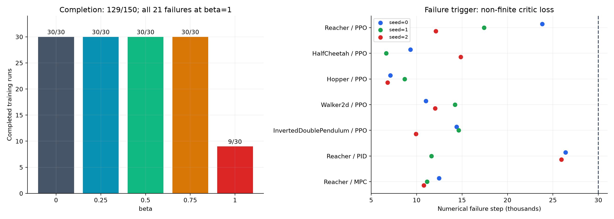
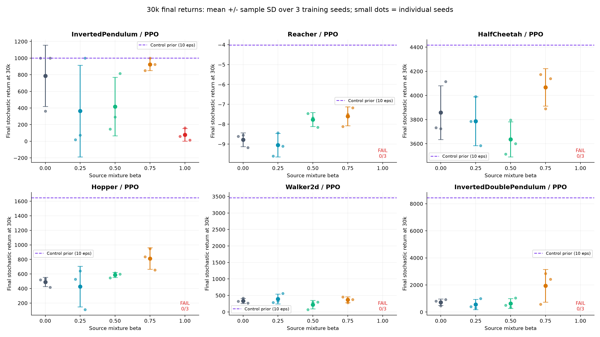
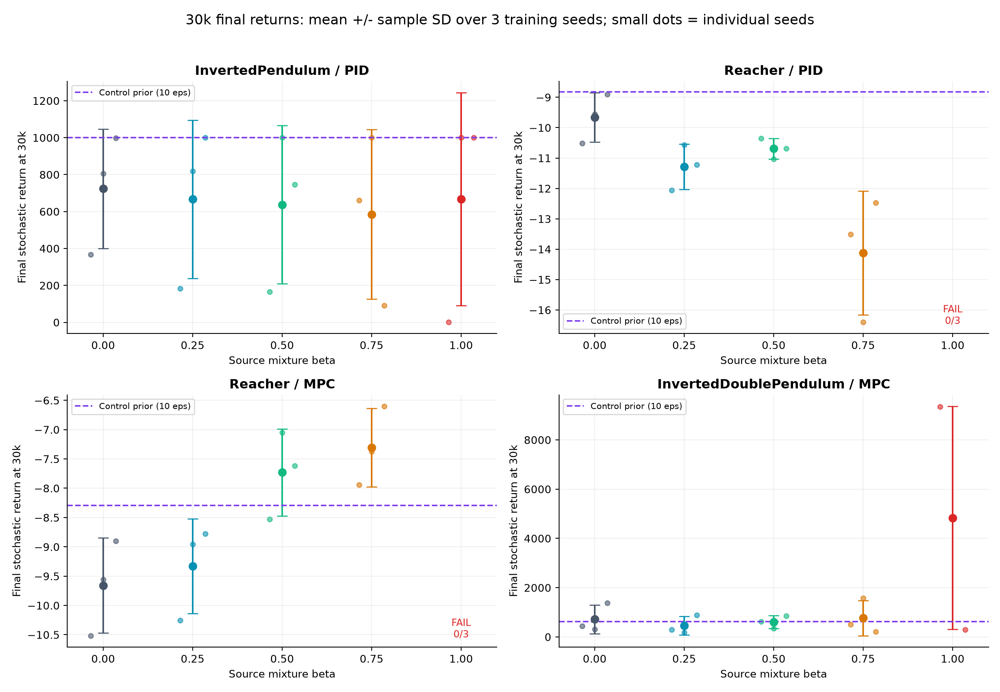
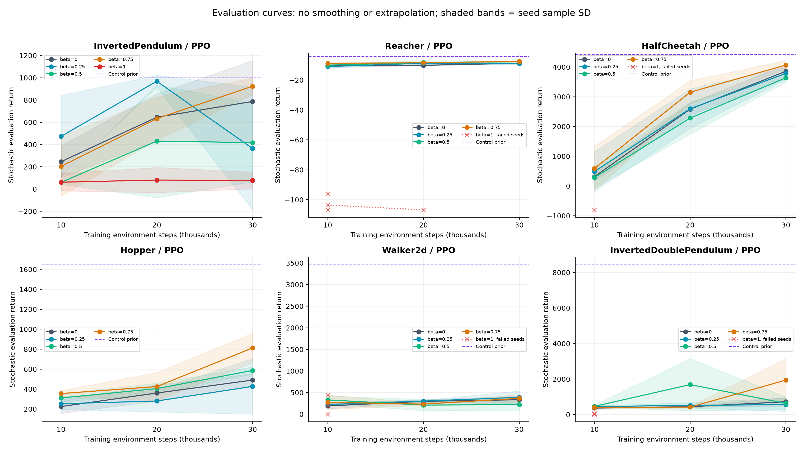
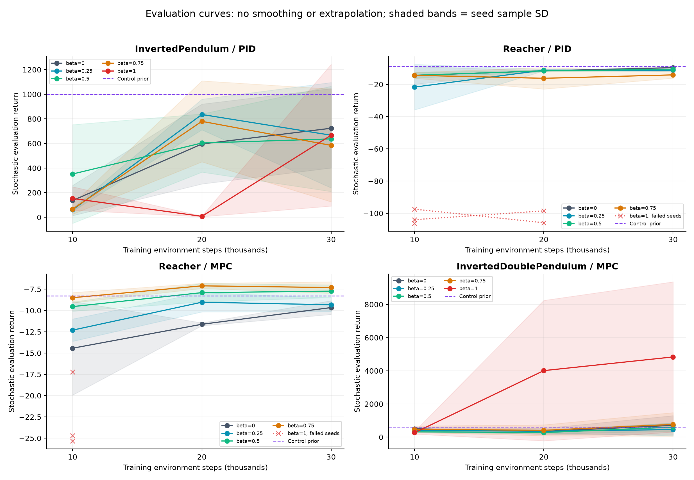

# MuJoCo 30k 控制先验 β 扫描实验总结

报告日期：2026-11-17。数据批次：`mujoco_30k_a100_v1`，由服务器同步至本地，结果提交为 `e8f7036`。本报告重新读取全部 150 个 run 的原始日志、逐回合评估与配置，未启动训练，也未改动原始数据。

**本轮得到的是有条件的先验收益，而非普遍优势。** Reacher/PPO、HalfCheetah/PPO、Hopper/PPO、Reacher/MPC 的 β=0.75 均在三个配对 seed 上优于各自 β=0；其中 Reacher/MPC 还在三个 seed 上超过了直接执行原 MPC 的平均回报。但六个 PPO 任务的最优组平均分都没有超过其冻结 PPO 先验，PID 两个任务没有观察到平均回报增益。β=1 是本轮主要稳定性风险：30 个 run 只有 9 个完成，21 个均因 Critic loss 非有限值停止。

双摆 MPC 的 β=1 得到本轮最醒目的单任务提升，但三个 seed 的最终回报分别为 **9,352.7、4,855.4、297.1**，均值 **4,835.1 ± 4,527.9**。该结果说明存在较高性能潜力，同时说明成功高度依赖 seed，尚不能作为稳定可靠的改进结论。

## 1. 实验范围与实际配置

| 先验 | 环境 | β | 训练 seeds | 每个 Flow run 预算 |
|---|---|---|---|---|
| PPO | InvertedPendulum-v5、Reacher-v5、HalfCheetah-v5、Hopper-v5、Walker2d-v5、InvertedDoublePendulum-v5 | 0、0.25、0.5、0.75、1 | 0、1、2 | 30,000 环境步 |
| PID | InvertedPendulum-v5、Reacher-v5 | 同上 | 同上 | 同上 |
| MPC | Reacher-v5、InvertedDoublePendulum-v5 | 同上 | 同上 | 同上 |

合计 10 个任务/先验组合 × 5 个 β × 3 个 seed = **150 个 run**。模型为本项目的 `prior_flame_m`，β=0 是同一实现下的基础高斯源对照，不等同于已经确认复现了原论文官方实现。

β 表示源分布的混合概率：`p_src(z|s) = (1−β) p_base(z) + β q_prior(z|s)`。每个样本按概率选择高斯或先验分量，并使用完整混合密度；没有把两个采样动作线性插值。β=1 使用纯先验源，但经过训练后的 Flow 动作不必等于控制器动作。

本轮 MPC 具体为配置中的 `cem_mpc`（CEM 规划控制器）；表格统一简称 MPC。

已逐 run 核对：Actor/双 Critic 均为 [256,256,256]；batch=256；K_train=32、K_local=16、K_exec=K_eval=1；单环境；前 5k 步均匀动作热身；UTD=1；固定 α=0.1，Critic 熵项开启；Heun 密度估计 5 步。控制器特征不输入网络，先验通过源分布注入。PID/MPC 的 latent sigma=0.3、基础高斯 sigma=1；PPO 使用 native pre-tanh 分布配置。β 全程固定，奖励未改动。

PPO 先验固定 seed=100，每任务实际制备 **1,001,472** 步，三训练 seed 共享冻结先验。HalfCheetah 复用已有先验，其余五个在服务器制备；六套先验文件完整，内容 hash 与服务器 registry 一致。新制备共 5,007,360 步，复用的 HalfCheetah 另有历史 1,001,472 步。**30k 仅是 Flow 新增在线预算，不包含 PPO 制备、校准、评估或 MPC 内部模型规划交互。**

实际运行版本为 Python 3.10.12、PyTorch 2.14.1+cu130、NumPy 2.2.6、Gymnasium 1.4.0、MuJoCo 3.16.0、TensorBoard 2.18.0。150 个 run 均记录 CUDA 可用，设备名称为 NVIDIA A100-SXM4-80GB，PyTorch 线程数为 1。设备名称描述物理型号；分配的 vGPU 显存额度以平台为准，不能由该名称推断为独占整卡。WandB 全程 disabled，本次分析使用本地记录。

## 2. 完成情况与数据口径

| β | 计划数 | 完成 30k | 数值失败 | 完成率 |
|---|---:|---:|---:|---:|
| 0 | 30 | 30 | 0 | 100% |
| 0.25 | 30 | 30 | 0 | 100% |
| 0.5 | 30 | 30 | 0 | 100% |
| 0.75 | 30 | 30 | 0 | 100% |
| 1 | 30 | 9 | 21 | 30% |
| 合计 | 150 | 129 | 21 | 86% |

批次已经运行结束，没有 planned、running、skipped 或 interrupted。`verification.json` 的全批验收为 false，是因为 21 个 run 数值失败；129 个完成 run 的服务器端记录验收均为 true。这不表示 150 个任务都成功，也不表示已完成 run 的数据丢失。

实际 Flow 交互总计 **4,151,270** 步，低于计划的 4,500,000 步；差额来自提前失败。计数器累计 **3,401,399** 次梯度更新。

本报告采用以下统计规则：

1. 主指标是训练结束后、30k 步的最后一次随机策略评估，每个训练 seed 评估 10 回合，环境 seeds=10000–10009。
2. 每个成功 run 有 10k、20k、30k 的周期评估以及一次最终评估，共 4 条。30k 重复记录取最后一次，因此主学习曲线只有 3 个测量点。129 个终点分数均与原始 JSONL、最终 10 回合 CSV 和服务器汇总一致。
3. 表中的“±”是三个训练 seed 之间的**样本标准差（ddof=1）**，不是 30 个回合混在一起的标准差，也不是置信区间。先验表的“±”则是 10 个评估回合的总体标准差，口径单独标明。
4. 主表只把完整 30k run 计作终点成绩。失败样本保留失败标签和停止步数；最后有效回报不是 30k 最终回报，失败后没有补零或延长曲线。
5. AUC 是 10k–30k 三点曲线的梯形积分除以 20k，单位仍是 return；没有测量的 0–10k 不计入。失败 run 的较短曲线不与完整 30k AUC 混合。
6. 所有任务均为 return 越高越好，Reacher 的负数越接近零越好。不将不同任务的原始 return 直接求一个总平均。每组仅 3 个 seed，以下属于描述性、探索性比较，不做显著性或普遍优越性声明。



## 3. 控制先验本身有多好

每个 Flow run 开始前均实际评估当前冻结先验。**先验 return**：PPO 从原生分布随机采样（`z ~ Normal(mu, sigma²), a = tanh(z)`），PID/MPC 执行确定性控制动作；不经过 Flow，不混基础高斯，也不额外加入 PID/MPC 的 source sigma 噪声。表中列出 10 回合平均 ± 回合总体标准差。最后一列统一展示**当前环境的冻结 PPO baseline（确定性）**，采用 `a = tanh(mu)` 的 10 回合平均 return；不随该行的 PPO/PID/MPC 先验类型改变。PID/MPC 行引用同环境 PPO 组的已有评估，未额外重新训练或评估 PPO。

PPO 行的这两列使用**同一份冻结 PPO 权重、同一组环境评估 seeds**；区别在于随机采样还是确定性执行。随机采样改变动作及后续状态，因此回报不必相同，确定性也不保证总是更高。`tanh(mu)` 是潜空间均值映射后的动作，不等同于随机动作分布的数学期望。

| 任务 / 先验 | 先验 return ± 回合 SD | 当前环境 PPO baseline return（确定性） |
|---|---|---|
| InvertedPendulum / PPO | 1,000.0 ± 0.0 | 1,000.0 |
| Reacher / PPO | -4.02 ± 1.39 | -3.97 |
| HalfCheetah / PPO | 4,416.7 ± 1,739.2 | 4,527.4 |
| Hopper / PPO | 1,646.2 ± 749.5 | 3,100.0 |
| Walker2d / PPO | 3,458.2 ± 1,438.2 | 4,823.5 |
| InvertedDoublePendulum / PPO | 8,433.1 ± 2,780.5 | 8,433.1 |
| InvertedPendulum / PID | 1,000.0 ± 0.0 | 1,000.0 |
| Reacher / PID | -8.82 ± 2.96 | -3.97 |
| Reacher / MPC | -8.29 ± 1.81 | -3.97 |
| InvertedDoublePendulum / MPC | 619.2 ± 299.6 | 8,433.1 |

同一任务/先验的 15 次先验 return 平均值完全相同：本轮重复使用了同一组评估种子和策略随机种子。它们用于关联每个 run 的控制先验，**不构成 15 套独立控制器或额外独立样本**。本次 HalfCheetah 的先验 return 为 4,416.7，使用的是当前共同评估种子；旧报告里其他校准种子的 4,789.7 不能替代它。

先验质量差异较大：倒立摆 PPO/PID 已满分；双摆 PPO 的先验 return 约 8,433，而双摆 MPC 只有约 619。Hopper 和 Walker2d 的 PPO 确定性执行明显好于随机执行。比较 Flow 是否“改善了控制”时，应同时看 β=0 对照和直接先验，不能只选其中一个较弱基线。

## 4. 30k 最终回报：全部 50 组

β 各列的正常数值单元格均为 3/3 完成时的均值 ± seed 样本 SD。最右两列分别列出**该行所用先验的 return**（PPO 随机采样，PID/MPC 确定性；± 为回合总体 SD）和**当前环境的 PPO baseline**（确定性 `tanh(mu)`、10 回合平均 return，引用同环境 PPO 组的已有评估）。因此 PPO 行两列可因执行方式不同而得分不同；PID/MPC 行也有 PPO 对照分数，同一环境最后一列数值相同。每行加粗的是 β 各列中本轮观察到的最高均值，属于**事后选择**；失败组不参与该选择。完整 150 个 seed 的分数和停止步数见[逐 run 审计表](../../../outputs/analysis/mujoco_30k_a100_v1/per_run_audited.csv)。

| 任务 / 先验 | β=0 | β=0.25 | β=0.5 | β=0.75 | β=1 | 先验 return ± 回合 SD | 当前环境 PPO baseline return（确定性） |
|---|---|---|---|---|---|---|---|
| InvertedPendulum / PPO | 787.1 ± 368.8 | 364.2 ± 551.3 | 417.4 ± 352.0 | **924.2 ± 75.1** | 77.5 ± 75.6 | 1,000.0 ± 0.0 | 1,000.0 |
| Reacher / PPO | -8.78 ± 0.35 | -9.05 ± 0.59 | -7.77 ± 0.36 | **-7.60 ± 0.48** | 失败（0/3） | -4.02 ± 1.39 | -3.97 |
| HalfCheetah / PPO | 3,857.4 ± 223.2 | 3,786.5 ± 202.9 | 3,636.7 ± 145.4 | **4,067.1 ± 155.2** | 失败（0/3） | 4,416.7 ± 1,739.2 | 4,527.4 |
| Hopper / PPO | 490.1 ± 64.0 | 426.8 ± 279.1 | 586.5 ± 35.4 | **812.6 ± 147.1** | 失败（0/3） | 1,646.2 ± 749.5 | 3,100.0 |
| Walker2d / PPO | 335.0 ± 77.6 | **389.9 ± 149.1** | 220.2 ± 127.9 | 367.3 ± 88.6 | 失败（0/3） | 3,458.2 ± 1,438.2 | 4,823.5 |
| InvertedDoublePendulum / PPO | 725.0 ± 240.5 | 561.7 ± 375.0 | 634.1 ± 361.9 | **1,943.1 ± 1,210.0** | 失败（0/3） | 8,433.1 ± 2,780.5 | 8,433.1 |
| InvertedPendulum / PID | **723.7 ± 322.9** | 667.1 ± 428.7 | 637.3 ± 428.1 | 584.4 ± 459.0 | 667.3 ± 576.2 | 1,000.0 ± 0.0 | 1,000.0 |
| Reacher / PID | **-9.66 ± 0.81** | -11.28 ± 0.74 | -10.69 ± 0.34 | -14.12 ± 2.04 | 失败（0/3） | -8.82 ± 2.96 | -3.97 |
| Reacher / MPC | -9.66 ± 0.81 | -9.33 ± 0.81 | -7.73 ± 0.74 | **-7.31 ± 0.67** | 失败（0/3） | -8.29 ± 1.81 | -3.97 |
| InvertedDoublePendulum / MPC | 713.8 ± 583.1 | 458.4 ± 379.8 | 606.4 ± 259.8 | 768.6 ± 712.6 | **4,835.1 ± 4,527.9** | 619.2 ± 299.6 | 8,433.1 |





图中小点为各训练 seed，误差棒为样本 SD；紫线为直接执行先验的平均 return（PPO 随机采样，PID/MPC 确定性）。FAIL 仅表示数值失败，不表示 return=0。误差棒是离散度，不是有界回报范围或置信区间。

## 5. 是否优于高斯，是否优于原控制器

下表对每行事后最高均值组作两种比较。Δβ0 为相对同一任务/先验组 β=0 的差值；“seed 改善数”按相同 seed 编号配对。Δ先验为相对该 run 的直接先验平均回报。严格大于才计改善；满分相等不计为提高。

| 任务 / 先验 | 事后最高均值 β | Δβ0 | 改善 β0 的 seed | Δ直接先验 | 超过先验的 seed |
|---|---|---|---|---|---|
| InvertedPendulum / PPO | 0.75 | +137.1 | 1/3 | -75.8 | 0/3 |
| Reacher / PPO | 0.75 | +1.18 | 3/3 | -3.58 | 0/3 |
| HalfCheetah / PPO | 0.75 | +209.7 | 3/3 | -349.6 | 0/3 |
| Hopper / PPO | 0.75 | +322.5 | 3/3 | -833.7 | 0/3 |
| Walker2d / PPO | 0.25 | +54.9 | 1/3 | -3,068.3 | 0/3 |
| InvertedDoublePendulum / PPO | 0.75 | +1,218.1 | 2/3 | -6,490.0 | 0/3 |
| InvertedPendulum / PID | 0 | +0.0 | 0/3 | -276.3 | 0/3 |
| Reacher / PID | 0 | +0.00 | 0/3 | -0.84 | 0/3 |
| Reacher / MPC | 0.75 | +2.35 | 3/3 | +0.98 | 3/3 |
| InvertedDoublePendulum / MPC | 1 | +4,121.3 | 2/3 | +4,215.8 | 2/3 |

**PPO 组。** β=0.75 在 Reacher、HalfCheetah、Hopper 的三个配对 seed 上都优于 β=0。HalfCheetah 均值提高约 **5.4%**，Hopper 提高约 **65.8%**；但两者均仍低于直接执行 PPO。Walker2d 的 β=0.25 均值优势只来自 1/3 seed，另两个 seed 比 β=0 差；倒立摆 PPO 的 β=0.75 也只有 1/3 seed 改善，因此不能用平均值就宣称稳定提高。双摆 PPO 的 β=0.75 有 2/3 seed 改善，但其 1,943.1 的均值仍远低于原 PPO 的 8,433.1。六个 PPO 场景都尚未显示最优组平均回报超过原先验。

**PID 组。** 倒立摆和 Reacher 的最高均值均为 β=0，非零 β 没有平均优势。Reacher/PID 的 β=0.75 比 β=0 更差；倒立摆/PID 的各 β 都有较大的 seed 波动。这说明“有一个能工作的控制器”不足以保证把其混入源分布就能改善短预算学习。它也不否定旧 300k PID 实验的局部收益：本轮预算、硬件及运行条件不同，不能作只改变训练步数的严格跨轮因果比较。

**Reacher/MPC。** β=0.75 为 **−7.31 ± 0.67**，比 β=0 的 −9.66 提高 2.35，比原 MPC 的 −8.29 提高 0.98，三个 seed 都超过这两个均值基线。β=0.5 的均值也超过原 MPC。这是本轮“在原控制器基础上学习改进”最一致的案例，但仍只覆盖一个任务、三个训练 seed 和固定的 10 个评估环境种子。

**InvertedDoublePendulum/MPC。** β=1 均值提高很大，但样本 SD 几乎与均值相当。seed0 达到约 9,353，seed1 约 4,855，seed2 只有约 297；仅 2/3 seed 超过 β=0 和原先验。β=0 自己也有约 714 的均值，已经高于约 619 的弱 MPC，因此仅证明“超过原 MPC”不能单独归功于先验引导。

从 10 个场景中分别挑选最好的 β 后，有 8 个场景均值高于各自 β=0；这包含多重事后筛选，不能把“8/10”解释为无偏成功率，也不能由此确定一个跨任务通用最优 β。

## 6. 学习过程与样本效率

| 任务 / 先验 | 终点最高均值 β | β0 AUC | 该 β 的 AUC | AUC 差值 |
|---|---|---|---|---|
| InvertedPendulum / PPO | 0.75 | 581.1 | 598.5 | +17.5 |
| Reacher / PPO | 0.75 | -9.90 | -8.36 | +1.54 |
| HalfCheetah / PPO | 0.75 | 2,335.5 | 2,740.7 | +405.2 |
| Hopper / PPO | 0.75 | 358.9 | 504.4 | +145.5 |
| Walker2d / PPO | 0.25 | 280.3 | 305.1 | +24.8 |
| InvertedDoublePendulum / PPO | 0.75 | 495.1 | 796.9 | +301.9 |
| InvertedPendulum / PID | 0 | 512.8 | 512.8 | +0.0 |
| Reacher / PID | 0 | -11.83 | -11.83 | +0.00 |
| Reacher / MPC | 0.75 | -11.83 | -7.50 | +4.33 |
| InvertedDoublePendulum / MPC | 1 | 477.5 | 3,281.8 | +2,804.3 |





曲线不平滑、不向未观测区间外推，阴影为 seed 样本 SD。β=1 的失败组只显示已有的个体评估点；6 个失败 run 在首次 10k 评估前已停止，因此没有可绘回报点。

Hopper/PPO、HalfCheetah/PPO 和 Reacher/MPC 的改善不仅体现在终点，也体现在所记录的 10k–30k AUC。双摆 MPC β=1 的均值 AUC 较高，但个体轨迹差异明显：seed1 在 20k 随机评估曾到 **8,826.5**，最后降至 **4,855.4**；其最终代表动作评估仅约 **728.2**。seed2 从 20k 的约 874.5 降至最终约 297.1。这些轨迹说明仅看 best checkpoint 会高估稳定性。

同一个 30k checkpoint 的周期评估和最终评估使用不同的策略随机采样，分数可能不同，并不表示两者之间又发生了训练。主表按预先规定取最后一次，保留全部原始记录。代表动作每 seed 仅 5 回合，不等同于随机 Flow 策略的动作期望；它与 PPO 的 10 回合均值动作基线只作辅助诊断。

## 7. β=1 的数值失败与性能退化

21 个失败的直接触发原因完全相同：`non-finite values in critic loss`；停止阶段均为 `flow_training`。这不是 WandB、TensorFlow 初始化、磁盘写入或任务未启动所致。

| 任务 / 先验（均 β=1） | seed0 停止步数 | seed1 | seed2 |
|---|---|---|---|
| Reacher / PPO | 23,816 | 17,411 | 12,099 |
| HalfCheetah / PPO | 9,311 | 6,658 | 14,846 |
| Hopper / PPO | 7,093 | 8,667 | 6,789 |
| Walker2d / PPO | 11,029 | 14,216 | 12,041 |
| InvertedDoublePendulum / PPO | 14,403 | 14,628 | 9,930 |
| Reacher / PID | 26,377 | 11,632 | 25,942 |
| Reacher / MPC | 12,458 | 11,135 | 10,789 |

失败步数范围为 **6,658–26,377**，中位数 **12,041**。详细最后有效评估、Critic loss 和停止信息见[失败明细](../../../outputs/analysis/mujoco_30k_a100_v1/numerical_failures.csv)。原服务器 `summary_seed_level.csv` 的失败行可能含较早的 `final_tail_return`，本报告将这些值仅记作 `last_eval_return`，没有伪装成 30k 分数。

β=1 的其余三个场景虽然没有数值退出，也不能一概称为稳定成功：

- InvertedPendulum/PPO 的最终均值只有 **77.5 ± 75.6**，远低于原 PPO 的 1000；主要问题是性能不佳。
- InvertedPendulum/PID 的三个最终分数为 **2、1000、1000**，完成率为 100% 仍掩盖了一个 seed 的明显失败表现。
- InvertedDoublePendulum/MPC 的高均值伴随巨大 seed 方差与部分轨迹回落。

本轮支持“纯先验源在当前最大熵 Flow 实现中存在明显稳定性风险”，不支持“β=1 必然失败”。β=1 移除的是独立基础高斯分量，**不是去掉所有随机性**；PID/MPC 仍有 latent sigma，PPO 仍有 native 标准差。日志能确定 Critic 非有限值是退出检查点，不能确定它是整个失稳链条的第一个原因。密度反演、MeanFlow 目标、Q 重加权和熵反馈之间的先后顺序仍需更密集的单步诊断。

## 8. 运行成本与复现性

Flow 矩阵从 **2026-11-13T12:14:13+08:00** 到 **2026-11-17T11:00:55+08:00**，记录跨度约 **94.78 小时**。所有 run 的 `summary.wall_time_sec` 合计 **91.47 小时**；该计时包括先验基线与主训练阶段，但不完整覆盖模型构建、最终保存和最后额外评估等开销，所以不能当作端到端墙钟时间。

| 任务 / 先验 | 全部 run 的计时合计 / 小时 | 成功 run 的计时中位数 / 分钟 |
|---|---|---|
| InvertedPendulum / PPO | 9.10 | 35.5 |
| Reacher / PPO | 4.49 | 20.8 |
| HalfCheetah / PPO | 16.87 | 100.1 |
| Hopper / PPO | 9.10 | 48.7 |
| Walker2d / PPO | 8.73 | 47.0 |
| InvertedDoublePendulum / PPO | 2.43 | 10.0 |
| InvertedPendulum / PID | 2.62 | 10.3 |
| Reacher / PID | 3.51 | 10.5 |
| Reacher / MPC | 10.62 | 50.1 |
| InvertedDoublePendulum / MPC | 24.00 | 86.1 |

单卡实验按顺序运行。MPC 两组约占 Flow run 计时的 37.9%，其中双摆 MPC 约 24 小时。当前 collector 持续查询和缓存控制器上下文，MPC 组在 β=0 时也仍支付规划成本。故这些时间不能直接解释为“先验引导本身增加多少 GPU 计算”，也不能用来推出 A100 相对 CPU 的加速倍数；本轮没有记录 GPU 利用率时间序列或做 CPU/GPU 对照。

147 个 run 记录运行源码 commit 为 `4e154ad` 且 dirty=true，3 个缺少 Git 信息。由于 outputs 本身被 Git 跟踪，dirty 并不自动意味着算法源码被改动；但缺少完整运行时源码 diff/快照，限制了严格复现核验。已核对所有 run 的关键解析超参一致，并校验六套冻结先验 hash。

## 9. 结论边界与下一步

**当前可以写进阶段性总结的判断：** 控制先验可以作为单步 Flow 的源分布并完成多任务训练；中高比例混合在部分任务改善了 30k 内的学习表现；Reacher/MPC 给出了三个 seed 都超过直接控制器的正例；纯先验源 β=1 在多任务、多类控制器上暴露了集中数值风险。

**尚未得到的结论：** 没有证明所有控制先验都有益，没有证明稳定优于原 PPO/PID/MPC，没有证明 β 越大越好，没有验证长期收敛、总样本效率优势或聚变模拟器性能。PPO 百万步制备数据与 MPC 模型访问不能从成本核算中消失。

后续建议按以下顺序推进，避免先扩大不稳定实验的规模：

1. **定位 β=1 的首个异常。** 在短预算诊断中保存 Critic target、熵/密度值、候选 Q/权重、Actor/MeanFlow 目标和梯度的同一步快照，分别测试基础高斯下限、密度积分与熵项。数值失败应保留，不通过静默重试筛选成功 seed。
2. **在明确正例上做确认实验。** 优先 Reacher/MPC，以及 HalfCheetah/Hopper 的 PPO β=0.75，新增独立训练 seeds 和未用于本轮选择的评估种子；预先固定 β 后再比较，处理事后选优偏差。
3. **解释强先验能力为何未被保留。** 增加“加噪先验源但不训练 Flow”的对照，分离先验随机化与后续学习；与直接控制器同时报告回报、动作与任务指标。本轮各 β 的前 5k 步均采用均匀动作热身，也没有通过模仿预训练强制保留原策略。
4. **统一跨先验初始化再作公平比较。** 本轮 Reacher/PID 与 Reacher/MPC 的 β=0 三条已记录评估曲线完全相同，不能当作六个独立基线 seed；PPO 组的 β=0 曲线不同。代码中控制器构造位于 Agent 初始化之前，PPO 包装器创建网络会消耗全局 Torch 随机数。应隔离这部分 RNG 并记录初始参数 hash，再验证跨先验配对关系；本轮主要采用组内 β 对照。
5. **最后再扩展预算和应用环境。** 将有前景且稳定的设置扩展至更长预算，分开统计先验制备、真实环境交互和规划模型调用；聚变模拟器接口、奖励改写和多先验融合均未由本轮验证。

`eval/failure_rate` 统计的是环境回合 `terminated`，与训练数值失败是两种指标。Reacher/HalfCheetah 的终止规则使该值不能直接代表任务成功率或控制安全性。三个 seed 和固定 10 个评估环境种子也不足以给出部署可靠性保证。

## 10. 数据与复算入口

- [本轮原始目录](../../../outputs/experiments/mujoco_30k_a100_v1)：manifest、配置、JSONL、逐回合评估和 TensorBoard。
- [审计后的逐 run 表](../../../outputs/analysis/mujoco_30k_a100_v1/per_run_audited.csv)：150 行；失败的 30k 最终回报为空，最后有效回报单列保留。
- [50 组合统计](../../../outputs/analysis/mujoco_30k_a100_v1/per_combination_audited.csv)、[对照差值](../../../outputs/analysis/mujoco_30k_a100_v1/comparison_with_baselines.csv)、[21 个数值失败](../../../outputs/analysis/mujoco_30k_a100_v1/numerical_failures.csv)。
- [完整机器可读分析](../../../outputs/analysis/mujoco_30k_a100_v1/analysis.json)：版本、预算、时间、曲线、逐 seed 分数和摘要。
- [离线分析脚本](../../../scripts/summarize_mujoco_30k.py)：只读取原始结果并生成上述表格、5 张 PNG 和本报告；不训练、不改写原始结果、不联系 WandB。

复算命令：

```bash
PYTHONPATH=src .venv/bin/python scripts/summarize_mujoco_30k.py
```

本地同步数据足够进行以上统计，但训练 checkpoint/replay 按 Git 规则没有同步；策略重评估、录像或从 checkpoint 复现异常，需要另从服务器取得对应文件。历史 300k 的总结保留在[原实验总结](../../../实验总结.md)，与本轮 30k 分开。

供后续 Agent 接续使用的状态与配置索引见[实验记录](../../experiment_records/实验记录.md)。
