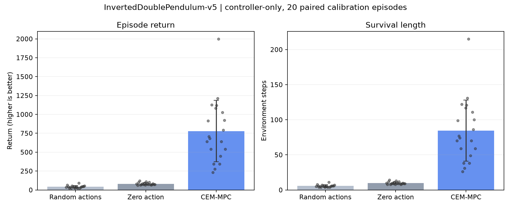

# 倒立双摆 MPC 单独评估

日期：2026-11-11。目标：判断倒立双摆是否提供未饱和的控制先验；本次只评估控制器，不训练 Flow，不调参，也不声称代表最优 MPC。

## 任务与协议

InvertedDoublePendulum-v5：小车和两根各0.6m的被动杆，仅小车受力。标准环境，1000步上限，reset_noise_scale=0.1；控制器只读取9维公开观测，由正余弦重建两个相对关节角。公开速度被环境裁剪为±10，因此达到该界时，重建模型是近似，未读取在线仿真器隐藏状态。

奖励为存活奖励10减去杆顶位置和两关节角速度惩罚。竖直静止且杆顶水平位置为0时，每步约9.36，1000步理想上界约9360；它不是10000。杆顶高度≤1m则终止。本轮每回合都运行到环境终止或1000步，不人为缩短。

## MPC 实现与校验

新增倒立双摆环境注册、公开观测到规划状态的转换、标准模型杆顶正运动学及规划代价；复用原有 CEMMPC 和独立 MuJoCo 规划实例。未实现PID，也未把其他控制器冒称PID。

固定参数：horizon=10（每步0.05s，规划0.5s）、population=64、iterations=4、elite_fraction=0.125、init_std=0.5、min_std=0.05、每次规划timeout=0.5s，控制器seed=0。无跨步warm-start，随机查询由观测与seed决定。规划采用环境位置/速度惩罚，计划中首次跌倒之后按吸收失败处理、每步增加失去的10分存活奖励，不另加控制力惩罚。

按框架的确定性执行约定，动作中心限制到±0.999，不添加源噪声、没有高斯混合。超时或无效规划会执行零动作并记录回退，不能将有回退的成绩表述为纯有效MPC。

测试验证了：公开状态及杆顶几何与MuJoCo一致；规划单个控制步与真实环境动力学一致；单步规划代价等于10−真实奖励；计划跌倒后的吸收处理正确。3个新增集成测试通过，原有4个PID/MPC回归测试也全部通过。校验入口：tests/integration/test_double_pendulum_planning.py。

## 评估结果

三种策略使用配对的20个校准环境seed：50000–50019；这是20个评估回合，不是20个训练seed。标准差按回合计算（ddof=0）。评估使用本地日志，不连接WandB。

| 策略 | 平均回报 ± 标准差 | 平均存活步数 | 满1000步比例 | 跌倒率 | 回退率 |
|---|---:|---:|---:|---:|---:|
| Random actions | 41.30 ± 15.28 | 5.65 | 0% | 100% | 0.00% |
| Zero action | 80.56 ± 15.70 | 9.85 | 0% | 100% | 0.00% |
| CEM-MPC | 779.24 ± 406.60 | 84.65 | 0% | 100% | 0.00% |

| MPC 每回合 | Return | 存活步数 | 首杆角度RMS（rad） | 第二关节相对角度RMS（rad） | 速度观测达到裁剪界的步数 |
|---:|---:|---:|---:|---:|---:|
| 50000 | 641.57 | 70 | 0.2141 | 0.0854 | 0 |
| 50001 | 912.99 | 99 | 0.1697 | 0.0840 | 0 |
| 50002 | 708.47 | 77 | 0.1402 | 0.0749 | 0 |
| 50003 | 680.24 | 74 | 0.1654 | 0.0697 | 0 |
| 50004 | 540.30 | 59 | 0.1725 | 0.0803 | 0 |
| 50005 | 1127.34 | 122 | 0.1855 | 0.1883 | 0 |
| 50006 | 231.51 | 26 | 0.2317 | 0.1020 | 0 |
| 50007 | 343.56 | 38 | 0.2296 | 0.0908 | 0 |
| 50008 | 278.26 | 31 | 0.2141 | 0.1021 | 0 |
| 50009 | 1081.98 | 117 | 0.1613 | 0.0862 | 0 |
| 50010 | 1119.34 | 121 | 0.1620 | 0.0884 | 0 |
| 50011 | 1210.77 | 131 | 0.1996 | 0.0859 | 0 |
| 50012 | 1997.64 | 215 | 0.1431 | 0.0656 | 0 |
| 50013 | 343.52 | 38 | 0.2023 | 0.0947 | 0 |
| 50014 | 446.35 | 49 | 0.2145 | 0.0863 | 0 |
| 50015 | 642.01 | 70 | 0.2057 | 0.0923 | 0 |
| 50016 | 1024.59 | 111 | 0.2005 | 0.0890 | 0 |
| 50017 | 792.28 | 86 | 0.1772 | 0.0812 | 0 |
| 50018 | 922.31 | 100 | 0.2056 | 0.1244 | 0 |
| 50019 | 539.87 | 59 | 0.2058 | 0.1177 | 0 |

MPC总评估交互 1693 步；模型规划累计 4,334,080 个控制步（每控制步包含5个物理积分步）。平均规划时延 157.18 ms，最大 441.02 ms。时延依赖当前机器，未作实时部署保证。

## 判断

当前固定预算MPC平均回报为779.24，相当于9360理想上界的8.3%，但这只是参考比例，不是任务成功率或对最优策略的精确性能比。

该任务确实没有被本次MPC轻易做到接近上限。需要同时注意：如果存活时间很短，当前MPC属于偏弱先验，不能仅因“不是满分”就认定适合作为强先验；若要做Flow改进实验，首先应比较MPC、加噪MPC源、零动作/随机动作，以及Gaussian＋Flow。

本次只有一个控制器参数配置和一个规划seed，不能据此断言MPC在双摆上普遍无法稳定，也没有证明Flow能够提高回报。下一步可以在独立校准种子上检查更长时域、增大CEM预算，或与明确命名的LQR状态反馈比较；不能为了制造先验改进空间而任意削弱控制器。

配置：[倒立双摆MPC配置](configs/controller/inverted_double_pendulum_mpc.yaml)。
原始数据：[完整结果](outputs/controller_screening/inverted_double_pendulum_20261111/results.json)、[逐回合日志](outputs/controller_screening/inverted_double_pendulum_20261111/episodes.jsonl)、[协议与源码哈希](outputs/controller_screening/inverted_double_pendulum_20261111/protocol.json)。
复现入口：scripts/screen_double_pendulum_mpc.py（拒绝覆盖已有结果）；报告入口：scripts/report_double_pendulum_screening.py。
