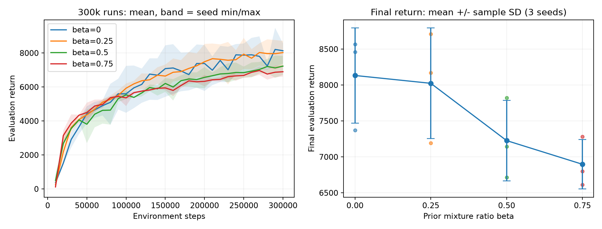
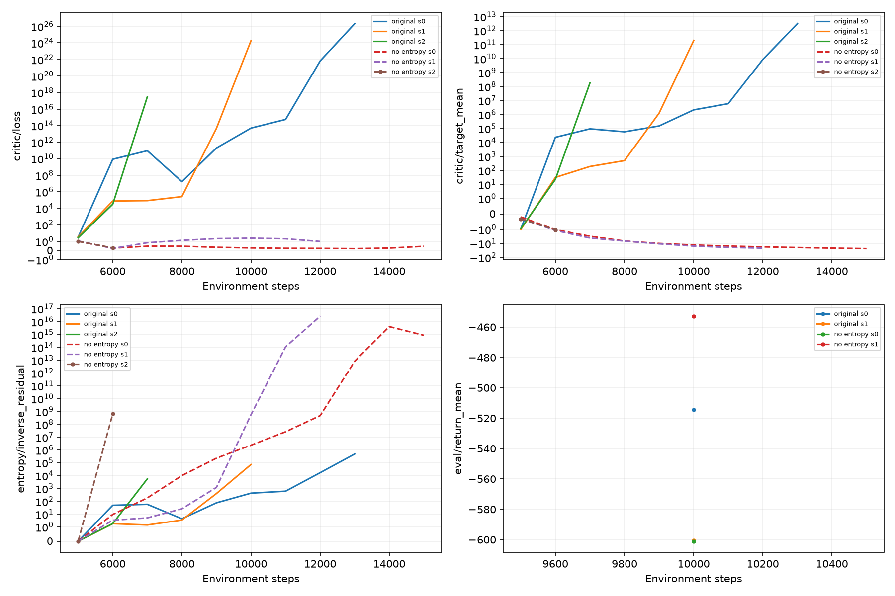
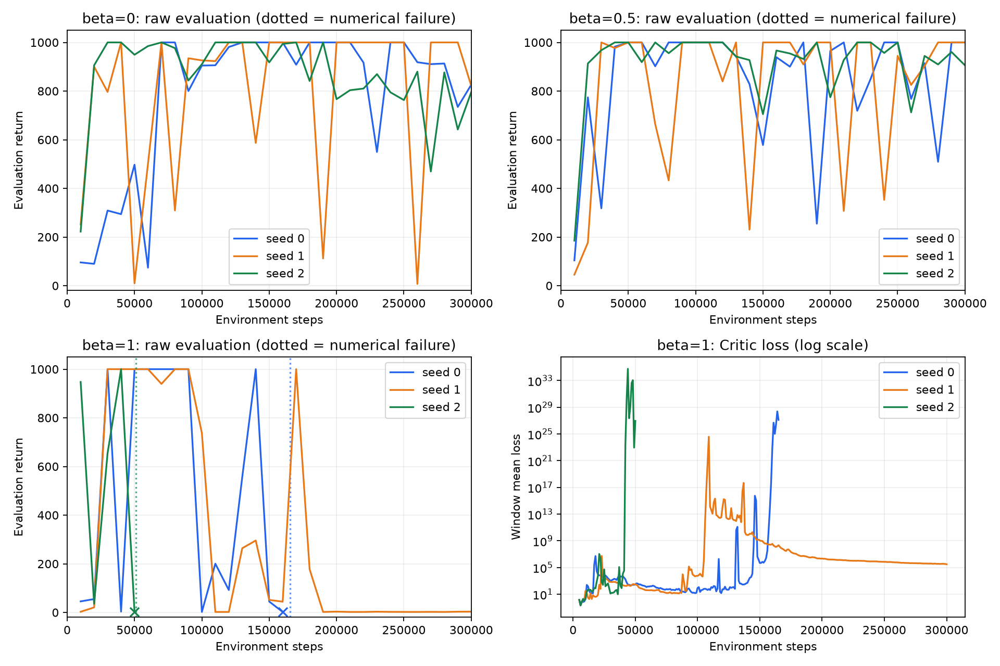

# PGOFP 实验总结

最新批次见 [MuJoCo 30k 控制先验 β 扫描实验总结（2026-11-17）](MuJoCo_30k实验总结_2026-11-17.md)：涵盖 150 个 run、全部 50 组结果、先验对照、学习曲线与数值失败分析。以下保留此前实验记录。

## 实验设置

前两节环境为 HalfCheetah-v5；第三节为 InvertedPendulum-v5。使用单步 Flow 策略；Gaussian 对照与 PPO 先验组使用同一套训练实现。PPO 先验为冻结的 `half_cheetah_ppo_seed100/stage_1000000`，采用原生 pre-tanh 动作分布。

### PPO 先验本身的回报

下表直接评估上述冻结 PPO 策略，不经过 Flow，使用独立校准评估，每种方式各 10 回合。

| PPO 执行方式 | 平均 return ± 回合间标准差 |
|---|---:|
| 随机策略（从 PPO 原生动作分布采样） | **4,789.74 ± 1,400.51** |
| 确定性策略（执行 tanh 后的潜空间均值） | **5,599.89 ± 59.55** |

该先验由 seed=100 训练，实际预训练交互步数为 **1,001,472**。这里的标准差统计评估回合波动，下文 Flow 表中的标准差统计三个训练 seed 的差异，两者不能直接作同口径的误差比较；校准评估种子也不同。这些数值是独立校准记录，并非本次重新评估。

数据来源：[PPO 校准结果](artifacts/priors/half_cheetah_ppo_seed100/stage_1000000/calibration_metrics.json)、[预训练预算](artifacts/priors/half_cheetah_ppo_seed100/stage_1000000/budget.json)。

## 1. 先验占比扫描

| β | seed 0 最终回报 | seed 1 | seed 2 | 均值 ± seed 间样本标准差 |
|---:|---:|---:|---:|---:|
| 0（Gaussian） | 8,462 | 7,370 | 8,566 | **8,133 ± 662** |
| 0.25 | 8,711 | 7,191 | 8,169 | **8,024 ± 770** | 
| 0.5 | 6,714 | 7,144 | 7,822 | **7,227 ± 559** | 
| 0.75 | 6,799 | 6,612 | 7,280 | **6,897 ± 345** |
| 1 | — | — | — | 失败 | 

左图为原始评估的 seed 均值，阴影为最小至最大值；同一步重复评估取最后一条，曲线只使用三个 seed 共有评估步数。右图误差棒为样本标准差，不是置信区间。

**结果：当前设置下，β=0.25 的最终均值接近 Gaussian（低约 1.3%），β=0.5/0.75 分别低约 11.1%/15.2%。尚未观察到 PPO 先验对最终平均回报的优势。** 每组仅 3 个 seed，未进行显著性检验；该结论限于本环境、先验和训练预算。

## 2. 关闭 Critic 熵项的诊断

保持 β=1、原先验及 Actor 温度 α=0.1，仅设置 `algorithm.use_entropy=false`，移除 Critic 目标中的熵项；每 seed 预算 20k，全部使用本地日志。此时日志点仍计算密度代理，用于诊断。

| seed | 实际停止步数 | 最后有效 Critic loss | 停止原因 |
|---:|---:|---:|---|
| 0 | 16,000 | 0.460 | 密度诊断 253/256 样本非有限 |
| 1 | 13,000 | 0.990 | 密度诊断 17/256 样本非有限 |
| 2 | 7,000 | 0.290 | 密度诊断 13/256 样本非有限 |

图中训练指标为日志窗口聚合值，不能用于确定单步异常的先后顺序；非有限值不绘制。反向重建误差指标包含 Actor 密度诊断，不能一概视为 Critic target 的专属指标。

**Critic 爆炸得到缓解，但整体失稳仍然存在。** 原配置的 Critic loss 曾达到约 10¹⁷–10²⁶；关闭熵项后，最后有效日志中的 Critic loss 保持在上述范围。与此同时，Actor 目标速度、梯度和密度反向重建误差仍大幅增长：seed 0 在 15k 的目标速度范数约 279 万，裁剪前 Actor 梯度范数约 6,256 万。

这支持“异常密度经熵项传播并放大到 Critic”的机制解释，但不能证明密度估计是最先根因。三个 seed 本轮均在日志密度检查处停止，不能把停止点直接等同于 Critic 参数已经 NaN，也不能据此推断跳过检查就能稳定训练。

## 3. InvertedPendulum-v5：PID 先验扫描（2026-11-10 汇总）

β=0/0.5/1，各 seed=0/1/2，每组预算 300k；sigma_prior=0.3、sigma_base=1.0、固定 α=0.1，Critic 熵项开启。PID 使用现有固定参数。β=0 保留相同控制器上下文，但源采样和密度退化为基础高斯，网络不额外读取控制器特征。

这轮 retry1 已全部结束：7 组完成、2 组数值失败。此前一轮因检查点写入 ENOSPC 中断，单独保留，不与本轮合并统计。WandB 离线保存，本次分析采用本地日志。

| β | seed 0 最终回报 | seed 1 | seed 2 | 完成数 | 最终均值 ± seed 间样本标准差 |
|---:|---:|---:|---:|---:|---:|
| 0 | 825.8 | 821.4 | 795.5 | 3/3 | **814.2 ± 16.4** |
| 0.5 | 1000.0 | 1000.0 | 905.7 | 3/3 | **968.6 ± 54.4** |
| 1 | 165,348 步数值失败 | 3.3 | 50,968 步数值失败 | 1/3 | 不汇总为三 seed 最终成绩 |

曲线为每个 seed 的原始随机策略评估，每次 10 回合；同一步多次评估取最后一条，不做平滑。β=1 的叉号是最后有效评估，竖虚线为实际数值失败步数；失败后不补零、不延长曲线。Critic loss 图只绘有限日志值。

| 指标（先按 seed 计算，再取三 seed 均值） | β=0 | β=0.5 |
|---|---:|---:|
| 最终回报 | 814.2 | 968.6 |
| 末段平均回报（250k–300k，含端点共 6 次） | 808.8 | 905.4 |
| 10k–300k 归一化评估 AUC | 830.1 | 870.1 |
| 10k–100k 归一化评估 AUC | 697.5 | 838.9 |
| 最终评估回合失败率 | 33.3% | 6.7% |

AUC 用梯形积分除以所注明的步数跨度，单位仍为回报，不包含 0–10k 的未测区间。失败率指环境回合提前终止，不是训练数值失败率；最终各组共 30 个评估回合，分别 10/30 与 2/30 回合失败。β=1 未完成 run 的 AUC 不与完整 300k AUC 混合。

**结论一：本轮中等比例 PID 先验有收益，但收益量级和稳定性要分别看。** β=0.5 的最终均值比 β=0 高约 19.0%，末段均值高约 11.9%，全程 AUC 高约 4.8%；三个配对 seed 的最终回报都更高。早期 AUC 均值也更高，但首次达到回报 900 的步数分别为 β=0 的 [70k,20k,20k]、β=0.5 的 [40k,30k,20k]，不能声称每个 seed 都收敛更快。首次满分之后仍有大幅回落，首次达到阈值不等于持续稳定收敛。

**结论二：β=1 的问题是长期训练失稳，而非单纯起点不好。** 三个 seed 都曾评估满分，但 seed0/seed2 最终因 Critic loss 非有限值退出；seed1 虽完成 300k，最终随机/代表动作评估回报仅 3.3/3.8，末段平均回报 2.45。两种现象需分开：数值失败 2/3，性能崩溃也出现在未触发数值异常的 run 中。不能用 best checkpoint 满分掩盖退化，也不能将失败样本从统计中删除。

**结论三：此次混合先验的优势主要体现在随机执行的鲁棒性。** β=0 和 0.5 的最终代表动作评估（固定源代表点，每 seed 5 回合）全部为 1000，随机执行评估则存在差异。这提示最终差距与动作分布、尾部行为或噪声鲁棒性有关，但不是因果证明；代表动作不是策略分布的动作均值，两类评估的回合数也不同。

**局限与下一步：** 每组仅三个训练 seed、评估环境种子固定，未作显著性检验，且任务回报上限为 1000。此结果不证明先验越强越好，也不能直接推广到 HalfCheetah。现有短验证中的 PID-only 满分不能替代本轮同协议基线；还需 PID-only、加噪源不训练 Flow、更多独立评估种子的对照，才能判断学习改进是否超越原控制器。β=1 在 PID 与 PPO 两类源上均失稳，说明问题不限于 PPO；候选估计、反向积分和熵反馈的具体根因仍未确定。

配置：[PID 扫描配置](configs/experiment/inverted_pendulum_pid_beta_sweep_300k_retry1.yaml)；逐 seed 指标：[分析数据](outputs/experiments/inverted_pendulum_pid_beta_sweep_300k_retry1/analysis_metrics.json)；完整证据见 [实验记录](docs/experiment_records/实验记录.md)。

## 当前判断与下一步

- **性能方面：** HalfCheetah 上 Gaussian 最终均值最高，β=0.25 接近；倒立摆上 β=0.5 的随机执行回报优于 Gaussian。收益依赖任务与先验，不能归纳为先验普遍优于高斯。
- **稳定性方面：** β=1 的 Actor/MeanFlow 目标与密度反演存在尚未定位的失稳链路；Critic 熵项是异常传播路径之一，单独关闭不足以解决问题。
- **对“新旧价值网络冲突”的判断：** 代码只加载 PPO 策略及其归一化器，没有加载旧 PPO 价值网络。先验和新 Q 学习可能间接相互影响，但现有实验不足以将其确定为根因。
- **下一步：** 在短程实验中捕获 Actor 目标、JVP、先验尺度、候选潜变量及反向积分轨迹的首个异常，再与含高斯混合分量的配置比较。先定位问题，再考虑长预算重跑。

